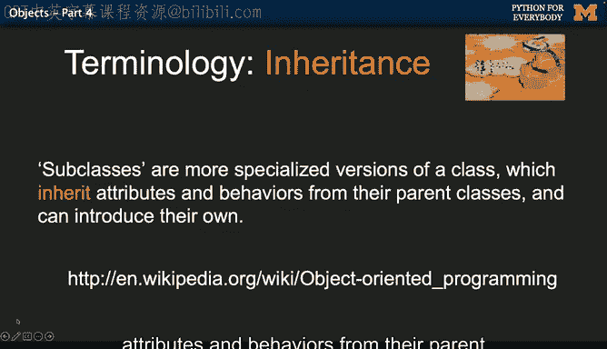
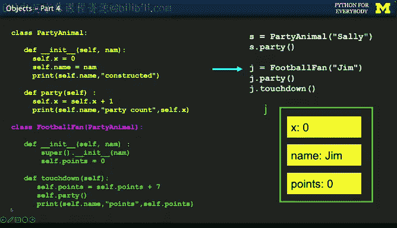
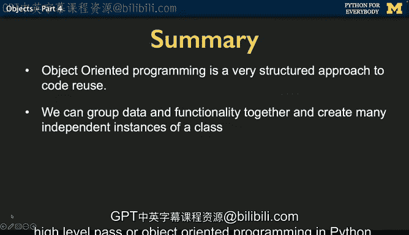

# 每个人的 Python 第四部分 10：10_01_04_对象继承 🧬


在本节课中，我们将要学习面向对象编程中一个非常强大且实用的概念：**继承**。继承的核心思想是“存储与复用”，避免重复编写相同的代码，从而提高代码的效率和可维护性。

## 概述

上一节我们介绍了类和对象的基本概念。本节中，我们来看看如何通过继承来复用和扩展现有类的功能。继承允许我们创建一个新类，它“继承”了另一个现有类的所有属性和方法，然后我们可以在此基础上添加或修改功能，而无需重写所有代码。

## 什么是继承？



继承是一种代码复用机制。它允许我们定义一个类（称为**子类**或**派生类**）来继承另一个类（称为**父类**、**基类**或**超类**）的所有功能。子类可以：
1.  直接使用父类的所有属性和方法。
2.  添加自己新的属性和方法。
3.  重写（覆盖）父类中已有的方法，以提供不同的实现。

以下是继承的基本语法：
```python
class 子类名(父类名):
    # 子类特有的属性和方法
```

## 一个继承的示例

让我们通过一个具体的例子来理解继承是如何工作的。假设我们有一个基础的 `PartyAnimal` 类。

```python
class PartyAnimal:
    def __init__(self, nam):
        self.x = 0
        self.name = nam
        print(self.name, 'constructed')

    def party(self):
        self.x = self.x + 1
        print(self.name, 'party count', self.x)
```

现在，我们想创建一个更具体的类 `FootballFan`，它拥有 `PartyAnimal` 的所有特性，但额外增加了与足球相关的功能。

```python
class FootballFan(PartyAnimal):
    def __init__(self, nam):
        super().__init__(nam)  # 首先调用父类的初始化方法
        self.points = 0  # 添加子类特有的属性

    def touchdown(self):
        self.points = self.points + 7
        self.party()  # 可以调用从父类继承来的方法
        print(self.name, 'points', self.points)
```

### 代码解析

1.  **定义子类**：`class FootballFan(PartyAnimal):` 表示 `FootballFan` 继承自 `PartyAnimal`。
2.  **初始化子类**：在 `FootballFan` 的 `__init__` 方法中，我们首先使用 `super().__init__(nam)` 调用父类的初始化方法。这确保了 `name` 和 `x` 属性被正确设置。这是**继承**的部分。
3.  **扩展功能**：然后，我们添加了子类特有的属性 `self.points = 0`。这是**扩展**的部分。
4.  **添加新方法**：`touchdown` 方法是子类新增的，它修改 `points` 属性并调用了从父类继承来的 `party` 方法。

### 运行示例

```python
s = PartyAnimal('Sally')
s.party()

j = FootballFan('Jim')
j.party()
j.touchdown()
```

**输出结果：**
```
Sally constructed
Sally party count 1
Jim constructed
Jim party count 1
Jim party count 2
Jim points 7
```



## 核心概念总结

以下是面向对象编程中与继承相关的核心术语定义：

*   **类**：创建对象的模板或蓝图。它定义了对象将拥有哪些属性和方法。可以把它想象成**饼干模具**。
*   **对象/实例**：根据类创建出来的具体实体。它是类的**实例化**结果，就像用模具压出来的**饼干**。
*   **构造函数 (`__init__`)**：在创建对象时自动调用的特殊方法，用于初始化对象的属性。
*   **继承**：一种机制，允许一个类（子类）获取另一个类（父类）的所有属性和方法，并可以对其进行扩展或修改。
*   **父类/基类/超类**：被继承的类。
*   **子类/派生类**：继承自其他类的类。

## 继承的优势

通过上面的例子，我们可以看到继承的主要优势：
*   **避免代码重复**：公共的属性和方法（如 `party`）只需在父类中定义一次。
*   **提高可维护性**：如果需要修改公共逻辑（比如改变 `party` 方法的行为），只需在父类中修改一次，所有子类都会自动生效。
*   **逻辑清晰**：通过继承关系可以清晰地表达不同类之间的“是一种（is-a）”关系（例如，`FootballFan` 是一种 `PartyAnimal`）。

## 总结



本节课中我们一起学习了面向对象编程的核心概念——**继承**。我们了解到继承是代码复用和组织的强大工具，它允许我们基于现有类创建更专门化的新类，从而构建出清晰、高效且易于维护的代码结构。记住关键术语：**类**、**对象**、**构造函数**和**继承**，它们是你深入理解Python面向对象编程的基石。虽然继承的语法（特别是 `super()`）初看可能有些复杂，但通过实践，你会逐渐体会到它在构建复杂程序时的巨大价值。