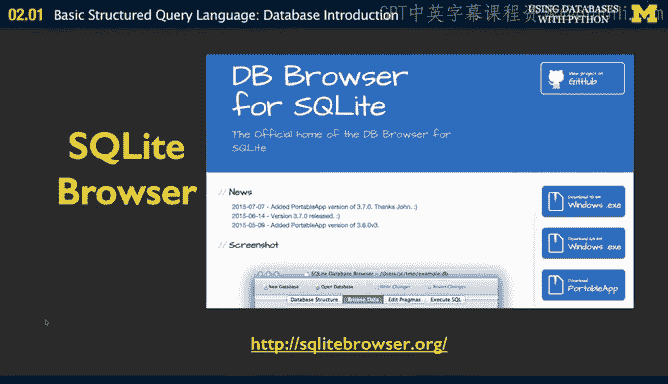
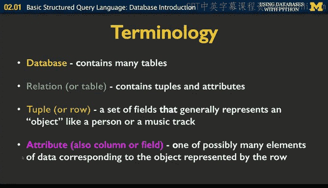
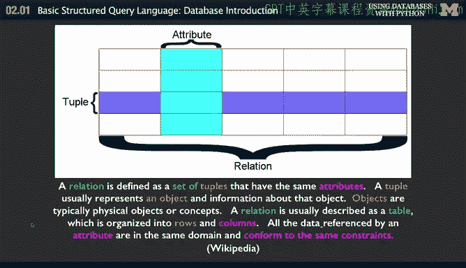
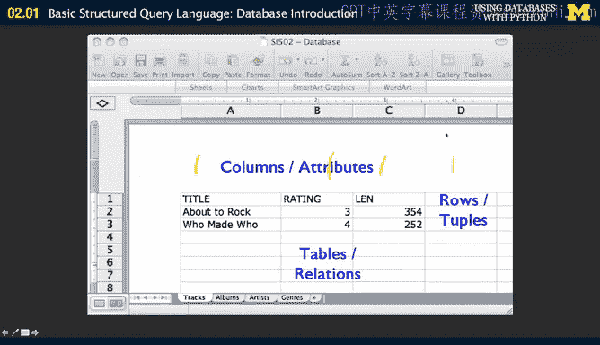
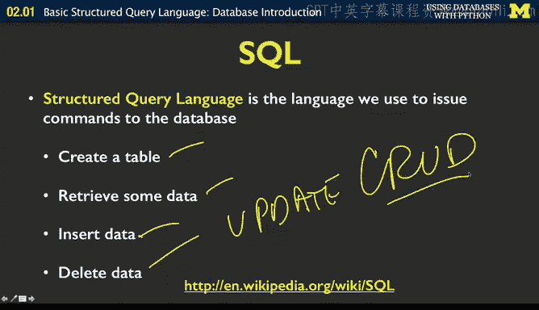

# 密歇根大学《给所有人的Python课》课程4：《使用数据库进行Python编程》｜P13：关系型数据库 🗄️

## 概述

在本节课中，我们将要学习关系型数据库的基本概念。我们将了解数据库为何重要，它们如何工作，以及我们如何通过SQL语言与它们进行交互。理解这些概念是使用Python进行高效数据分析和处理的关键。

---

## 从编程到数据库

上一节我们介绍了课程的整体背景，本节中我们来看看为何要在编程课程中讨论数据库。

我们使用Python进行数据分析。当你从网络等来源获取数据时，经常需要将数据存储在数据库中。你可能受到速率限制，或者需要一个流程来读取数据、存入数据库，然后再从数据库中进行分析。这样做可以加快处理速度，并允许你灵活调整分析过程，而不必受限于数据检索环节，从而提升整体工作流的效率。但为了实现这一点，你需要学习如何将信息存入数据库。

---

## 安装数据库浏览器

在深入数据库操作之前，你需要一个工具来直接查看和操作数据库文件。

我们将使用Python来读写这些文件，但也需要一个能直接读写文件的方法。以下是获取工具的方式：

*   你可以为Mac、Windows或Linux下载一个名为“数据库浏览器”的应用程序。
*   此外，还有一个Chrome插件可用于SQLite，它能完成我们在课程中要做的所有事情。

课程评分更侧重于你**生成的数据**，而非你**使用工具的方式**。因此，你可以选择任何你喜欢的方式。现在请暂停视频，下载并安装这个工具。过程应该很简单，如果遇到问题，可以在课程论坛中寻求帮助。

---

## 关系型数据库的起源

上一节我们准备好了工具，本节中我们来探索关系型数据库的由来。

关系型数据库是计算机科学的一个完整子领域。要理解它，最好先看看关系型数据库出现之前的生活。如今，你每天会在不知不觉中使用关系型数据库成千上万次。想象一个学习管理系统，它有数十万用户和TB甚至PB级的数据，而你登录后能在半秒内看到该看的内容。你不可能在半秒内读完PB级的数据。

在早期，数据量小，计算机存储空间有限。我们倾向于使用磁带，将数据存储在磁带上。例如，银行会将旧余额放在一盘磁带上，交易记录放在另一盘上，然后逐条读取余额，检查交易是否引起变化，再存储新的余额。在六七十年代，日复一日都是这样更新数据的。如果你看老式计算机视频，那些旋转的小东西就是磁带驱动器，那是当时大多数真实数据的存储方式。

随着计算机速度更快、内存更大，数据开始更多地存储在计算机内存和磁盘驱动器中，出现了全新的方式。你不再需要为了读取一个以字母S开头的账户，而读完从A到S的所有数据。有了磁盘驱动器，我们可以跳过、回退、跳转到任意位置。问题变成了：如何高效、快速、巧妙地利用这种可以随机访问的存储介质？仅仅能够随机访问数据并不意味着速度快，你仍然需要查看所有数据。如果只是顺序查看，效率依然低下。

关系型数据库的出现，正是为了解决如何巧妙利用随机访问（主要是旋转的磁盘驱动器）进行数据存储的问题。它在六七十年代兴起，并催生了像Oracle这样的公司。Oracle之所以存在，是因为聪明人比其他人更早解决了这个问题。如今，Oracle是全球领先的数据库供应商，其大部分收入来自数据库产品及基于其上的服务。可以说，在1960年之前，“数据库”这个概念并不真正存在，它是随着存储技术和我们对计算机的期望而发展起来的。试想，如果登录电脑需要读取磁带4小时，这在现代是完全无法接受的。

---

## 数据库术语：数学视角与程序员视角

正如前面提到的，数据库技术源于大量的理论分析，其基础涉及一些非常强大的数学。因此，一些人在描述数据库时仍会使用蕴含强大数学思想的术语。你会遇到两种并行的术语体系。

在更偏向数学的术语中，我们使用**关系**、**元组**和**属性**这些词。这是一种更学术化的说法。

而我们这些只管做事的程序员，则称之为**表**、**行**和**列**。

如果你试图理解其背后精妙的数学原理，那么“表、行、列”的思考方式可能并不准确。但你不必担心底层的数学，只需要在阅读时意识到，当人们切换到这种更“花哨”的术语时不要感到惊讶。其核心思想是，你在一个“连接点”上对数据进行建模，而不是从某个起点开始顺序读取。例如，将“一个人”建模为这个、那个和其他事物之间的连接。这种在连接处建模的概念，正是使数据库快速的底层数学原理。

---

## 程序员视角：表、行和列

当程序员思考数据库时，我们通常将其视为行和列。这里有一张我制作的电子表格截图。

沿着底部，你可以看到各种子表的名称：tracks, albums, artists, genres。这些就像数据库中的**表**。每个表，如果你选中它，都有行和列。例如，这个表有三列和多行。

当你在电子表格中操作时，你会建立一个数据模型或策略。例如，你知道第一列总是标题，第二列是评分。如果不加标签，数据就毫无意义。因此，我们通常将电子表格的第一行作为描述各列的元数据。

---

## 数据库模式

电子表格并不完全知道你正在这样做，尽管它有时在排序时会提示“勾选此框以说明第一行是标题，不要排序”。这样排序时就只排下面的部分。在数据库中，这变成了我们所谓的**模式**。

所有这些标题，以及我们制定的规则（例如，这个必须是整数，那个必须是长度不超过128个字符的字符串），构成了我们对数据内容的严格约定。这在某种程度上感觉与我们写这些标题时很相似，但实际上，正如你将看到的，它要复杂和精细得多。

如果你曾尝试用电子表格来分类管理你的音乐收藏，你会发现这非常困难，因为存在大量重复数据。我们将在数据库中解决这个问题。

---

## 数据库抽象与SQL的诞生

在六七十年代，人们想出了一种在磁盘上表示数据的方法，它可以被随机访问，并且有指针指向其他内容。早期，他们通过排序、跳转、索引等各种巧妙的技术手段，解决了快速访问大量数据的问题。早期我们编程操作这些数据库时，应用程序员需要直接面对底层的“读这个，然后跳转到那个，再读另一个”的能力，这使得我们的生活非常困难。我们必须编写非常复杂的程序，但一旦写成，它们运行得非常快。

随着时间的推移，情况发生了变化。我们的代码不再直接与文件或数据库对话，而是中间构建起一个层，我们称之为数据库应用程序或数据库管理系统。最初，我们直接与那个复杂层对话。但后来，我们有了数据库管理系统，然后我们的应用程序代码与数据库管理系统对话，由数据库管理系统处理所有复杂的魔法。这在计算机科学中被称为**抽象**，意味着我们的工作变得更简单，因为复杂性都被隐藏在这里了。

那么问题来了：我们如何与这个被称为数据库的强大软件进行通信呢？我们如何与这个生活在这里的东西沟通？有时我们称之为**API**。所以，这是我们的应用程序，数据库本身是另一个应用程序。我们需要一个接口，让我们的应用程序能与另一个应用程序对话。就像前面的课程中提到的，这就像一个提供服务的东西。最终，我们可以把这里的这个东西（包括数据以及理解数据形状的软件）看作一个服务，一种面向服务的架构。

因此，我们必须再次定义，在使用服务或架构时，切割点在哪里？我们的应用程序和这个神奇的东西之间的分界线是什么？这是Oracle，它非常昂贵但也非常出色。微软的数据库也很棒。随着行业决定在这个点上创建一个标准，人们聚集在美国国家标准与技术研究院，商定了一种语言，作为应用程序和数据库系统之间的API。他们想出的这个东西的名字就是**SQL**。

这意味着，在这里你可以有Oracle，在那里你可以有微软的SQL Server，这里可以有应用1，那里可以有应用2。应用1可以与Oracle对话，也可以与MySQL对话；应用2也是如此。因为它们使用相同的语言在Oracle和MySQL之间通信，这意味着你可以编写一个能在不同数据库之间移植的应用程序。

SQL是一门美丽的语言，是我遇到过的最优美的语言。我不把它作为第一门编程语言教授的唯一原因是，如果你先学了SQL，你可能再也不想用任何其他语言编程了。它因其简洁性、表达力和强大功能而美丽优雅。但SQL的问题在于，它依赖于数据是“漂亮”的。它是处理非常规整数据的绝佳方式。

因此，我们要做的一部分工作就是学习如何让数据看起来很好，然后编写很酷的代码。另一方面，Python在处理非结构化或不完美的数据时更得心应手。你可以不断编写更多Python代码来处理各种情况。这就是为什么Python加SQL如此强大：Python擅长清理数据，而SQL是存储和检索数据的绝佳方式。

SQL有四个基本功能，我们称之为**CRUD**：创建、读取、更新和删除。

---

## 总结

本节课中，我们一起学习了关系型数据库的核心概念。我们了解了数据库在数据分析工作流中的重要性，探索了其从磁带存储到现代随机访问技术的发展历程。我们区分了数据库术语的数学视角和程序员视角，理解了表、行、列以及更重要的“模式”概念。最后，我们认识了数据库作为抽象层和服务的角色，并介绍了作为应用程序与数据库之间标准通信语言的SQL。掌握这些基础知识，将为我们后续使用Python连接和操作数据库打下坚实的根基。