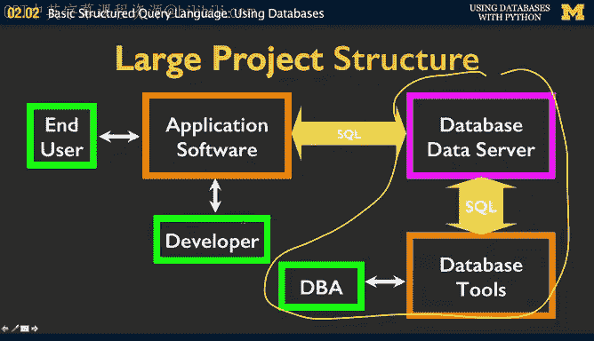
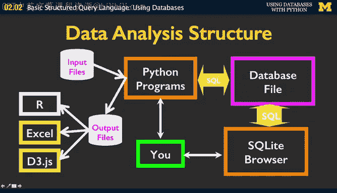
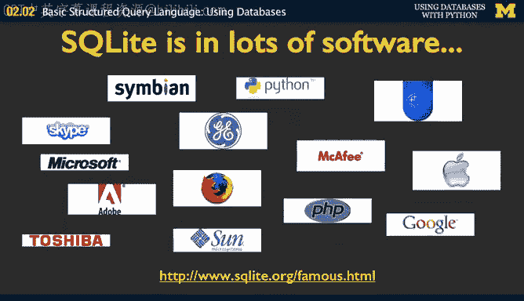

# 密歇根大学《给所有人的Python课》课程4：《使用数据库进行Python编程》｜ P14：数据库在编程环境中的角色 🗄️

## 概述
在本节课中，我们将要学习数据库在编程环境中的位置和角色，了解在大型项目和小型项目中，开发人员与数据库管理员如何协作。我们还将介绍几种常见的数据库系统，并重点说明本课程将使用的SQLite数据库。

## 数据库在大型项目中的角色
现在，我们想讨论如何将数据库和数据库软件置于我们即将构建的编程环境的其他方面之中。我们将讨论大型项目和小型项目。大型项目可能是一个网站，例如用于追踪漫画书或类似用途的网站，所有数据都存储在数据库中。在本课程中，我们不会过多涉及大型项目的构建，但既然我们正在学习数据库，我认为现在是时候让你了解它们在这些在线系统中是如何使用的。在未来的课程中，你可能会看到它们如何在大型项目中使用并学习如何操作。

在大型项目中，通常有两种角色。一种是编写应用程序并为应用程序和网站生成用户界面的开发人员。另一种是实际监控和调整数据库的人员，即数据库管理员。在大型项目中，作为应用程序开发人员，你通常会从数据库管理员那里获得一些建议。因为数据库调优和监控是一项相对专业的工作。

## 开发人员与数据库管理员
在一个专业环境中，例如我参与的开源学习管理系统Sakai，在生产环境中，我作为开发人员并不直接接触生产数据库。开发人员编写很酷的代码，为最终用户制作非常棒的小部件。最终用户通过Web浏览器与这些功能交互。开发人员编写代码与数据库服务器（包括代码和数据库存储本身）对话，使用SQL与数据库服务器通信，获取数据，然后为最终用户格式化数据。这就是开发人员的工作，他们创建应用软件。

数据库管理员。通常，我们不让开发人员直接与生产数据库对话，因为我们担心开发人员会破坏它。这很可能是因为有很多开发人员破坏数据库的经验。因此，我们有一个称为数据库管理员的特殊人员，他们被允许直接与数据库对话。因为数据库既是存储又是软件，它可以接收来自许多不同来源的SQL查询，无论是应用程序还是数据库工具。因此，数据库管理员有一种直接与数据库对话并获取数据的方式。如果出现问题，例如数据库变得非常大，数据库管理员会直接向数据库运行命令。而开发人员通常无法访问真实的数据库。最终，我们可以编写新版本的应用程序软件。这就是大型项目中开发人员和数据库管理员之间的角色划分。

数据库管理员负责协助设计和实施，并且通常一个数据库管理员会负责多个软件项目。但这并不是我们即将要做的。也许你有一份工作，那里有数据库管理员，情况会类似那样。但在本课程中，我们已经遇到了数据库和应用程序开发人员，而他们两者都是你。现在的情况是，你将同时扮演这两个角色。以后，如果有人帮助你，你可能会更多地转向开发人员一侧，或更多地转向数据库管理员一侧，这完全没问题。我们仍然有一个数据库系统。

## 本课程的学习模式
这个系统既包含使数据库变得智能的逻辑和软件，也包含数据本身。我们将与之对话，并使用我们将要使用的程序。

最初，在我们学习数据库管理员的工作方式时，你将编写SQL。你将与这个小软件对话，直接提交内容。因此，你将扮演数据库管理员的角色。我们将创建表，向其中放入数据，并且我们将直接向这个名为SQLite浏览器的应用程序输入内容。还有其他类似的数据库管理员应用程序。很久以后，我们将开始编写Python程序。在这些程序中，我们将使用SQL与相同的数据库文件对话。我们不会编写具有Web界面的程序，那会像Twitter或漫画书注册网站那样。我们将有各种输入源，有时是文件，有时是网络。

我们将编写程序来读取这些内容并进行清理。通常有一个清理步骤。然后，我们将把数据写入数据库。因此，我们将增长这些数据，填充它。然后，我们将完成这个数据获取阶段，所有数据都将存储在数据库中。之后，我们将编写另一个Python程序来读取这些数据，可能生成一个漂亮的文件。在课程的更后期，我们将可视化这些数据或将其发送到其他地方，例如发送到R进行统计分析，或发送到Excel进行一些简单的分析或可视化，或者使用JavaScript制作漂亮的图片和动态效果等。所以，这里的基本模式是相同的，我们将有应用程序和数据库管理员，但两者都是你。

## 我们将使用的工具
我们将首先关注的是这里。我们将使用的数据库是一个叫做SQLite的东西，我们将使用的软件是我之前一开始就告诉你要安装的SQLite浏览器。希望你已经安装了，否则你无法与数据库对话，除非你有与此等效的东西，而它们确实存在。但基本模式是：读取数据，清理数据，以合理且有组织的方式将其放入数据库，然后编写其他应用程序来理解并分析数据。这就是我们接下来要做的事情。

## 数据库模型与模式
当我们构建这些数据时，我提到了“模式”这个词。我们为数据应该呈现的确切样子制定一个契约。有了这个契约，数据库软件可以最有效地利用自身。它可以很好地利用磁盘驱动器，很好地利用所有其他东西。因此，我们称之为数据库模型，最好将其视为一个契约。

我们将数据存入这个文件，这里会存储一些神奇的东西。我们使用这个数据库软件，而模式是我们用来告知数据库我们打算如何使用数据的方式，并让数据库找出存储的方式、位置。我们会把这个东西放在这里，把另一个东西放在那里，并在这里放一个快捷方式。我们不关心这些细节。我们说，这是我们将要使用的数据模型，而你，数据库代码，应该非常智能，并找出如何最合理地处理它。所以，数据模型不仅仅是SQL查询，数据模型是我们关于将在数据库中存储和检索的数据形状的契约。

## 常见的数据库系统
有几个常见的数据库系统，我已经提到了其中几个。Oracle非常出色。它是一家基本上为了制作数据库系统而成立的公司，成立于关系型运动兴起之初。他们之所以成功，部分原因是他们非常擅长于此。其他没有获胜的包括IBM等，尽管它们也都有关系型数据库。许多其他没有……我不确定“让Oracle获胜”这个词是否准确，那些没有……被Oracle在竞争中超越的供应商，是那些没有接受这种关系型理念的供应商。因为当NASA（此处应为“关系型模型”）兴起时，我正在上大学，我们中的一些人觉得关系型模型数学性太强，更喜欢快速、直接的方式。关系型模型花了一段时间才真正获胜，但当它获胜时，它大获全胜。Oracle是一家押注于其获胜的公司。

所以，当我们都意识到“哇，这是个好主意”时（因为我们最初都认为这是个坏主意，至少我是这么认为的），已经太晚了。Oracle已经拥有了我们最终都意识到是好主意的这个好理念的最佳实现。因此，Oracle在某种程度上获胜了。接下来发生的是，Oracle在市场上是元老，非常昂贵且商业化。很多人认为它是最好的，但也有相当不错的替代品。有MySQL，它是开源的。MySQL已被Oracle收购，但仍然是开源的。如果你真的想要开源，还有MariaDB。MariaDB的名字以M开头是故意的，以便与MySQL以相同字母开头。MariaDB是在MySQL被Oracle收购时，基于其开源版本创建的副本。但MySQL仍然是开源的，所以很多使用MySQL的人正在转向MariaDB，但也有很多人继续使用MySQL。如果Oracle对MySQL做了什么不好的事情，我们都会转向MariaDB，事情就结束了。到目前为止，Oracle还没有对MySQL做什么真正不好的事情，所以还可以。我们倾向于在很多网站项目中使用MySQL。Oracle则倾向于用于企业级应用。另一个非常流行的是SQL Server，它是微软的产品。你可能甚至用过Microsoft Access，并且做过类似拖放生成界面的操作，其底层实际上是SQL。微软的SQL Server是一个非常优秀的产品。一些企业组织完全使用微软技术，所以他们使用SQL Server。别担心，我即将谈论的大部分内容同样适用于SQL，因为SQL是一个标准，这很好。还有一个叫做PostgreSQL的数据库。它也是开源的，非常优秀，它更像是Oracle的模仿者，而不是MySQL。MySQL设计得更简单、更快，解决的问题比Oracle少，但执行速度超快，这就是为什么它在网站上非常流行。PostgreSQL更像是一个功能丰富的数据库，是Oracle的直接竞争对手。MySQL有它自己的世界。

## 本课程的选择：SQLite
我们不会使用上述任何数据库。如果你去上一门网页课程，你可能会使用MySQL。我在本课程中教给你的所有知识在那里都有用。所有的知识，所有的SQL。但我们将使用一个叫做SQLite的东西，“lite”意味着小巧、轻量。SQLite被称为嵌入式数据库。

MySQL或Oracle是整个独立的软件，我们通过网络连接与之对话。但SQLite实际上是软件的一部分，因此它内置于你的汽车中。如果你的车是相对现代的车型，里面可能有五个SQLite的副本。所以你的车里有SQLite。如果你的车里有高级音乐播放器，它可能正在使用SQLite。在iPhone上，可能有30个SQLite的副本，因为SQLite设计得非常小，小到你实际上不需要将其分离，只需将其构建到应用程序中。对我们来说最重要的是，它已经内置于Python中。这非常棒，对吧？而且它速度快，针对较小数据量设计。因为在Python中我们进行数据分析，我们将很好地利用SQLite，而它内置于Python中这一事实使我们的生活非常简单。我们不需要安装一堆软件。Python通过一个import语句就拥有了它。

你知道这个故事：如果你在Python中需要完成某事，你首先要弄清楚需要什么import语句。这让我们对我们即将使用的SQL应用程序有了一个概念。接下来，我们真的要开始编写一些SQL，创建一个数据库，放入一些表，并向这些表中放入一些数据。

## 总结
本节课中，我们一起学习了数据库在编程环境中的不同角色，区分了开发人员与数据库管理员在大型项目中的职责。我们介绍了Oracle、MySQL、SQL Server和PostgreSQL等常见数据库系统，并解释了本课程选择使用SQLite的原因——它轻量、快速且内置于Python中，非常适合数据分析和学习。接下来，我们将开始动手实践，编写SQL语句来创建和管理数据库。