# 密歇根大学《给所有人的Python课》课程4：《使用数据库进行Python编程》｜P15：单表增删改查操作 📊


在本节课中，我们将学习数据库操作的核心——对单个数据表进行创建、插入、删除、更新和查询操作。我们将使用SQLite数据库和SQLite Browser工具，通过编写SQL语句来实践这些基本操作。

---

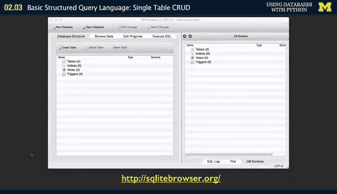

## 启动SQLite Browser并创建数据库

上一节我们介绍了数据库的基本概念，本节中我们来看看如何实际操作。首先，你需要一个能执行SQL语句的软件。SQLite Browser是一个很好的选择。

启动SQLite Browser后，创建一个新数据库。

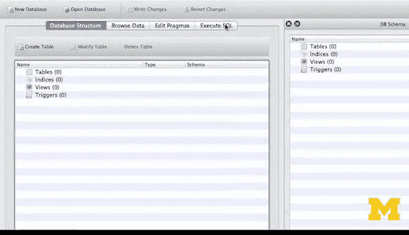

1.  点击 **New Database**。
2.  选择保存位置（例如桌面）。
3.  将数据库命名为 `SQL1` 并保存。

这个操作会在磁盘上创建一个名为 `SQL1` 的特殊格式文件。所有数据都将存储在这个文件中，但我们必须通过SQL库来读写它，而不是直接操作文件。

---

## 创建数据表 📋

数据库创建好后，里面是空的。我们需要创建表来存储数据。创建表就是定义数据的“合同”或结构，这被称为**模式（Schema）**。

以下是创建表的SQL语句：

```sql
CREATE TABLE users (
    name VARCHAR(128),
    email VARCHAR(128)
);
```

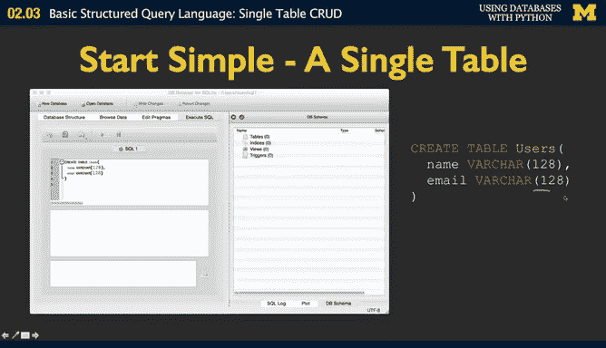

让我们分解这个语句：
*   `CREATE TABLE` 是SQL关键字，表示创建表。
*   `users` 是表的名字。
*   括号内定义了表的列（字段）及其数据类型。
*   `name VARCHAR(128)` 定义了一个名为 `name` 的列，其数据类型是可变长度字符串，最大长度为128个字符。
*   `email VARCHAR(128)` 定义了另一个列。

这个“合同”意味着：
*   我们只能向这个表插入 `name` 和 `email` 数据。
*   不能插入未定义的列，如 `age`。
*   不能插入超过128个字符的姓名或邮箱。

定义明确的模式有助于数据库优化数据在磁盘上的存储布局，从而实现快速检索。

在SQLite Browser的“Execute SQL”标签页中输入上述语句，点击执行按钮。成功后，你就能在“Database Structure”标签页中看到新建的 `users` 表及其结构。

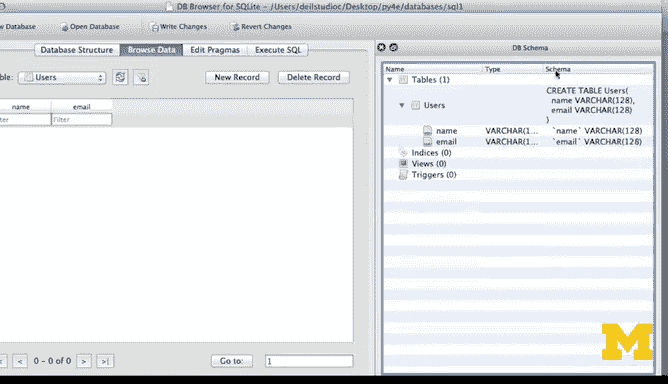

---

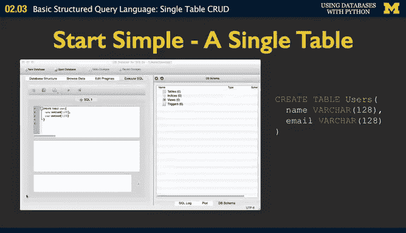

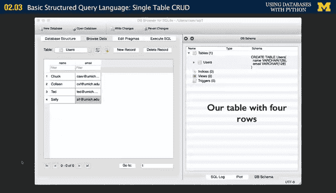

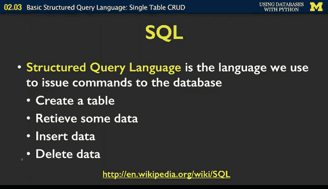

## 插入数据 ➕

表创建后，我们就可以向其中插入数据了。在图形界面中，我们可以手动添加行。但更重要的是学习如何使用SQL的 `INSERT` 语句。

以下是插入数据的SQL语句：

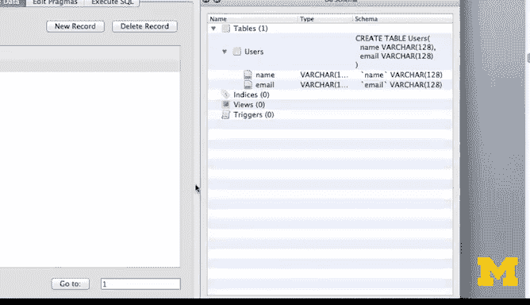

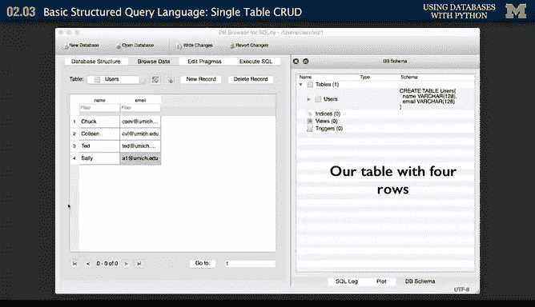

```sql
INSERT INTO users (name, email) VALUES ('Kristen', 'kf@umich.edu');
```

这个语句的含义是：
*   `INSERT INTO` 是关键字，表示向哪个表插入数据。
*   `users` 是目标表名。
*   `(name, email)` 指定了要插入数据的列。
*   `VALUES` 是关键字。
*   `('Kristen', 'kf@umich.edu')` 提供了要插入的具体值，顺序与前面指定的列对应。

在SQLite Browser中执行此语句，然后通过“Browse Data”查看，你会发现表中多了一行 Kristen 的数据。

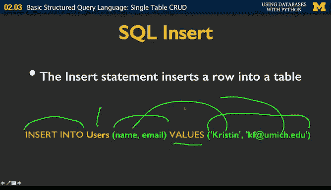

---

## 删除数据 ➖

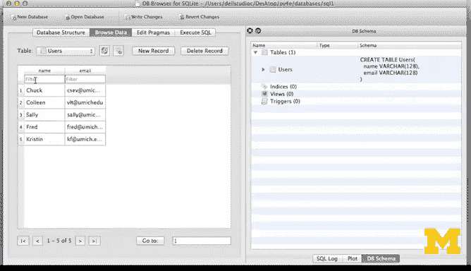

有时我们需要从表中移除数据，这时使用 `DELETE` 语句。

以下是删除数据的SQL语句：

```sql
DELETE FROM users WHERE email = 'fred@umich.edu';
```

这个语句的含义是：
*   `DELETE FROM` 是关键字，表示从哪个表删除。
*   `users` 是目标表名。
*   `WHERE` 子句至关重要，它指定了删除的条件。只有满足条件的行才会被删除。
*   `email = 'fred@umich.edu'` 是条件，意思是“邮箱等于 fred@umich.edu”。

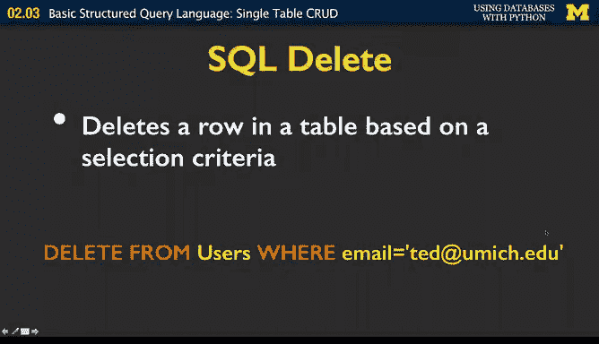

**注意**：如果没有 `WHERE` 子句，`DELETE FROM users;` 将删除表中的所有行，请谨慎使用。

执行上述语句后，浏览数据，邮箱为 fred@umich.edu 的行就被删除了。

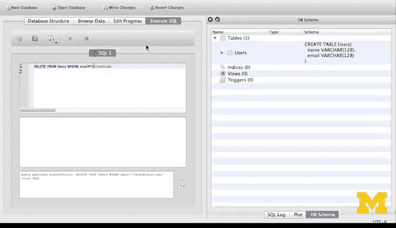

---

## 更新数据 ✏️

如果需要修改表中已有的数据，我们使用 `UPDATE` 语句。

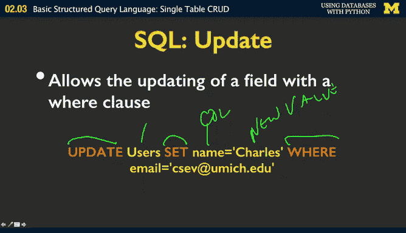

以下是更新数据的SQL语句：

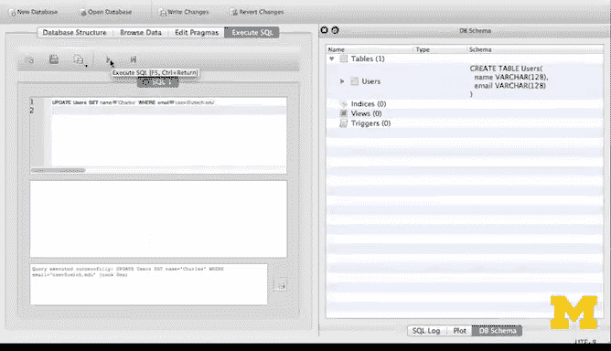

```sql
UPDATE users SET name = 'Charles' WHERE email = 'csev@umich.edu';
```

这个语句的含义是：
*   `UPDATE` 是关键字，表示更新哪个表。
*   `users` 是目标表名。
*   `SET` 是关键字，后面指定要修改的列和新值。
*   `name = 'Charles'` 表示将 `name` 列的值改为 ‘Charles’。
*   `WHERE` 子句同样关键，它指定了哪些行需要被更新。这里只更新邮箱为 csev@umich.edu 的行。

执行此语句后，你会发现对应行的姓名已从 “Chuck” 更新为 “Charles”。

---

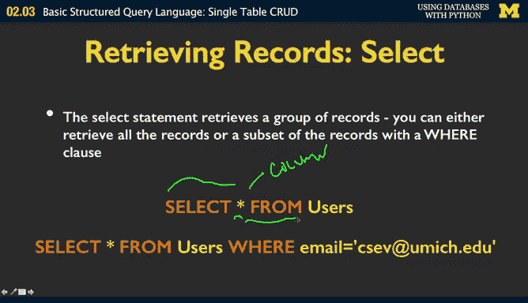

## 查询数据 🔍

查询是数据库最常用的操作，使用 `SELECT` 语句。

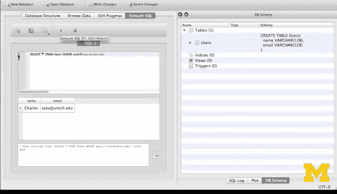

以下是几个查询示例：

**1. 查询所有数据：**
```sql
SELECT * FROM users;
```
*   `SELECT` 是关键字。
*   `*` 表示“所有列”。
*   `FROM users` 指定从 `users` 表查询。
*   这条语句会返回表中的所有行和所有列。

**2. 带条件的查询：**
```sql
SELECT * FROM users WHERE email = 'csev@umich.edu';
```
*   添加了 `WHERE` 子句，只返回邮箱等于 ‘csev@umich.edu’ 的行。

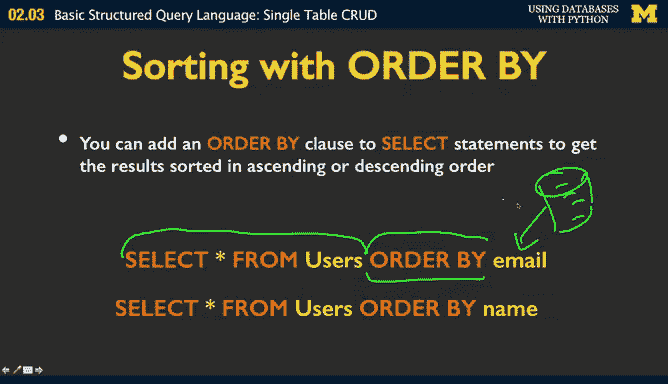

**3. 对结果排序：**
```sql
SELECT * FROM users ORDER BY email;
```
*   `ORDER BY` 是关键字，用于对结果进行排序。
*   `email` 指定按邮箱列排序（默认升序）。
*   你也可以指定 `ORDER BY name` 来按姓名排序。

数据库在排序方面非常高效，你只需告诉它按什么排序，它就会利用内部优化快速完成。

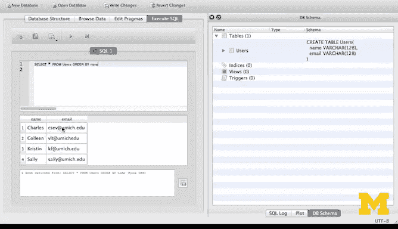

---

## 核心操作总结 📝

本节课中我们一起学习了针对单个数据表的四种基本操作，常被称为 **CRUD**：

*   **创建（Create）**：`INSERT` 语句用于插入新数据。
    *   公式：`INSERT INTO 表名 (列1, 列2) VALUES (值1, 值2);`
*   **读取（Read）**：`SELECT` 语句用于查询数据。
    *   公式：`SELECT 列1, 列2 FROM 表名 WHERE 条件 ORDER BY 排序列;`
*   **更新（Update）**：`UPDATE` 语句用于修改现有数据。
    *   公式：`UPDATE 表名 SET 列1=新值 WHERE 条件;`
*   **删除（Delete）**：`DELETE` 语句用于移除数据。
    *   公式：`DELETE FROM 表名 WHERE 条件;`


目前，我们对单表的操作就像在使用一个功能强大、速度飞快的智能电子表格。然而，数据库真正的威力在于处理**多个相关联的表**，并通过表之间的关系来建模复杂数据，这正是我们接下来要探讨的内容。