# 4：《使用数据库进行Python编程》｜ P16：实战示例：统计数据库中的电子邮件 📧

在本节课中，我们将学习一个完整的实战示例：如何利用Python和SQLite数据库来统计邮件文件中发件人的出现频率。我们将通过分析代码，理解如何连接数据库、执行SQL命令以及高效地处理数据。

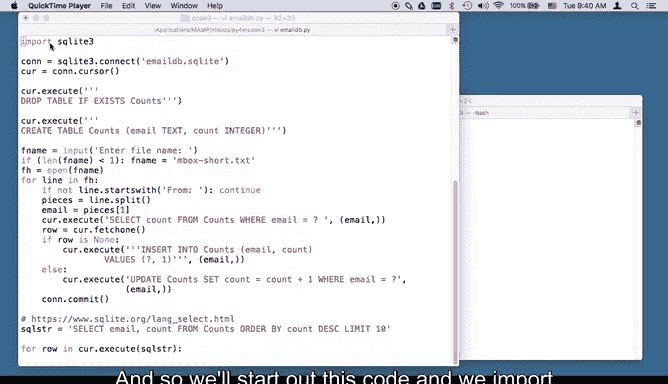

---

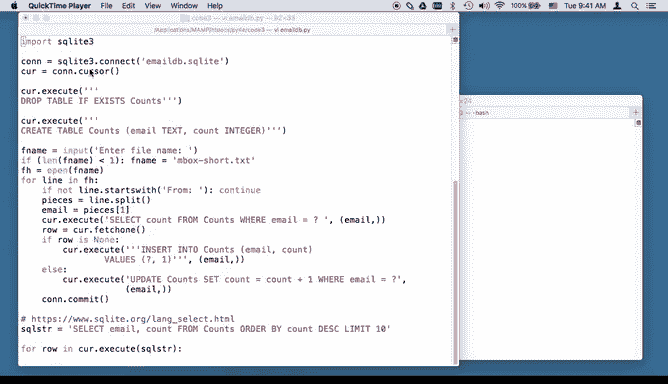

## 概述

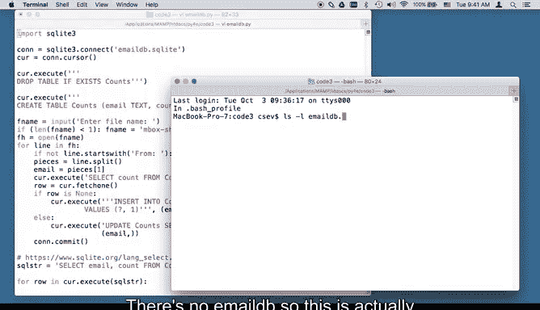

我们将要分析的脚本 `emaildb.py` 是一个简洁而强大的示例，它展示了使用Python操作SQLite数据库的核心流程。这个程序会读取一个邮件文件（如 `mbox-short.txt`），提取每封邮件的发件人地址，并使用数据库来记录每个地址出现的次数。通过这个例子，我们可以将数据库操作的精髓提炼出来。

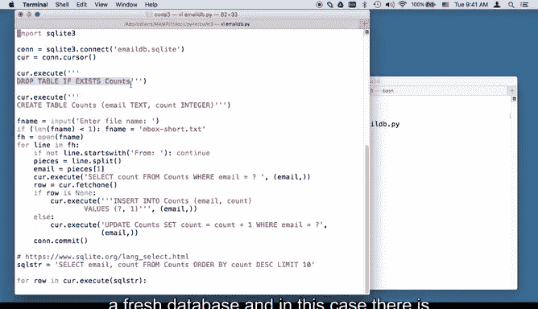

---

## 代码结构与数据库连接

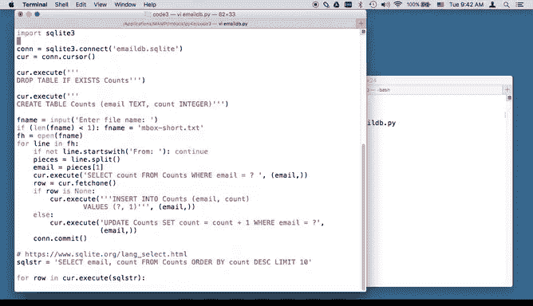

首先，我们导入必要的库并建立与数据库的连接。在数据库编程中，连接分为两步：建立连接和创建游标。

```python
import sqlite3

conn = sqlite3.connect('emaildb.sqlite')
cur = conn.cursor()
```

这里，`conn` 是到数据库文件的连接。如果文件 `emaildb.sqlite` 不存在，`sqlite3.connect()` 会自动创建它。`cur` 是游标对象，它是我们向数据库发送SQL命令并获取结果的“手柄”。

---

## 初始化数据库表

在开始处理数据之前，我们需要确保数据库中有合适的表结构。通常，我们会先删除可能存在的旧表，然后创建一个新表。

上一节我们介绍了数据库连接，本节中我们来看看如何初始化数据表。

```python
cur.execute('DROP TABLE IF EXISTS Counts')

cur.execute('''
CREATE TABLE Counts (email TEXT, count INTEGER)
''')
```

`DROP TABLE IF EXISTS` 语句可以防止在全新的数据库上运行时出错。紧接着，`CREATE TABLE` 语句创建了一个名为 `Counts` 的表，它包含两个列：`email`（文本类型，用于存储邮件地址）和 `count`（整数类型，用于存储出现次数）。

---

## 处理邮件文件并更新数据库

程序的核心部分是读取邮件文件，解析出发件人地址，并更新数据库中的计数。这模仿了字典的功能，但数据被持久化存储在数据库中。

以下是处理流程的关键步骤：

1.  **获取文件名并读取内容**：程序提示用户输入文件名（如 `mbox-short.txt`），然后逐行读取。
2.  **提取发件人地址**：对于以 `From ` 开头的行，我们通过分割字符串来提取邮件地址。
3.  **查询数据库**：使用 `SELECT` 语句和参数化查询（`?` 占位符）来检查当前邮件地址是否已存在于表中。
4.  **插入或更新记录**：
    *   如果地址不存在（查询返回 `None`），则执行 `INSERT` 语句，将计数初始化为1。
    *   如果地址已存在，则执行 `UPDATE` 语句，将其计数直接加1。**这是一种更优的“原子操作”**，避免了先读取再更新的竞态条件风险。

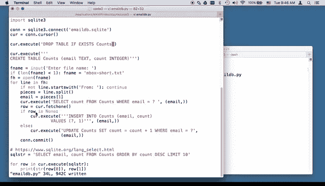

```python
fname = input('Enter file name: ')
if len(fname) < 1:
    fname = 'mbox-short.txt'
fh = open(fname)
for line in fh:
    if not line.startswith('From: '):
        continue
    pieces = line.split()
    email = pieces[1]

    cur.execute('SELECT count FROM Counts WHERE email = ? ', (email,))
    row = cur.fetchone()

    if row is None:
        cur.execute('''INSERT INTO Counts (email, count)
                VALUES (?, 1)''', (email,))
    else:
        cur.execute('UPDATE Counts SET count = count + 1 WHERE email = ?',
                    (email,))
    # 可以选择定期提交，而非每次循环都提交
    conn.commit()
```

**关键概念：参数化查询**
使用 `?` 作为占位符，并将实际值以元组形式传递给 `execute()` 方法，可以有效防止SQL注入攻击，并自动处理字符串中的特殊字符。

---

## 提交事务与性能考量

在数据库操作中，`commit()` 方法用于将内存中的更改永久写入磁盘文件。频繁提交会影响性能。

```python
conn.commit()
```

在上面的循环中，每次更新后都执行提交。对于大量数据操作，可以优化为每处理10条或100条记录提交一次，以提升速度。但在需要保证数据即时持久化的场景（如Web应用），每次操作后提交是必要的。

---

## 查询并展示结果

所有数据插入完成后，我们可以执行一个查询来获取排序后的结果。数据库非常擅长排序和筛选操作。

以下是查询并打印结果的代码：

```python
sqlstr = 'SELECT email, count FROM Counts ORDER BY count DESC LIMIT 10'

for row in cur.execute(sqlstr):
    print(str(row[0]), row[1])

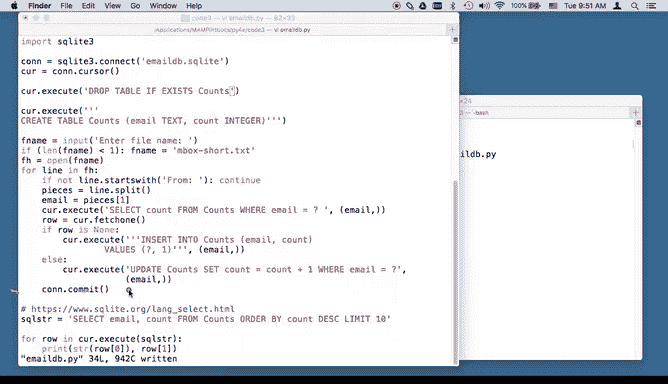

cur.close()
```

这段代码执行一个 `SELECT` 查询，按 `count` 降序排列，并只取前10条结果。然后遍历游标，打印出邮件地址和对应的计数。最后，关闭游标。

---

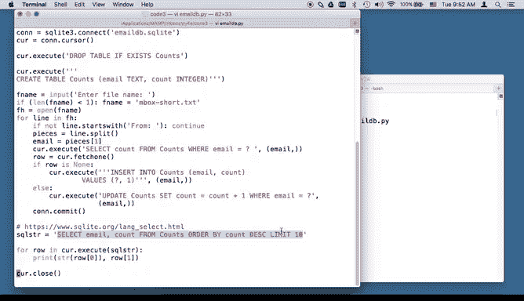

## 运行示例与数据查看

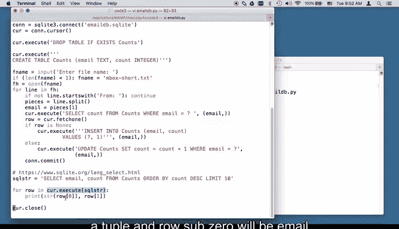

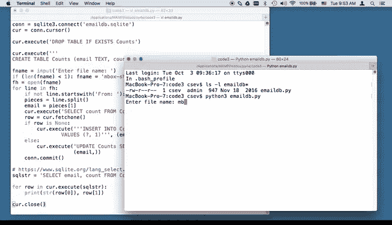

运行程序后，它会处理指定的邮件文件，并将结果存储在 `emaildb.sqlite` 数据库文件中。

我们可以使用如 **DB Browser for SQLite** 这样的图形化工具打开这个 `.sqlite` 文件，直观地查看 `Counts` 表中的数据。这验证了我们的程序不仅计算了结果，还将数据持久化保存了下来。

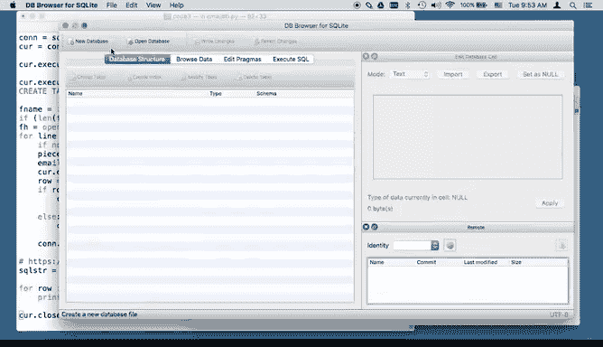

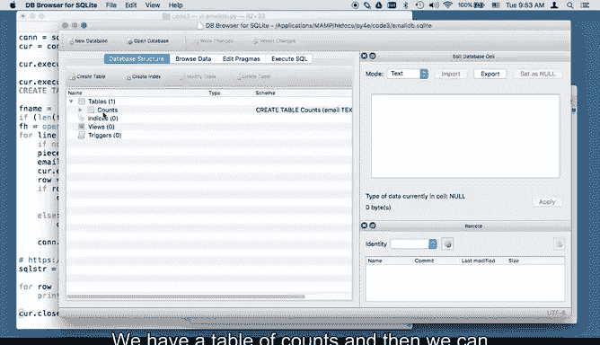

这个示例的巧妙之处在于，虽然本次我们每次运行都重建了表，但只需稍作修改（例如移除 `DROP TABLE` 语句），数据库就可以在多次程序运行之间保留历史数据，实现数据的累积统计。

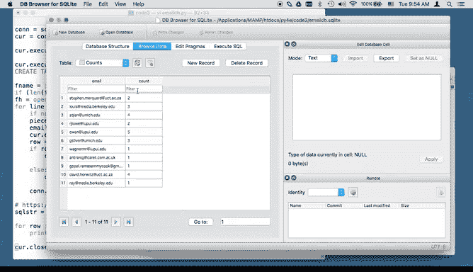

---

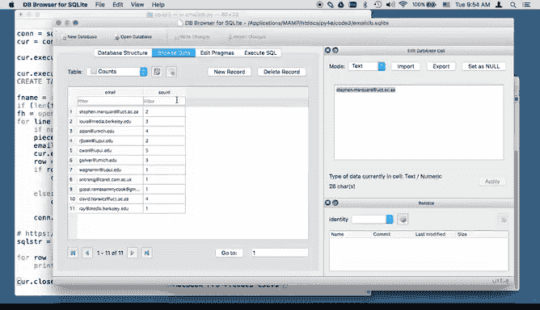

## 总结

本节课我们一起学习了如何构建一个使用SQLite数据库的Python程序。我们掌握了：
1.  使用 `sqlite3` 库连接数据库并创建游标。
2.  执行 `CREATE TABLE`、`DROP TABLE` 等SQL语句来管理表结构。
3.  通过参数化查询（`?` 占位符）安全地执行 `SELECT`、`INSERT` 和 `UPDATE` 操作，这是防止SQL注入的关键。
4.  理解 `commit()` 的作用及在性能和数据一致性之间的权衡。
5.  利用数据库强大的 `ORDER BY` 功能对查询结果进行排序。
6.  认识到将数据存入数据库而非内存中的字典，可以实现数据的持久化和更复杂的数据管理。

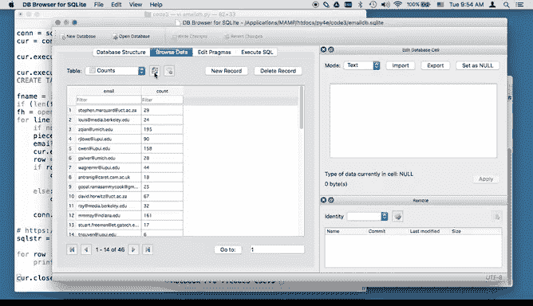

这个简单的邮件统计程序是连接Python与数据库世界的一座坚实桥梁，其核心模式可以扩展到各种数据存储和处理的应用中。