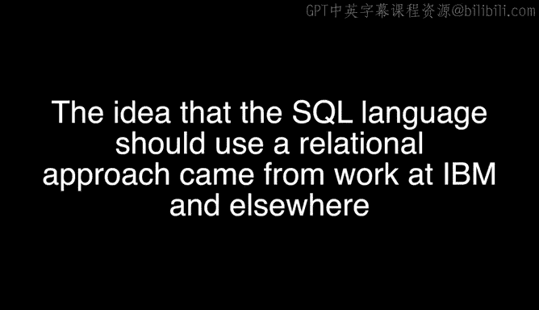
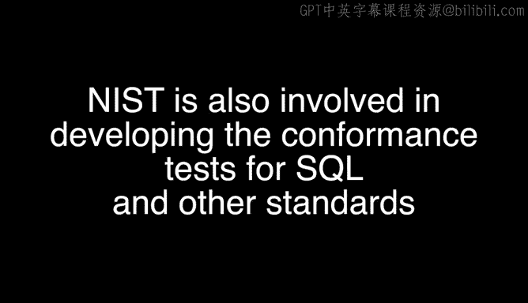

# 每个人的 Python 第四部分 18：SQL早期发展访谈 🗣️💾

## 概述
在本节课中，我们将通过Elizabeth Fong的访谈，了解SQL语言和数据库标准化的早期发展历程。你将理解为什么需要数据库标准，以及标准化过程如何影响技术创新和市场竞争。

---

## 数据库标准化的背景与需求

当时，市场上涌现出许多产品。我们意识到，当用户想要购买一个产品时，他们需要考量产品应具备哪些特性。

我所做的另一项工作是特性分析。我们分析了大约半打产品，而标准化工作的核心在于建立共识。我们从成熟的技术中汲取经验，这些技术已经准备好被标准化。人们开始面临选择：是购买IBM的产品，还是Oracle的，或者选择一个更便宜的方案？这类决策开始出现。

选择的基础在于，你可以在一个软件基础（我称之为数据库管理系统）之上构建多少种不同的应用。可能性太多样化了，因此你需要某种标准，以确保你的应用能在不同的平台上运行。

---

## 数据管理模型的演变

我们曾使用文件系统工作，文件是层次化的。当时有IBM的信息管理系统（IMSS），它是一种树状结构。业界一直在争论：数据应该是树状的、网状的还是平面文件的？我们甚至还在争论数据是否应该包含自描述标签（后来我们称之为元数据，现在人们称之为模式）。

因此，数据库系统研究小组提出了一个参考模型或规范，定义了数据库管理系统为了成为一个合格的系统所应具备的最小功能集。你需要能够存储数据、检索数据、修改数据、组织数据、删除和操作数据。这成为了一项规范。

---

## 标准化组织的诞生

在那段时间，我们参与创建了一个NC小组，现在称为Insight，即美国国家标准协会的X3 H2小组。Don Deutsch和Ln Gallagher等人都参与其中。这个小组被称为数据管理语言小组。

要标准化任何事物，你都会意识到可以有多种实现。例如，灯泡可以有红色的、白色的。你真正想要标准化的，是当你需要与另一个人或系统沟通时，那个通信接口或双方都必须理解的共同词汇区域。

因此，对于一个软件系统，唯一需要标准化的不是其能力，而是其**语言**。

---

## 关系型数据库与SQL的诞生



当时的关系型数据库领域有IBM的Chris Date，他谈论规范化，开始讨论平面文件并将其称为“表”。这是一个非常易于理解的概念。

为了从表中检索数据，你会使用类似 `SELECT column_name FROM table_name` 的语句，例如 `SELECT name FROM employee`。这就是一种简单的查询语言的诞生。

```sql
-- 示例：从员工表中选择姓名列
SELECT name FROM employee;
```



---

## 标准符合性测试的重要性

测试也是采用标准时非常重要的一个方面。你需要认证产品符合某个特定版本的ISO标准（如JTC1）。否则，你的应用程序可能无法工作。

假设你构建了一个学生课程记录系统。无论你使用的是Oracle、Sybase还是Microsoft SQL Server，你都希望你的应用程序能够正常工作。这正是市场所期望的。

当然，Oracle或微软会推销它们的产品。在采购过程中，你会要求产品“符合SQL标准”。因此，供应商必须拥有符合性测试证书。

我们有经过认证的实验室，它们会提供一个经过验证的产品列表。你可以从这个列表中选择购买已验证符合标准的产品。这是一个严格的要求，因为付钱购买的是用户，而不是我们。

---

## 标准化时机的重要性

时机就是一切。你不能过早地标准化一项技术，否则会扼杀许多创新概念，因为人们会说：“我已经无法进入你的市场了，因为你已经做出了决定，即使这个决定并不完美。”这样会抑制创新。

反之，如果标准化得太晚，你会错失良机，市场上会出现太多不同的变体，选择变得过于困难。当然，SQL是标准化成功推动技术发展的典范案例之一。

---

## 总结
本节课中，我们一起学习了SQL和数据库标准化的早期历史。我们了解了从文件系统到关系型数据库的演变，认识了标准化组织的作用，并明白了为什么需要一个共同的查询语言（SQL）以及符合性测试的重要性。最后，我们讨论了标准化时机对技术创新的关键影响。理解这些背景知识，有助于我们更好地运用现代数据库系统进行编程。