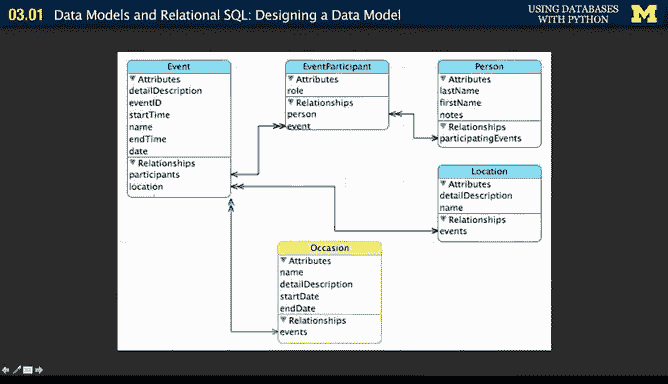
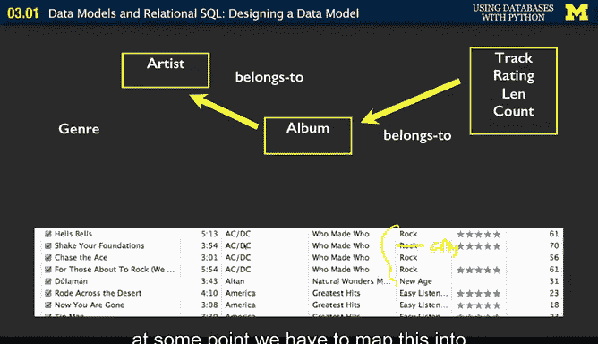

# 每个人的 Python 第四部分 19：数据模型设计 🗺️

在本节课中，我们将学习如何设计数据库的数据模型。我们将从处理单一表格过渡到将多个表格连接起来，这是数据库强大功能的来源，同时也带来了复杂性。我们将通过一个音乐管理应用的设计示例，学习如何识别实体、避免数据冗余，并最终绘制出描述数据关系的逻辑模型图。

---

## 从单一表格到多表连接

上一节我们介绍了如何使用SQL与单一表格进行交互。本节中，我们来看看如何将多个表格连接在一起。这正是数据库展现其真正威力之处，同时也带来了设计的复杂性。

当你开始创建一个公司或应用时，通常需要设计一个数据库。以我们虚构的音乐管理应用为例，许多应用都需要数据库支持。数据库设计通常是一个团队协作的过程，涉及不同技能的人员，例如有人关注用户功能，有人关注性能等。

我们将要学习的是数据库设计的基础，这些基础概念非常强大。聪明的设计者会在数据库设计上投入时间，这是一个高度协作的过程。

## 理解数据模型图

最终，为应用设计的数据库会以图表的形式呈现。这些图表看起来可能很复杂，但它们本质上描绘了多个表格以及表格之间的关系。

如上图所示，每个方框代表一个表格，其中的条目是表格的列。一些特殊的列用于表示与其他表格的关系，图表中的箭头就描述了这些连接关系。箭头可能表示“一对一”或“一对多”等关系。虽然我们暂时不深入这些细节，但最终目标是获得一张描述应用数据如何存储在数据库中的“蓝图”，这被称为**模式**或**契约**。

## 复杂性与简单性

在一个大型应用中，你可能会看到非常复杂的数据库关系图。

这张图可能代表了多年精心设计的成果，以确保应用高效运行。表面上看它很复杂，但本质上，我们只是在解决三个问题：创建哪些表格、在表格中存放什么数据，以及如何连接这些表格。连接关系是数据库强大功能的关键。我们可以把所有数据塞进一个文件，但那会导致性能极差。因此，仔细设计数据结构是为了在完成后获得高效的性能。

## 核心设计原则

设计数据模型的核心思想是：确定需要表示的数据，绘制图表，并在图表元素间画线连接。我们遵循一个基本规则：**不要重复存储相同的字符串数据**。

例如，如果有一个列需要多次出现“Chuck”这个名字，直接重复存储是不好的做法。正确的做法是创建另一个表格来存放“Chuck”，并给它分配一个数字ID（比如1），然后在原表格中用这个数字ID（1）来引用它。这意味着我们在建模两个表格之间的连接关系。

以下是核心原则总结：
*   **避免数据冗余**：不要重复存储相同的字符串数据，使用关系（数字ID）来代替。
*   **模拟现实世界**：根据现实世界的实体创建表格，例如为用户、音乐曲目、圣诞树农场等分别建表。

## 从用户界面发现问题

我们的公司决定开发一个按单曲销售音乐的应用。以下是我们计划构建的用户界面原型：

观察这个界面，我们立刻能发现问题。如果尝试将其直接转化为电子表格，这些问题就会显现，核心在于**列中的数据重复**。

例如，同一个艺术家的名字（如“Black Sabbath”）可能会在“Artist”列中出现数百次。同样，“Album”列和“Genre”列也存在大量字符串重复。在编程中，当数据量达到百万或万亿级别时，存储字符串“Metal”和存储一个简短的整数ID（如2）在性能和存储空间上的差异是巨大的。

## 平衡用户需求与数据模型

这时，用户界面设计师可能会说：根据调研，用户就想看到现在这样的界面，数据重复显示正是用户期望的。作为开发者，我们不能反驳用户的需求。因此，我们的挑战在于：如何在支持这种用户界面的同时，构建一个高效的数据模型？

答案不是改变用户界面，而是改变底层的数据模型。我们需要设计一个既能准确表示数据、又能高效支持所需用户界面的数据模型。

## 逐步设计数据模型

现在，假设我们正在会议室中，准备在白板上绘制数据模型图。我们面前有一堆数据列，需要决定哪些列代表现实世界中的独立“事物”，哪些列只是某个“事物”的“属性”。

### 第一步：确定核心实体

第一个问题通常是：从哪里开始？一个有效的方法是思考这个应用最核心的实体是什么？用一句话描述这个应用。对我们的音乐应用来说，它是一个“**曲目（Track）**管理工具”，而不是专辑或艺术家管理工具。从用户界面也能看出，每一行都是一首曲目。

因此，我们创建的第一个表格是 **`Track`（曲目）表**。

### 第二步：识别属性和关联实体

创建了`Track`表后，我们需要审视其他数据列，判断哪些是曲目的属性，哪些本身应该是独立的表格。

像“评分（Rating）”、“时长（Length）”、“播放次数（Plays）”这些数字，以及“标题（Title）”，显然是曲目的属性，应该放在`Track`表中。

那么，哪些不是曲目的属性呢？那些出现数据重复的列就是警示信号，它们很可能代表独立的实体。在我们的例子中，就是“艺术家（Artist）”、“专辑（Album）”和“流派（Genre）”。

### 第三步：绘制关系图

我们在白板上画出了第一个方框：`Track`表，包含`title`、`rating`、`length`、`plays`等字段。

接下来，曲目与什么连接？曲目可以连接到艺术家，也可以连接到专辑。通常，一张专辑包含多首曲目。所以，我们创建第二个表格：**`Album`（专辑）表**，并建立`Track`属于`Album`的关系。

那么专辑属于谁呢？通常，专辑属于艺术家。因此，我们再创建 **`Artist`（艺术家）表**，并建立`Album`属于`Artist`的关系。

### 第四步：处理有争议的关系

现在，我们有了`Artist`、`Album`、`Track`三个表格。最后一个问题是：**“流派（Genre）”应该连接到什么？**

它是连接到专辑、艺术家，还是曲目？这需要根据应用的实际逻辑来决定。想象一下在音乐软件中更改一首曲目的流派：如果流派是专辑的属性，那么更改会影响到该专辑下的所有曲目；如果流派是艺术家的属性，那么会影响到该艺术家的所有作品；如果流派是曲目的属性，则只影响这一首曲目。

在实际应用中，当你更改一首曲目的流派时，通常只有该曲目发生变化。这个事实告诉我们，**`Genre`（流派）应该作为`Track`（曲目）的一个属性**。这是一个简单的例子，说明了数据模型如何决定应用程序的功能特性。我们必须确保数据模型正确，才能使一切高效运行。

## 从逻辑模型到物理数据库

现在，我们已经在会议室的墙上绘制出了逻辑数据模型图。

在某个阶段，我们必须将这个逻辑模型映射到实际的数据库结构中。我们需要弄清楚如何将刚刚绘制的逻辑图转化为在数据库中具体实现的物理方案。这将是我们后续课程的内容。

---

本节课中，我们一起学习了数据库数据模型设计的基础。我们从识别核心实体（Track）开始，逐步区分了实体的属性和关联实体（Artist, Album），并遵循“避免数据冗余”的核心原则，绘制出了描述表之间关系的逻辑模型图。最后，我们讨论了如何根据应用的真实行为（如更改流派）来确定数据关系的归属，强调了正确的数据模型对应用功能和性能的决定性作用。