# 密歇根大学《给所有人的Python课》课程4：《使用数据库进行Python编程》｜P20：数据模型与表结构表示 📊


## 概述

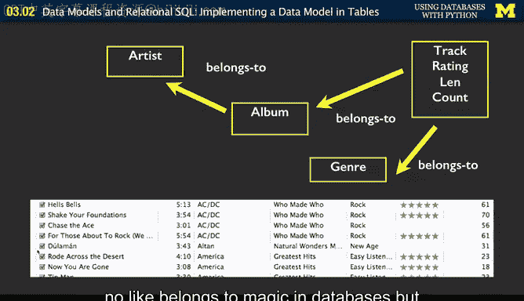

在本节课中，我们将学习如何将逻辑数据模型转化为数据库中的物理表结构。我们将介绍主键、外键和逻辑键的概念，并通过实际操作演示如何使用SQL语句创建数据库表。

---

## 从逻辑模型到物理模型

上一节我们通过讨论和绘制白板图，确定了音乐数据库的逻辑数据模型。该模型展示了艺术家、专辑、曲目和流派等实体之间的关系。本节中，我们来看看如何将这个逻辑模型转化为数据库能够理解和存储的物理表结构。

数据库无法直接理解“属于”这种逻辑关系。我们必须将逻辑模型映射为物理模型，这个过程需要为每个表和表之间的关系添加一些明确的信息。

---

## 表结构与键的概念

以下是构建物理模型时需要理解的核心概念。我们将以`track`表为例进行说明。

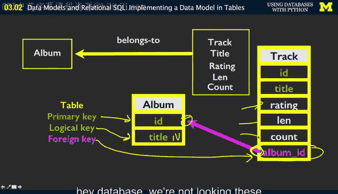

我们首先创建一个名为`track`的表。像`title`、`rating`、`length`和`count`这样的属性会成为表中的列。除此之外，我们通常还需要添加以下几种特殊的列：

### 1. 主键
主键是我们引用特定行的方式。它是一个唯一的数字，例如1, 2, 3, 4。每个专辑、艺术家等都会获得一个这样的数字。我们在其他表的列中使用这个数字来“指向”它。主键是箭头的终点。

**代码示例：**
```sql
CREATE TABLE track (
    id INTEGER NOT NULL PRIMARY KEY AUTOINCREMENT UNIQUE,
    ...
);
```

### 2. 外键
外键是我们添加到表中、作为箭头起点的列。按照本课程采用的命名约定，外键通常以它所指向的表名开头，后跟`_id`。例如，指向`album`表的外键可以命名为`album_id`。

**代码示例：**
```sql
CREATE TABLE track (
    ...
    album_id INTEGER,
    genre_id INTEGER,
    ...
);
```

### 3. 逻辑键
逻辑键是我们在外部世界可能用来查找某行的唯一标识。例如，我们可能通过`title`来查找曲目。逻辑键是我们可能在`WHERE`子句或`ORDER BY`子句中使用的列。数据库可能会为逻辑键创建索引以提高查询效率。

**总结：**
*   **主键**是箭头的终点，用于唯一标识本表的每一行。
*   **外键**是箭头的起点，用于指向另一张表的某一行。
*   **逻辑键**是可能用于查询的列。

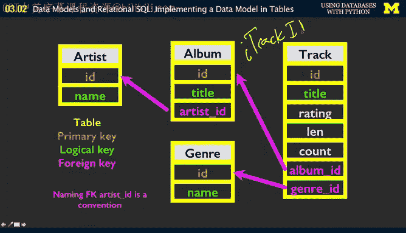

---

## 命名约定与团队协作

命名约定非常重要。在本课程中，我们采用一种简洁的约定：主键列命名为`id`，外键列命名为`<目标表名>_id`（例如`artist_id`）。

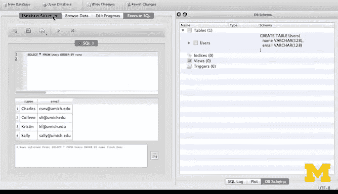

不同的团队或项目可能采用不同的命名约定（例如`pKeyTrack`或`trackId`）。重要的是团队内部保持一致。当你加入一个新团队时，应该学习并遵循他们现有的命名约定，而不是强行推行自己习惯的那一套。

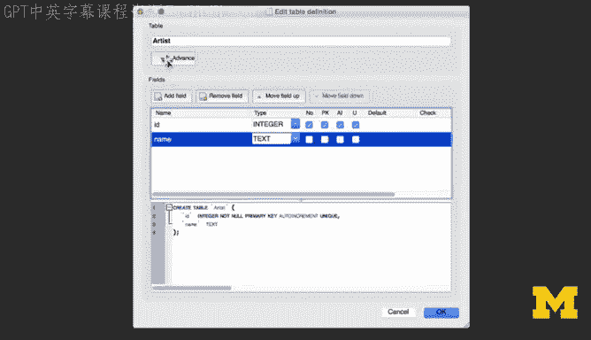

---

## 实践：创建数据库表

现在，我们将把理论付诸实践，使用SQL语句创建我们的音乐数据库表。我们遵循从外到内的顺序创建表，即先创建箭头指向的目标表（如`artist`），再创建包含外键的源表（如`album`, `track`）。

以下是创建各个表的步骤：

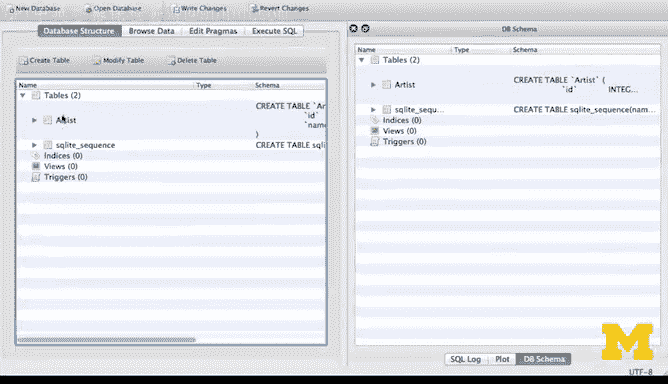

### 1. 创建Artist表
首先创建`artist`表，它是最外层的表之一。

**SQL语句：**
```sql
CREATE TABLE artist (
    id INTEGER NOT NULL PRIMARY KEY AUTOINCREMENT UNIQUE,
    name TEXT
);
```

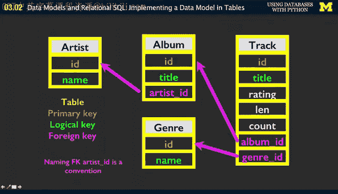

### 2. 创建Genre表
接下来创建`genre`表。

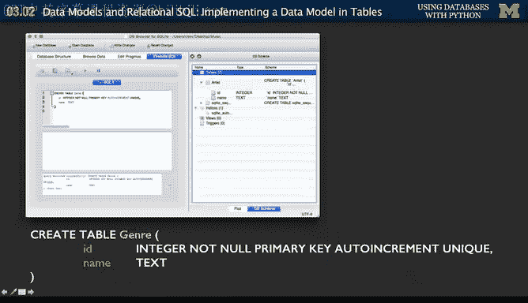

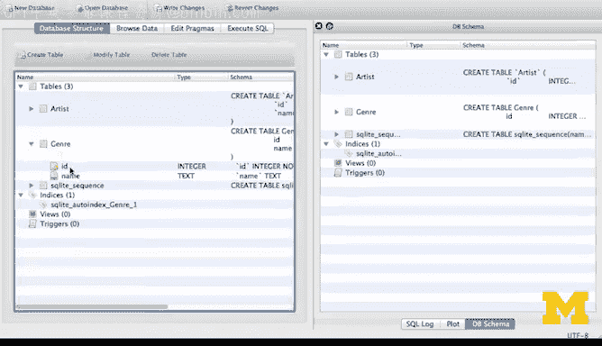

**SQL语句：**
```sql
CREATE TABLE genre (
    id INTEGER NOT NULL PRIMARY KEY AUTOINCREMENT UNIQUE,
    name TEXT
);
```

### 3. 创建Album表
`album`表是我们遇到的第一个包含外键的表。它通过`artist_id`列指向`artist`表。

**SQL语句：**
```sql
CREATE TABLE album (
    id INTEGER NOT NULL PRIMARY KEY AUTOINCREMENT UNIQUE,
    artist_id INTEGER,
    title TEXT
);
```

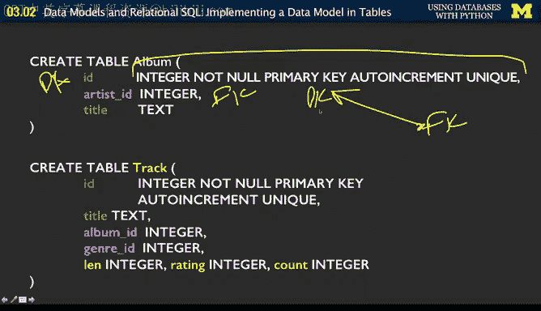

### 4. 创建Track表
`track`表是最复杂的表，它包含两个外键，分别指向`album`表和`genre`表。

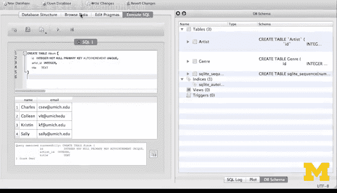

**SQL语句：**
```sql
CREATE TABLE track (
    id INTEGER NOT NULL PRIMARY KEY AUTOINCREMENT UNIQUE,
    title TEXT, -- 逻辑键
    album_id INTEGER, -- 外键，指向album表
    genre_id INTEGER, -- 外键，指向genre表
    len INTEGER,
    rating INTEGER,
    count INTEGER
);
```

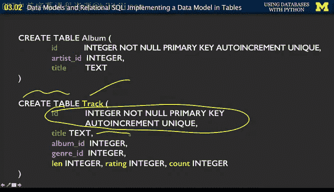

执行以上所有SQL语句后，我们就成功地将逻辑数据模型转化为了数据库中的物理表结构。

---

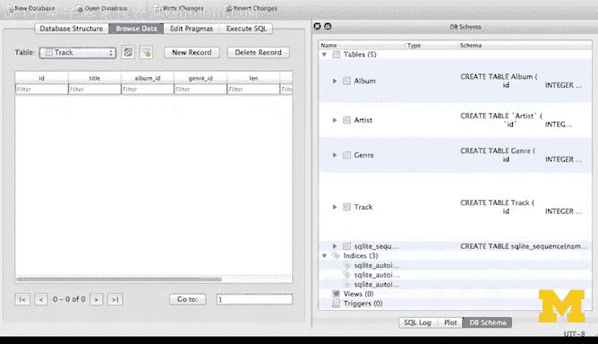

## 总结


本节课中我们一起学习了数据建模的关键一步：将逻辑模型转化为物理数据库表。我们明确了**主键**、**外键**和**逻辑键**这三个核心概念及其作用，并实践了如何使用SQL的`CREATE TABLE`语句来构建表结构，同时遵循了清晰的命名约定。现在，我们的数据库已经准备好了空表，下一节课我们将开始向这些表中插入实际的数据。