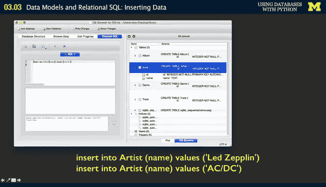
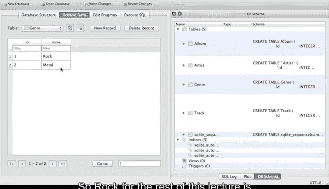
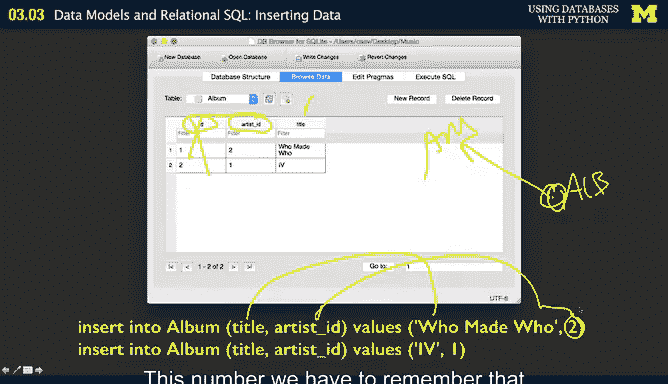
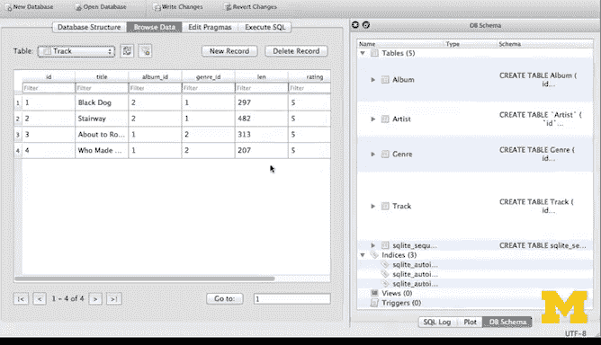
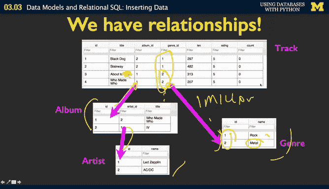

# 密歇根大学《给所有人的Python课》课程4：《使用数据库进行Python编程》｜ P21：21_03_03_关系型数据插入 📝


## 概述

在本节课中，我们将学习如何向已创建好的数据库表中插入数据。我们将遵循从外到内的顺序，先插入独立表的数据，再插入依赖这些数据的关联表数据，并理解主键、外键以及自动生成字段在数据插入过程中的作用。

---



## 从外到内的数据插入顺序

上一节我们完成了数据库的物理模型设计。本节中，我们来看看如何向这些表中填充数据。

插入数据时，我们需要遵循一个逻辑顺序：从最独立、最外层的表开始，逐步向内层、依赖其他表的表插入数据。这样做的目的是为了先建立好外键所引用的主键值。

以下是插入数据的基本步骤：

1.  首先插入 `artist`（艺术家）和 `genre`（流派）表的数据，因为它们是最独立的。
2.  然后插入 `album`（专辑）表的数据，因为它依赖于 `artist` 表。
3.  最后插入 `track`（曲目）表的数据，因为它同时依赖于 `album` 和 `genre` 表。

---

## 插入艺术家（Artist）数据

我们首先向 `artist` 表插入数据。请注意，该表有一个 `id` 字段是自动生成的，因此在插入时我们**不需要**指定它。

SQL 关键字（如 `INSERT INTO`）不区分大小写，但表名、列名和实际插入的数据（字符串）是区分大小写的。

以下是插入艺术家数据的 SQL 语句：

```sql
INSERT INTO artist (name) VALUES (‘Led Zeppelin‘);
INSERT INTO artist (name) VALUES (‘AC/DC‘);
```



执行后，数据库会自动为 `Led Zeppelin` 分配 `id=1`，为 `AC/DC` 分配 `id=2`。这样，我们就在数据库中建立了数字与艺术家名称的对应关系。

---

## 插入流派（Genre）数据

接下来，我们处理 `genre` 表。同样，它的 `id` 也是自动生成的。

这里介绍一个小技巧：在 SQL 编辑器中，只要用分号分隔，可以一次执行多条 SQL 语句。

以下是插入流派数据的 SQL 语句：



```sql
INSERT INTO genre (name) VALUES (‘Rock‘);
INSERT INTO genre (name) VALUES (‘Metal‘);
```

执行后，`Rock` 对应的 `id` 是 1，`Metal` 对应的 `id` 是 2。现在，当我们后续需要引用“摇滚”时，只需使用数字 `1` 即可，无需重复存储字符串“Rock”。

---

## 插入专辑（Album）数据

现在我们来处理第一个包含**外键**的表——`album` 表。它有一个指向 `artist` 表的外键 `artist_id`。

插入时，我们必须明确指定这个外键的值（即之前为艺术家生成的数字ID），而不是艺术家的名字。

以下是插入专辑数据的 SQL 语句：

```sql
INSERT INTO album (title, artist_id) VALUES (‘Who Made Who‘, 2);
INSERT INTO album (title, artist_id) VALUES (‘IV‘, 1);
```

这里，`artist_id=2` 对应 `AC/DC`，`artist_id=1` 对应 `Led Zeppelin`。虽然手动操作时需要记住这些数字，但在程序中，这非常容易管理。程序可以在插入艺术家后立即获取其自动生成的ID并保存起来供后续使用。

---

## 插入曲目（Track）数据

最后，我们处理最核心的 `track` 表。它包含两个外键：`album_id` 和 `genre_id`。

这是允许**数据重复**的关键所在。我们可以在多行中使用相同的 `album_id`（如 `1`）和 `genre_id`（如 `1`），这表示这些曲目属于同一张专辑和同一种流派。我们重复的是数字，而不是冗长的字符串，从而实现了数据的规范化。

以下是插入曲目数据的 SQL 语句示例：

```sql
INSERT INTO track (title, rating, len, count, album_id, genre_id)
VALUES (‘Black Dog‘, 5, 297, 0, 1, 1);

INSERT INTO track (title, rating, len, count, album_id, genre_id)
VALUES (‘Stairway‘, 5, 482, 0, 1, 1);

INSERT INTO track (title, rating, len, count, album_id, genre_id)
VALUES (‘About to Rock‘, 5, 313, 0, 2, 1);

INSERT INTO track (title, rating, len, count, album_id, genre_id)
VALUES (‘Who Made Who‘, 5, 207, 0, 2, 1);
```



执行这些语句后，我们就完成了所有数据的插入。现在，像“Metal”这样的流派名称在整个数据库中只存储了一次（在 `genre` 表中），所有曲目都通过数字 `2` 来引用它。

---

## 总结

本节课中，我们一起学习了如何向关系型数据库表中插入数据。



我们掌握了从外到内的插入顺序，理解了**自动生成主键**（`AUTOINCREMENT`）在插入时无需指定的特性，并实践了如何为**外键**字段填入正确的引用ID。

最重要的是，我们看到了使用数字ID代替重复字符串的巨大优势：它极大地减少了数据冗余，提升了存储和查询效率。例如，一个数字ID可能只占4字节，而一个字符串可能占128字节。当数据量达到百万级时，这种设计能显著减少需要扫描的数据量，并便于建立高效的索引。

至此，我们已经成功构建了一个具有完整关系和数据的数据库模型。