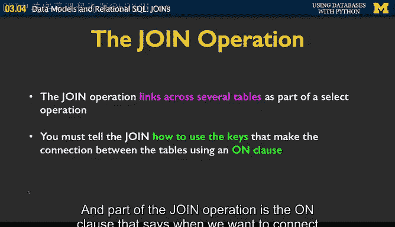
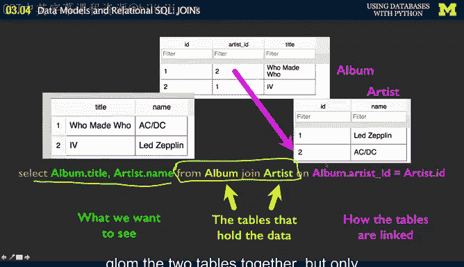
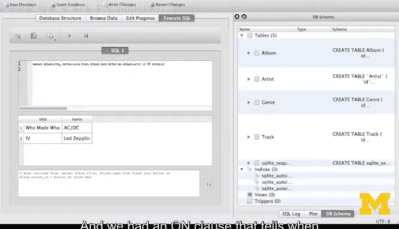
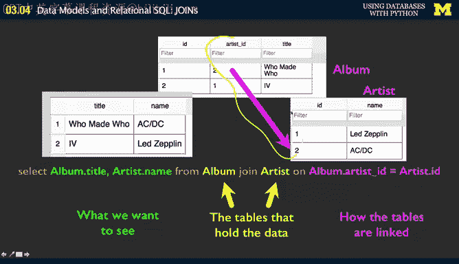
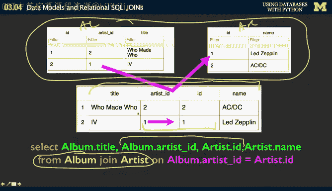
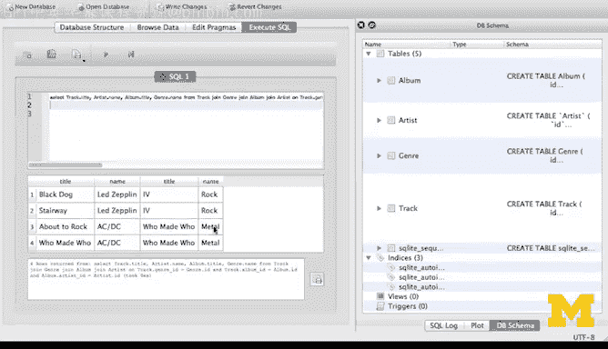

# 4：《使用数据库进行Python编程》｜ P22：22_03_04_通过JOIN重构数据 🧩


## 概述

在本节课中，我们将学习如何使用SQL的`JOIN`操作，将分散在多个数据库表中的数据重新连接起来，从而重构出用户界面所需的数据视图。我们将理解`JOIN`和`ON`子句的工作原理，并通过实例演示如何从多个关联表中提取信息。

## 从分散到聚合：JOIN的作用



上一节我们介绍了如何通过主键和外键将数据分散到多个表中以减少冗余。本节中我们来看看如何使用`JOIN`操作将这些分散的数据重新聚合起来。

我们创建了多个数据库表，并通过数字（外键）将它们链接起来。这看起来可能把事情弄复杂了，但现在我们将使用`JOIN`操作把所有数据重新组合起来。我们终于触及了关系型数据库的核心能力。这个过程可能看起来有些繁琐，但这非常重要，尤其是在数据规模增长时。如果你从事专业的数据分析工作，处理的数据量通常不会很小。主键、外键以及这些指向其他数据的数字，正是关系型数据库的精髓所在。

为了重构用户界面所需的数据，我们需要重新连接所有这些关联。实现这一点的SQL语法就是`JOIN`操作。`JOIN`的基本含义是，我们从多个表中选择数据。`JOIN`操作的一部分是`ON`子句，它定义了如何将一个表中的一行与另一个表中的对应行连接起来。

## 基础JOIN操作示例

以下是我们的数据示例，我们想要提取专辑标题和艺术家名字。但专辑标题在`album`表中，而艺术家名字因为我们的关系化设计，在`artist`表中。因此，我们需要从两个表中提取数据。



```sql
SELECT album.title, artist.name
FROM album
JOIN artist ON album.artist_id = artist.id;
```

这里有一个语法：`表名.字段名`。我们从`album`表中选择`title`列，从`artist`表中选择`name`列。`FROM`子句指定了表，这里我们从一个表`JOIN`另一个表。`JOIN`操作创建了一个“超级表”，它包含了来自这两个表的行。我们不只是查询一个表，而是查询两个表。除了`JOIN`操作指定我们要操作这些表，`ON`子句则决定了何时将此表中的一行连接到彼表中的一行。`ON`子句的写法是：当`album.artist_id`（来自`albums`表的外键，是我们箭头的起点）等于`artist.id`（`artist`表的主键，是箭头的终点）时进行连接。这匹配并重新连接了所有对应行之间的箭头。我们选择这两个字段（每个表一个），然后将两个表连接起来，但只在这些条件为真时连接行。



有些人更喜欢将其写成一个更长的`WHERE`子句，有些数据库也偏好这种写法。但我倾向于使用`ON`子句，以免混淆我的`WHERE`子句。不过，如果你学会了`WHERE`子句的技巧，它与`ON`子句是等效的。



运行上述查询，我们得到了来自一个表的标题和来自另一个表的名字，并通过`ON`子句将它们连接在一起。

## 深入理解JOIN的连接机制

我们可以更深入地查看参与这两个表之间连接的所有数据，以理解其关系。



```sql
SELECT album.title, album.artist_id, artist.id, artist.name
FROM album
JOIN artist ON album.artist_id = artist.id;
```

这个查询与之前类似，但在`SELECT`中增加了两个字段。我们选择标题、`artist_id`、`artist.id`和名字。这样你可以看到整个表是如何被连接起来的，就像中间有胶水将它们粘合在一起。它们被粘合在一起的条件是这两个值匹配。虽然这些ID字段在最终输出中不一定需要显示，但它们是连接的来源。通过选择它们，你可以看到连接的具体样子。

## 构建更多JOIN查询

让我们构建另一个查询。假设我们想要音轨标题和流派名称。查看`track`表，我们有`genre_id`。这里存在一些数据重复，我们需要进行查找。我们希望看到所有音轨及其对应的流派，比如摇滚、金属等。这样我们就重构了重复数据。这是用户想要看到的，但这不是我们数据库中存储的形式。

```sql
SELECT track.title, genre.name
FROM track
JOIN genre ON track.genre_id = genre.id;
```

我们再次使用`SELECT`，从`track`表中选择标题，从`genre`表中选择流派名称。`FROM`子句指定从`track`表`JOIN`到`genre`表，这创建了一个横跨两个表的“超级行”。然后我们有一个`ON`子句。你可能会觉得这些查询很难构建，但实际上，`track`表有一个名为`genre_id`的外键，它将等于`genre`表的`id`字段。随着你不断练习，编写这些查询会变得越来越容易。我使用的连接语法非常规范，我会反复使用它。

运行这个查询，我们就重构了重复数据。这也是一个好时机，来展示`JOIN`操作底层发生了什么。现在一切看起来都很美好简单，但如果我们去掉`ON`子句会发生什么？

```sql
SELECT track.title, genre.name
FROM track
JOIN genre;
```

如果我们没有`ON`子句，数据库会生成所有可能的组合。这里有4行，那里有2行，所以每个组合都会产生，总共是8行。如果一个是1000行，另一个是100行，那就会产生100,000行。没有`ON`子句，结果就是所有组合。我们可以展示一下。这与之前的`SELECT`语句完全相同，但我们去掉了`ON`子句。让我们看看运行这个查询会发生什么。

SQL语句中的换行和空格不影响执行，你可以添加空格和换行来让你的SQL看起来更美观。我经常缩进它们，虽然缩进没有语法意义，但看起来更整洁。

现在我们看到，我们得到了所有组合。例如，“Black Dog”这首歌同时关联了两个流派（流派1和流派2），因为我们没有`ON`子句来匹配。你可以将`JOIN`理解为构建两个表之间所有可能的组合，而`ON`子句则负责丢弃那些不匹配的组合，或者更准确地说，是挑选出那些匹配的组合。如果没有`ON`子句，就会得到所有组合。`ON`子句的作用就是剔除不匹配的行。

## 构建复杂的多表JOIN

现在情况可以变得复杂，因为我们可能想要音轨标题、艺术家名字、专辑标题和流派名称。这看起来内容很多，但如果你遵循模式，就会发现规律。

```sql
SELECT track.title, artist.name, album.title, genre.name
FROM track
JOIN genre ON track.genre_id = genre.id
JOIN album ON track.album_id = album.id
JOIN artist ON album.artist_id = artist.id;
```

我们有一个`SELECT`子句，列出了我们想要的输出字段。我们有一个很长的`FROM`子句，它说：`track`表`JOIN``genre`表，`JOIN``album`表，`JOIN``artist`表。这是所有表连接在一起。然后是`ON`子句，它们看起来有点复杂，但我们从`track`表开始向外连接：`track`表中的外键`genre_id`等于`genre`表的主键；`track`表中的`album_id`等于`album`表的主键；还有一个外键是`album`表中的`artist_id`等于`artist`表的`id`。

回顾我们之前画的示意图：`track`指向`genre`，`track`指向`album`，`album`指向`artist`。我们看着这个图，这就是为什么示意图如此重要，我们根据它来重构所有连接。对我来说，这可能看起来有点复杂，但如果你多做几次，就会意识到命名约定真的能帮上大忙。



运行这个庞大的查询，我们就重构了数据。现在这里又出现了数据重复，但这是输出结果。这就是数据库的美妙之处：你可以重构出任何重复数据，但实际上并不存储这些重复。这就是为什么你必须学会编写`JOIN`子句。

## 总结

本节课中我们一起学习了如何使用SQL的`JOIN`操作。我们完成了一个完整的循环：就像任何初创公司花费三天构建产品一样，我们从设计一个有数据冗余的用户界面开始，然后提出了逻辑数据模型和物理数据模型，接着插入了所有数据，用数字（而非字符串）连接事物，最后使用`JOIN`来重构数据。我们一步步走来，最终能够重构出最终用户希望看到的输出结果。现在，由于我们精心构建了一个合理的数据模型，我们可以处理数百万甚至数十亿行数据了。