# 4：《使用数据库进行Python编程》｜P23：实战示例：tracks.py程序 📂

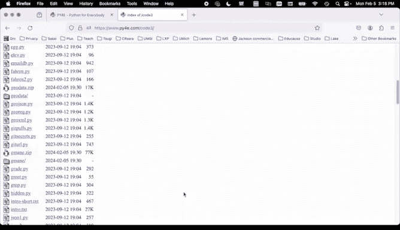

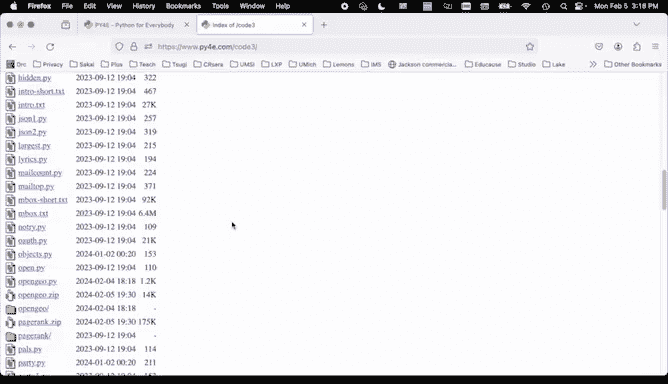

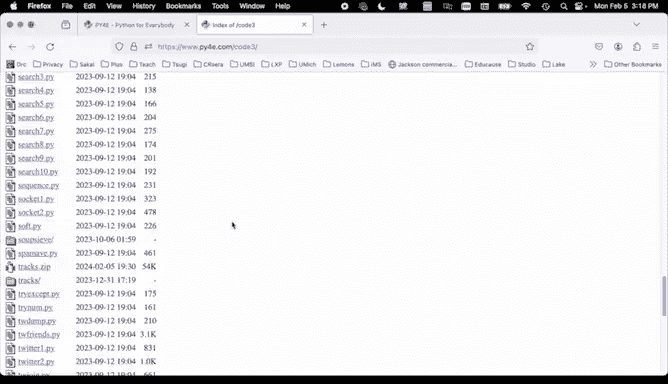

在本节课中，我们将学习一个完整的实战示例：`tracks.py`程序。该程序演示了如何读取一个包含音乐数据的CSV文件，并将其规范化地存储到SQLite数据库中。我们将重点关注如何建立表之间的关系，并使用“插入或忽略”等技巧来避免数据重复。

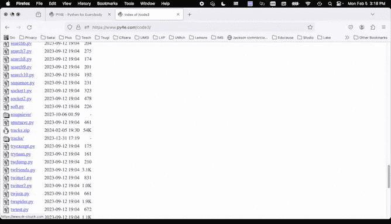

## 概述与准备工作

上一节我们介绍了数据库的基本操作，本节中我们来看看如何将理论应用于实践，处理真实的数据集。


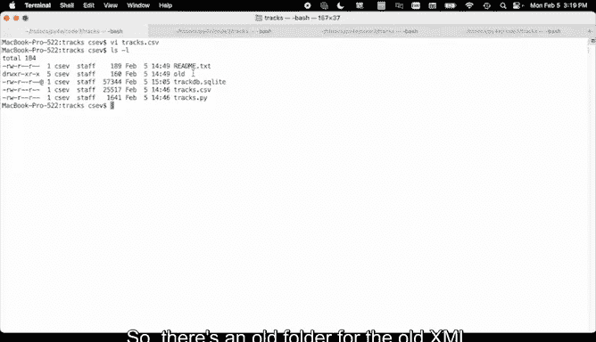

首先，你需要获取程序所需的代码和数据文件。


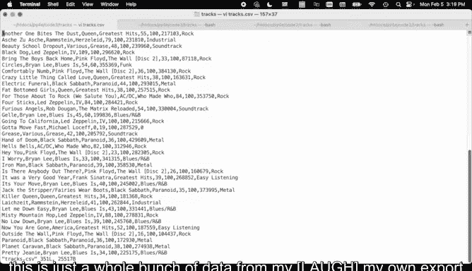

访问 `www.py4e.com/code3`，下载名为 `tracks.zip` 的文件。

下载并解压该文件后，你将获得本教程中使用的所有代码。

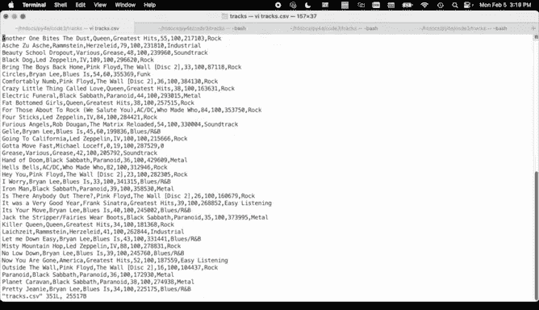

解压后的文件夹中包含一个 `old` 子文件夹，其中存放了此应用程序的旧XML版本代码。如果你有兴趣学习XML，可以尝试。但本教程将使用CSV版本。

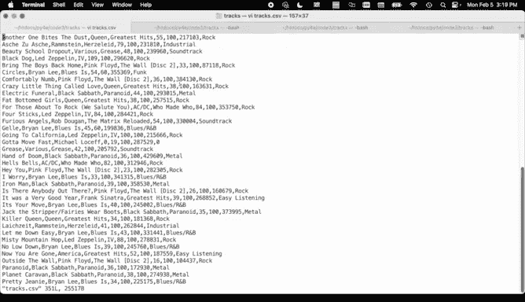

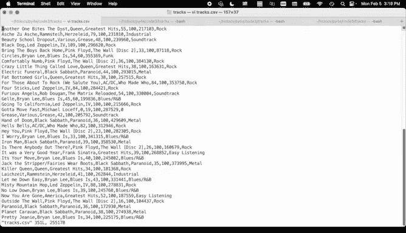


我们将要处理的核心数据文件是 `tracks.csv`。这是一个逗号分隔值文件，包含了从iTunes数据导出并转换为CSV格式的歌曲信息，如歌曲标题、艺术家、专辑等。

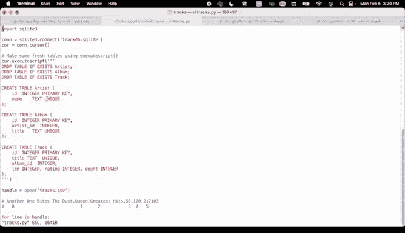

我们的目标是逐行读取这个CSV文件，并将其数据插入到一个规范化的数据库中。规范化的核心在于避免数据冗余。例如，每个艺术家的名字在`artist`表中只出现一次，并通过主键和**外键**与其他表关联。

## 程序结构与初始化


让我们开始查看 `tracks.py` 的代码结构。程序首先会连接到（或创建）一个SQLite数据库文件 `trackdb.sqlite`。

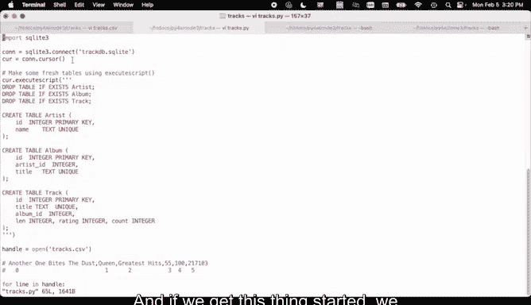

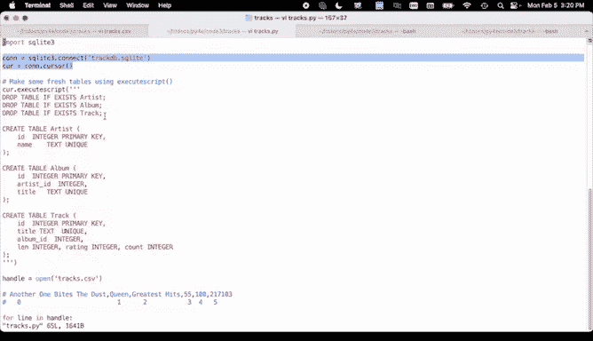


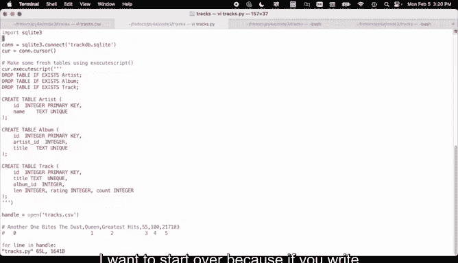

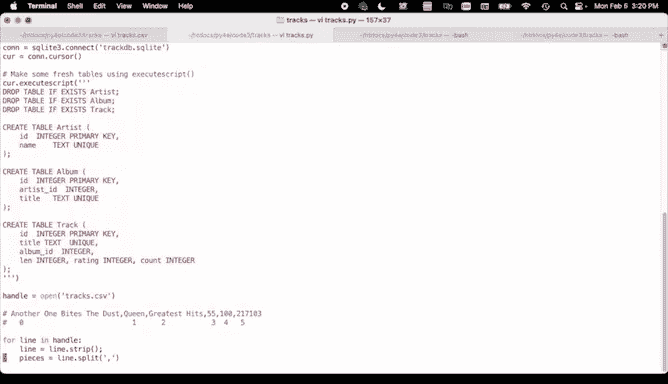

为了便于反复测试和修改代码，程序在开始时会删除所有已存在的表，然后重新创建它们。这样能确保每次运行时都从一个干净的状态开始。

以下是初始化数据库的代码逻辑：
```python
conn = sqlite3.connect('trackdb.sqlite')
cur = conn.cursor()

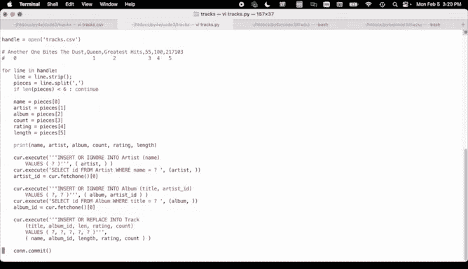

cur.execute('DROP TABLE IF EXISTS Artist')
cur.execute('DROP TABLE IF EXISTS Album')
cur.execute('DROP TABLE IF EXISTS Track')


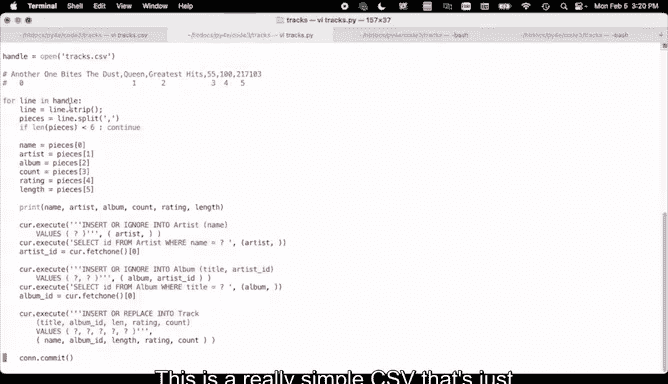

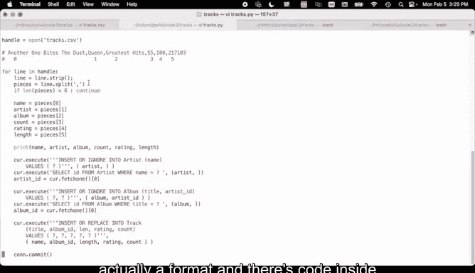

# 创建新表
cur.execute('''CREATE TABLE Artist (
    id  INTEGER NOT NULL PRIMARY KEY AUTOINCREMENT UNIQUE,
    name    TEXT UNIQUE
)''')
# ... 创建Album和Track表的语句
```

## 读取与解析CSV数据

上一节我们初始化了数据库，本节中我们来看看如何读取源数据。


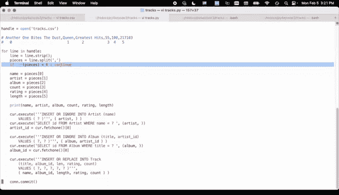

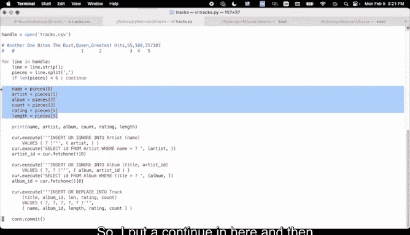

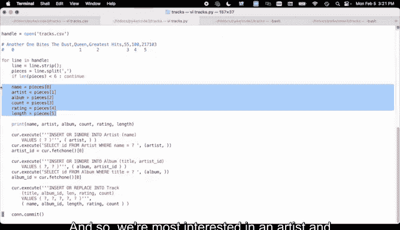

程序使用 `open()` 函数打开 `tracks.csv` 文件。这个CSV格式比较简单，没有复杂的转义规则，因此我们直接使用 `split(‘,’)` 方法按逗号分割每一行。

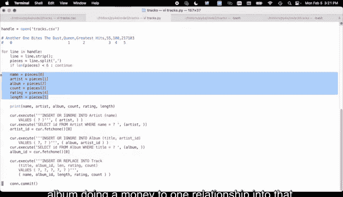

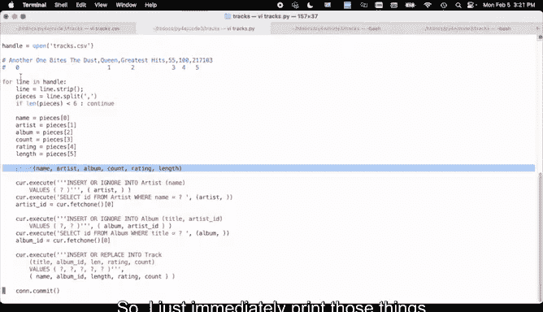

在读取过程中，程序会进行简单的错误检查。如果某一行分割后的字段数量少于6个，程序将跳过该行，继续处理下一行。

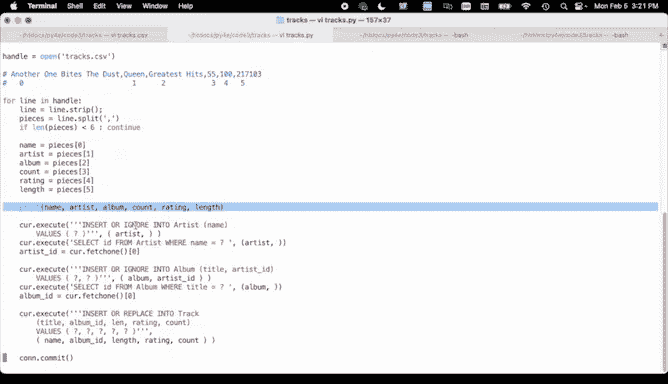

解析后，我们得到以下几个关键字段：歌曲名称（`name`）、艺术家（`artist`）、专辑（`album`）、播放次数（`count`）、评分（`rating`）和时长（`length`）。其中，我们最关心的是建立艺术家和专辑之间的一对多关系。

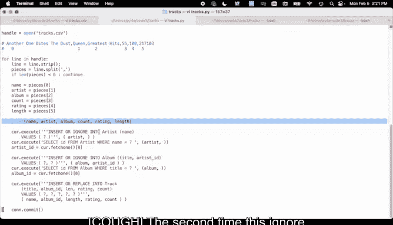

在开发初期，可以先打印出这些解析后的字段，以确认数据读取和解析是否正确。
```python
if len(pieces) < 6:
    continue

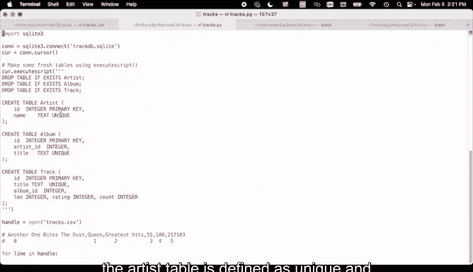

name = pieces[0]
artist = pieces[1]
album = pieces[2]
count = pieces[3]
rating = pieces[4]
length = pieces[5]

print(name, artist, album) # 用于调试
```

## 实现数据规范化插入

数据解析完成后，下一步是将它们插入到规范化的数据库表中。我们采取从“树的外围向内部”处理的策略，即先处理独立的实体（艺术家），再处理依赖实体（专辑），最后处理最具体的实体（歌曲）。

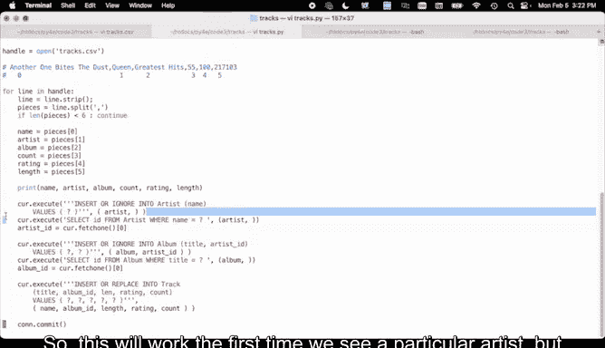

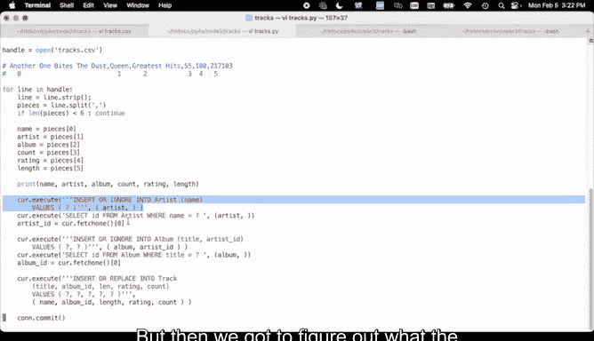

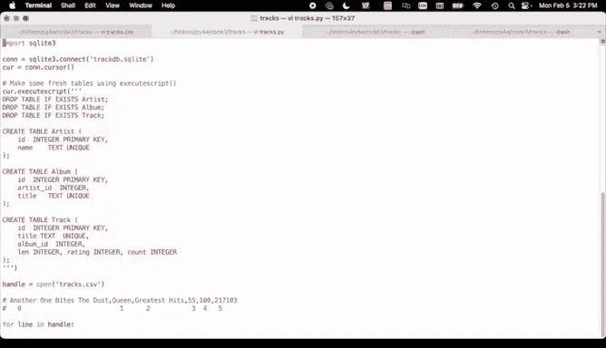

以下是插入数据的核心步骤：


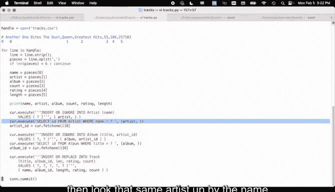

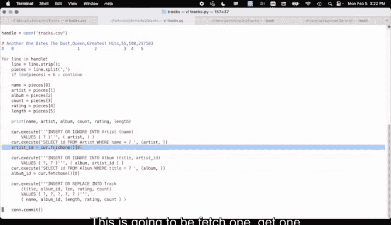

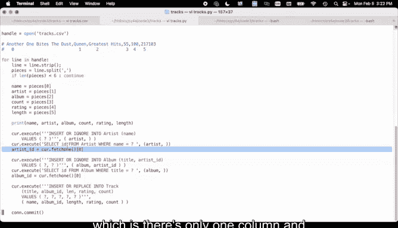

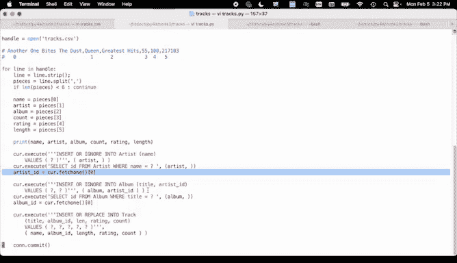

首先，处理艺术家。使用 `INSERT OR IGNORE` 语句向 `Artist` 表插入艺术家名字。由于 `name` 字段被定义为 `UNIQUE`，首次插入新艺术家会成功，后续遇到同名艺术家时该语句会被忽略，从而避免了重复。
```sql
INSERT OR IGNORE INTO Artist (name) VALUES ( ? )
```
插入后，我们需要获取该艺术家的自动生成的主键 `id`，供后续表使用。
```sql
SELECT id FROM Artist WHERE name = ?
```

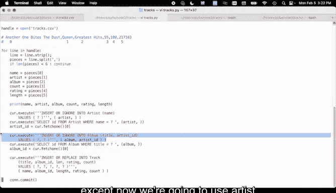

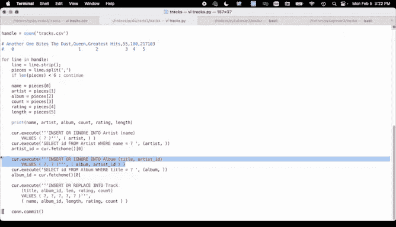

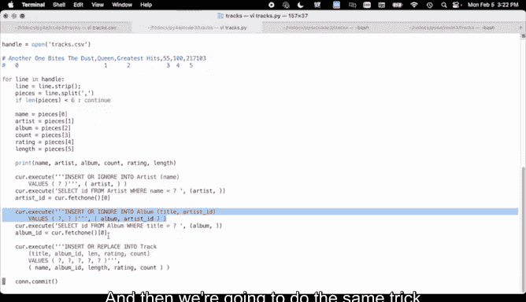

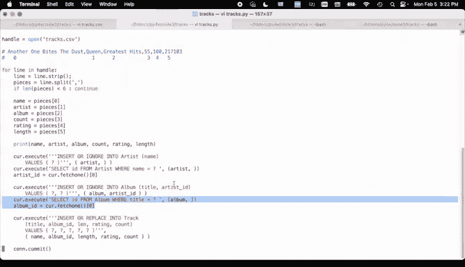

接着，处理专辑。专辑依赖于艺术家。我们使用获取到的 `artist_id` 和专辑标题，向 `Album` 表执行 `INSERT OR IGNORE`。同样，这里假设 (`title`, `artist_id`) 的组合是唯一的。
```sql
INSERT OR IGNORE INTO Album (title, artist_id) VALUES ( ?, ? )
```
然后，查询刚插入（或已存在）的专辑的主键 `id`。
```sql
SELECT id FROM Album WHERE title = ? AND artist_id = ?
```

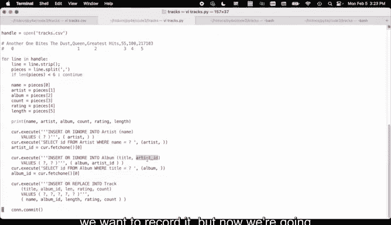


最后，处理歌曲。现在我们已经拥有了专辑的主键 `album_id`，以及歌曲的其他信息（名称、时长等），可以将它们插入到 `Track` 表中。
```sql
INSERT INTO Track (title, album_id, len, rating, count) VALUES ( ?, ?, ?, ?, ? )
```

在所有数据插入操作完成后，调用 `conn.commit()` 提交事务，将所有更改永久保存到数据库文件中。

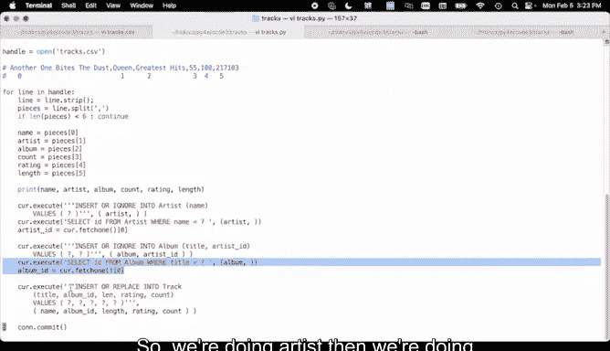

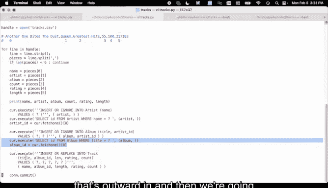

## 运行程序与验证结果

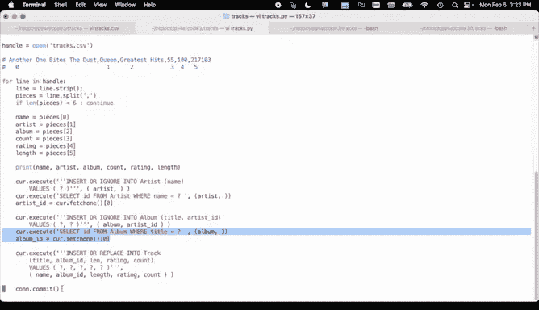


程序逻辑构建完成后，就可以运行它了。在命令行中执行：
```
python tracks.py
```
程序将打开CSV文件，循环处理每一行数据，并将规范化后的数据插入数据库。


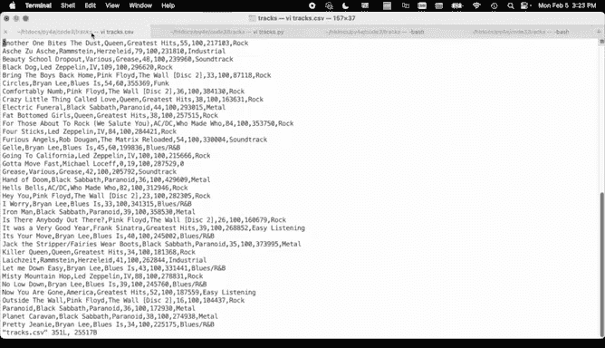

运行完毕后，我们可以检查生成的 `trackdb.sqlite` 数据库文件来验证结果。

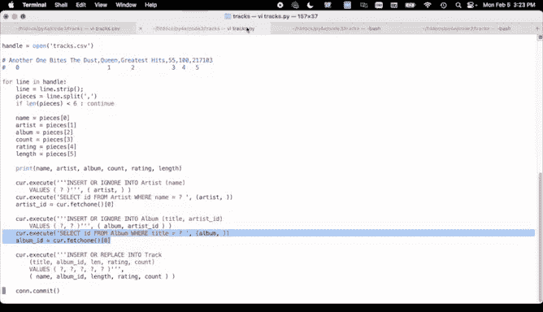

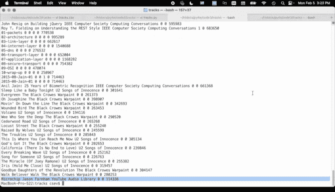


你可以使用命令行工具或图形化工具（如DB Browser for SQLite）来查看数据。以下是一些验证查询示例：


查看存在的表：
```sql
.tables
```


查看 `Artist` 表的前10条记录，确认每个艺术家只出现一次：
```sql
SELECT * FROM Artist LIMIT 10;
```

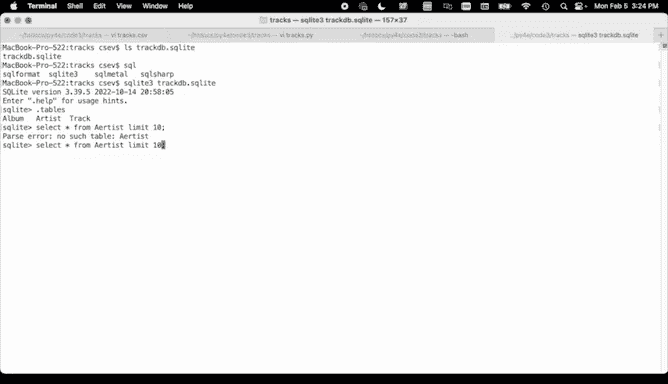

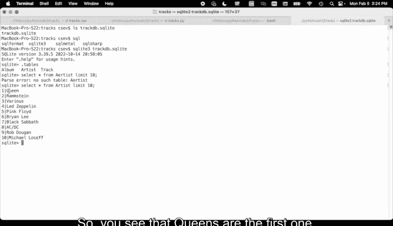

查找特定艺术家（如“Queen”）的记录，确认只有一条：
```sql
SELECT * FROM Artist WHERE name = ‘Queen’;
```

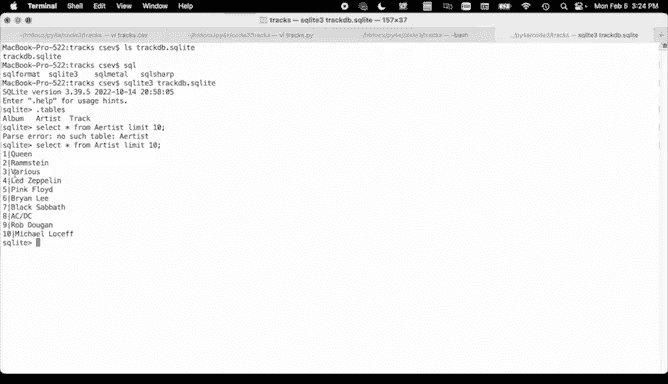

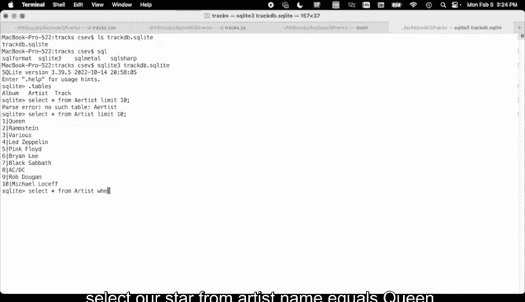

查看 `Track` 表的前10条记录，观察它们如何通过 `album_id` 与专辑关联：
```sql
SELECT * FROM Track LIMIT 10;
```

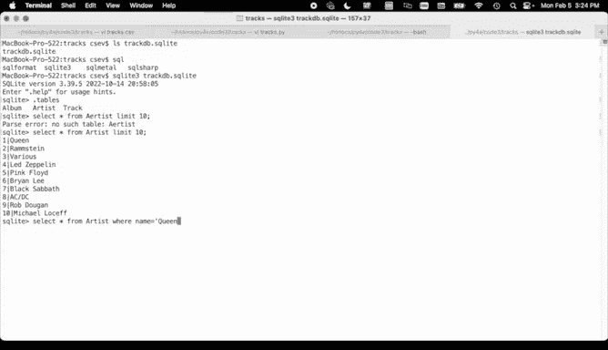

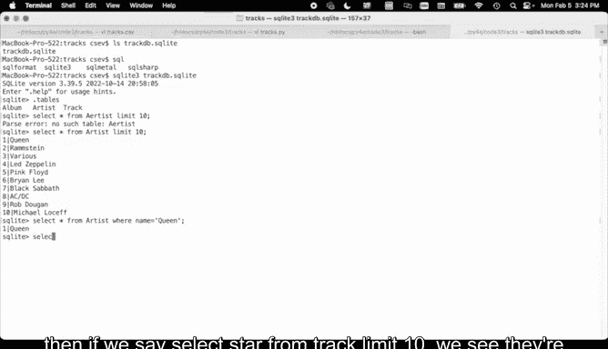

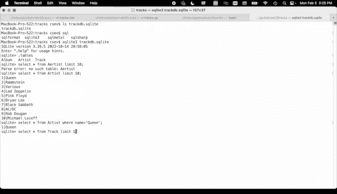

通过图形化工具打开数据库，可以更直观地浏览 `Artist`、`Album`、`Track` 表之间的关系和数据，确认外键约束和数据的完整性。

## 总结


本节课中我们一起学习了一个完整的数据库应用实例 `tracks.py` 程序。


我们首先准备了CSV格式的源数据，然后初始化了一个SQLite数据库，并建立了 `Artist`、`Album`、`Track` 三个具有关联关系的表。

通过逐行读取和解析CSV文件，我们实现了从“外围到内部”的数据插入策略：先确保艺术家唯一，再关联专辑，最后插入歌曲详情。在这个过程中，我们巧妙地运用了 `INSERT OR IGNORE` 和 `SELECT` 语句来获取外键ID，从而构建起规范化的数据关系。

最后，我们运行程序并验证了数据库中的结果，确保数据被正确、无冗余地存储。这个示例清晰地展示了如何使用Python和SQLite处理真实数据，并将其转化为结构良好、易于查询的数据库形式。