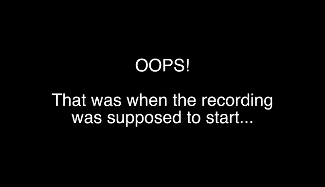

# 每个人的 Python 第四部分 26：巴塞罗那附加办公时间 🎥

在本节课中，我们将回顾课程讲师查克·塞弗伦斯博士在巴塞罗那举行的第二次附加办公时间。本次办公时间旨在与学生面对面交流，分享学习体验。

---

## 课程概述

本节是课程第四部分《使用数据库进行Python编程》中的一次特别录制的办公时间。由于第一次办公时间的视频丢失，讲师在巴塞罗那的另一天补办了这次会议。一些同学参加了两次会议，同时也有许多新同学加入。

## 与会学生介绍

以下是参与本次巴塞罗那办公时间的同学们，他们分享了各自的学习背景和体验。

*   **Ia**：计划开始学习互联网历史课程，并认为Python比其更有趣。
*   **（另一位同学）**：正在学习Python课程。
*   **Christina**：是一名语言学家，正在鼓励性地学习Python。
*   **（另一位同学）**：正在学习Python，并表示感谢。
*   **Marha**：正在学习Python课程，认为它非常有趣，并极力推荐给所有人。
*   **Sean**：有幸见到了查克博士，并认为所有同学都会羡慕他们与老师共度的有趣时光。
*   **Teresa**：非常享受Python课程，并认为通过它可以学到很多。

## 会议总结

本次巴塞罗那办公时间在轻松愉快的氛围中成功举行。讲师查克·塞弗伦斯博士与这些优秀的学生们进行了交流。会议最后，大家共同举杯致意，期待下一次相见。

---

本节课中，我们一起回顾了在巴塞罗那举行的附加办公时间，聆听了来自世界各地的同学们学习Python的体验与感想。这种交流体现了编程学习的社区精神和乐趣。