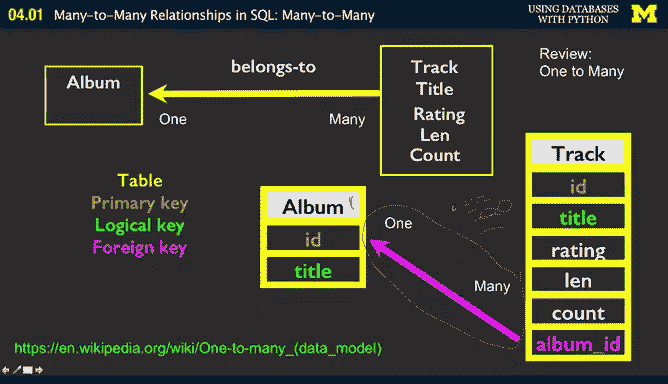
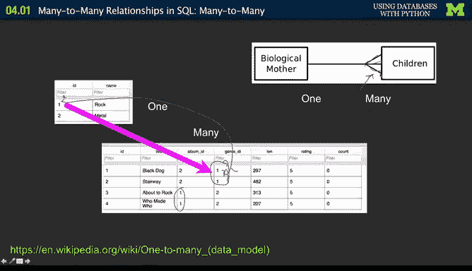
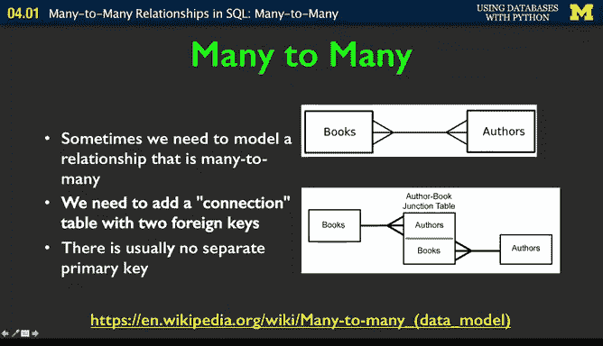
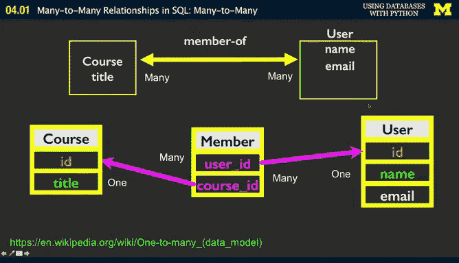
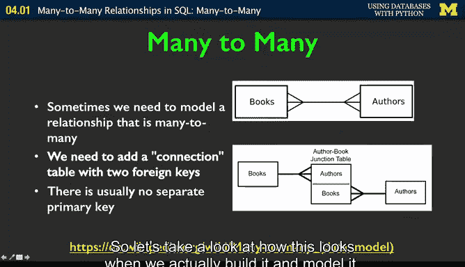
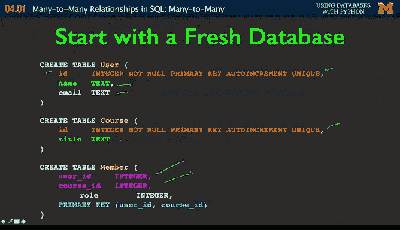

# 4：《使用数据库进行Python编程》｜ P27：多对多关系 👥➡️👥


## 概述



在本节课中，我们将要学习数据库建模中的一个核心概念：**多对多关系**。我们已经了解了外键、JOIN操作和数据规范化，现在需要掌握如何建模那些无法用简单的一对多关系描述的数据关联。



## 从一对多到多对多

上一节我们介绍了如何使用外键和JOIN来建立一对多关系。例如，一个专辑可以包含多首曲目，这通过在外键所在的“多”的一方（曲目表）中引用“一”的一方（专辑表）来实现。这种关系在数据模型图中通常用“乌鸦脚”符号表示。

**一对多关系示例：**
*   一个专辑（一）对应多首曲目（多）。
*   一位亲生母亲（一）对应多个孩子（多）。

然而，有些数据关系是双向的“多”。例如，在我们的音乐数据中，一个专辑可能有多位艺术家，同时一位艺术家也可能参与多个专辑。这就是**多对多关系**。

## 理解多对多关系







一个经典的例子是书籍和作者的关系：
*   一位作者可能撰写多本书籍。
*   一本书籍可能由多位作者合著。

我们无法在任意一方的表中放置一个单一的外键来指向另一方，因为那会将其限制为“一”的关系。为了解决这个问题，我们需要引入一个**中间表**（也称为连接表或关联表）。

## 构建中间表

我们将一个多对多关系分解为两个一对多关系。具体做法是创建一个新的中间表，这个表只负责记录两个实体之间的连接。

**中间表的核心结构：**
*   包含两个外键，分别指向两个相关表的主键。
*   通常没有独立的自增主键，而是将这两个外键的组合作为**复合主键**，以确保每条连接记录的唯一性。
*   有时可以在中间表中添加额外的属性来描述这种关系（例如，角色、加入日期等）。

### 实践：课程与用户模型



让我们通过一个“课程-用户”成员关系的例子来具体操作。一个用户可以注册多门课程，一门课程也可以包含多个用户。

以下是创建相关表的SQL代码：

```sql
-- 创建用户表
CREATE TABLE User (
    id     INTEGER NOT NULL PRIMARY KEY AUTOINCREMENT UNIQUE,
    name   TEXT UNIQUE,
    email  TEXT
);

-- 创建课程表
CREATE TABLE Course (
    id     INTEGER NOT NULL PRIMARY KEY AUTOINCREMENT UNIQUE,
    title  TEXT UNIQUE
);

-- 创建中间表：成员关系表
CREATE TABLE Member (
    user_id     INTEGER,
    course_id   INTEGER,
    role        INTEGER,
    PRIMARY KEY (user_id, course_id) -- 复合主键
);
```

在`Member`表中：
*   `user_id` 是引用 `User.id` 的外键。
*   `course_id` 是引用 `Course.id` 的外键。
*   `role` 字段用于描述用户在该课程中的角色（例如，1代表教师，0代表学生）。
*   `PRIMARY KEY (user_id, course_id)` 确保同一个用户不能在同一个课程中重复注册。

## 插入与查询数据

创建表后，我们需要插入数据并建立连接。

以下是插入示例数据的步骤：

1.  首先，插入用户和课程记录，数据库会自动生成ID。
2.  然后，在`Member`表中插入行，使用已知的用户ID和课程ID来建立关联，并指定角色。

```sql
-- 插入用户
INSERT INTO User (name, email) VALUES ('Jane', 'jane@tsugi.org');
INSERT INTO User (name, email) VALUES ('Ed', 'ed@tsugi.org');
INSERT INTO User (name, email) VALUES ('Sue', 'sue@tsugi.org');

-- 插入课程
INSERT INTO Course (title) VALUES ('Python');
INSERT INTO Course (title) VALUES ('SQL');
INSERT INTO Course (title) VALUES ('PHP');

-- 在Member表中建立关联 (假设ID已知)
INSERT INTO Member (user_id, course_id, role) VALUES (1, 1, 1); -- Jane 是 Python 课的教师
INSERT INTO Member (user_id, course_id, role) VALUES (2, 1, 0); -- Ed 是 Python 课的学生
INSERT INTO Member (user_id, course_id, role) VALUES (3, 1, 0); -- Sue 是 Python 课的学生
INSERT INTO Member (user_id, course_id, role) VALUES (1, 2, 0); -- Jane 是 SQL 课的学生
INSERT INTO Member (user_id, course_id, role) VALUES (2, 2, 1); -- Ed 是 SQL 课的教师
-- ... 可以继续添加其他关联
```

现在，我们可以使用JOIN操作从多个表中提取有意义的信息。


以下是一个查询示例，用于获取课程成员列表，并按课程、角色和用户名排序：

```sql
SELECT User.name, Member.role, Course.title
FROM User
JOIN Member ON Member.user_id = User.id
JOIN Course ON Member.course_id = Course.id
ORDER BY Course.title, Member.role DESC, User.name;
```

这个查询会：
*   将用户、成员关系和课程表连接起来。
*   结果首先按课程标题排序。
*   在同一课程内，按角色降序排列（教师在前，学生在后）。
*   角色相同则按用户名排序。

## 为何需要规范化与多对多关系

你可能会问，为什么要进行如此复杂的规范化设计，使用整数ID和多个表？核心原因在于**性能**和**数据完整性**。

对于小规模数据，简单的平面文件或许足够。但当数据量增长到一定程度（例如构建在线应用或进行大规模数据分析）时，不规范的数据结构会导致：
*   **数据冗余**：浪费存储空间。
*   **更新异常**：修改一处数据可能需要更新多处，容易出错。
*   **查询缓慢**：需要扫描大量重复数据。

数据库的规范化设计，包括使用多对多关系，正是为了解决这些问题。它通过消除冗余、建立清晰的关联来确保数据一致性，并利用索引等机制实现高效查询。

## 总结

本节课中我们一起学习了：
1.  **多对多关系**的概念，它描述了数据间双向的“多”对“多”的关联。
2.  如何使用**中间表**（连接表）来分解多对多关系，将其转化为两个一对多关系。
3.  中间表包含两个**外键**，并常使用**复合主键**来保证连接的唯一性。
4.  如何在中间表中存储关系的附加属性（如`role`）。
5.  通过**JOIN**操作，可以跨用户表、课程表和成员表进行复杂查询。
6.  数据库规范化和这种建模方式的根本目的是为了保障**数据完整性**和提升大规模数据操作时的**性能**。

这只是SQL和数据库设计的入门。还有许多高级主题值得探索，例如**索引**（加速查询）、**约束**（保证数据质量）和**事务**（保证操作原子性）。掌握这些基础知识，将为你未来构建高效、可靠的应用程序打下坚实的基础。