# 4：《使用数据库进行Python编程》｜ P28：28_04_02_实战示例：roster.py程序 📝

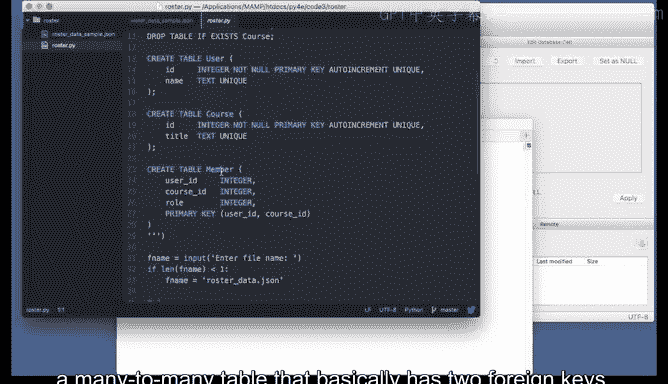

在本节课中，我们将学习如何通过一个名为 `roster.py` 的实战程序，在Python中实现数据库的“多对多”关系。我们将重点理解如何使用连接表、主键、外键以及一些关键的SQLite操作技巧来管理用户和课程之间的复杂关系。

## 概述 📋

我们将创建一个数据库，其中包含三个表：`User`（用户）、`Course`（课程）和 `Member`（成员）。`Member` 表是一个连接表，用于建立用户和课程之间的“多对多”关系。这意味着一个用户可以注册多门课程，一门课程也可以有多个用户。我们将使用SQLite数据库，并通过Python的 `sqlite3` 模块来操作它。

## 数据库设计 🗄️

上一节我们介绍了“多对多”关系的基本概念，本节中我们来看看如何具体设计数据库表。

我们将创建三个表：
*   `User` 表：存储用户信息。
*   `Course` 表：存储课程信息。
*   `Member` 表：作为连接表，记录哪个用户加入了哪门课程。

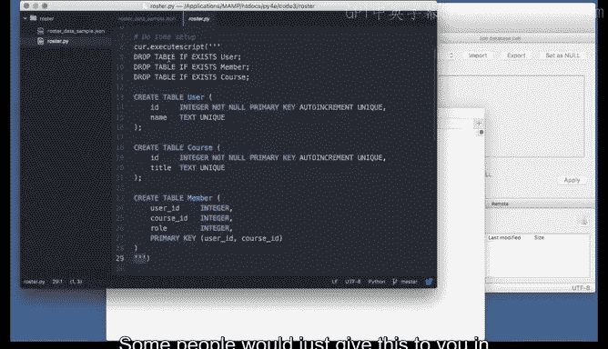

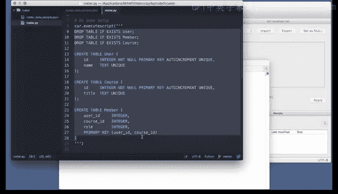


以下是各表的核心结构：

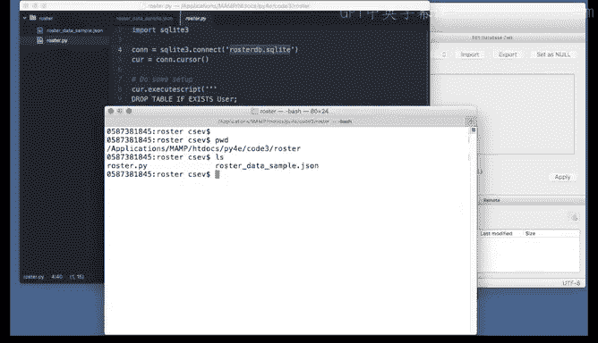

**User 表**
```sql
CREATE TABLE User (
    id     INTEGER NOT NULL PRIMARY KEY AUTOINCREMENT UNIQUE,
    name   TEXT UNIQUE
);
```
*   `id` 是主键，使用 `INTEGER PRIMARY KEY AUTOINCREMENT UNIQUE` 实现自动递增。
*   `name` 是逻辑键，并标记为 `UNIQUE`，确保用户名不重复。

**Course 表**
```sql
CREATE TABLE Course (
    id     INTEGER NOT NULL PRIMARY KEY AUTOINCREMENT UNIQUE,
    title  TEXT UNIQUE
);
```
*   结构与 `User` 表类似，`id` 是自增主键，`title` 是唯一的课程标题。

**Member 表**
```sql
CREATE TABLE Member (
    user_id     INTEGER,
    course_id   INTEGER,
    role        INTEGER,
    PRIMARY KEY (user_id, course_id)
);
```
*   `user_id` 和 `course_id` 分别是指向 `User.id` 和 `Course.id` 的外键。
*   `PRIMARY KEY (user_id, course_id)` 定义了一个**复合主键**，确保同一个用户和同一门课程的组合在表中只出现一次。这防止了用户重复注册同一门课程。

## 程序初始化与数据准备 ⚙️

程序开始时，需要导入必要的库并连接到数据库。

我们使用 `json` 库来读取包含名册数据的JSON文件，使用 `sqlite3` 库来操作数据库。`cursor` 对象类似于文件句柄，我们通过它向数据库服务器发送SQL命令并获取返回的数据。

以下是初始化步骤的代码：
```python
import json
import sqlite3

conn = sqlite3.connect('rosterdb.sqlite')
cur = conn.cursor()
```

为了确保每次运行都能从一个干净的状态开始，程序会先删除已存在的表（如果它们存在），然后重新创建它们。这通过执行一个包含多个 `DROP TABLE` 和 `CREATE TABLE` 语句的长SQL脚本实现。


## 核心逻辑：插入与关联数据 🔄

这是程序最核心的部分，我们遍历JSON数据，将用户和课程信息插入数据库，并在 `Member` 表中建立关联。

我们从 `roster_data_sample.json` 文件中加载数据。该文件是一个数组，其每个元素也是一个数组，结构为 `[姓名， 课程标题， 身份]`。

以下是处理每条记录的核心步骤：

1.  **插入或忽略用户**：我们尝试将用户名插入 `User` 表。使用 `INSERT OR IGNORE` 语句。如果用户名已存在（由于 `UNIQUE` 约束），`IGNORE` 会忽略此次插入，避免报错；如果不存在，则创建新记录。这是一种确保数据唯一性的巧妙方法。
    ```python
    cur.execute('''INSERT OR IGNORE INTO User (name) VALUES ( ? )''', (name, ))
    ```

2.  **获取用户ID**：插入后（无论是新插入还是已存在），我们需要获取该用户对应的 `id`（主键）。我们通过查询来获得。
    ```python
    cur.execute('SELECT id FROM User WHERE name = ? ', (name, ))
    user_id = cur.fetchone()[0]
    ```
    `fetchone()` 返回一个元组，`[0]` 用于获取元组中的第一个元素，即 `id`。

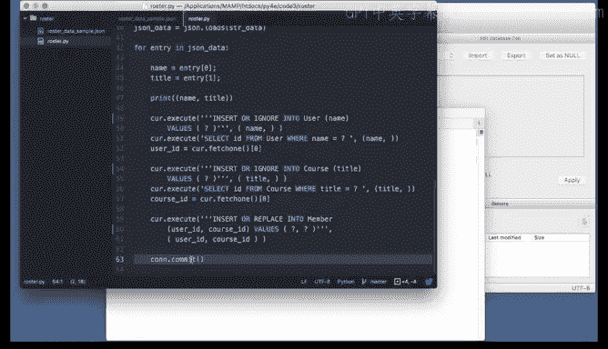

3.  **插入或忽略课程并获取课程ID**：对课程标题 `title` 重复步骤1和2，确保课程唯一并获取其 `course_id`。

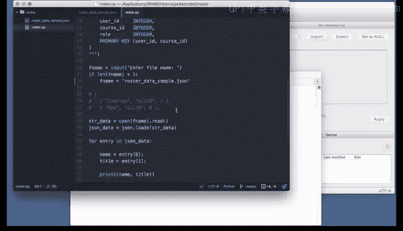

4.  **插入或替换成员关系**：现在，我们有了 `user_id` 和 `course_id`。我们将它们插入 `Member` 表。这里使用 `INSERT OR REPLACE`。由于 `(user_id, course_id)` 是复合主键，如果该组合已存在，`REPLACE` 会更新该行（在本例中，可能用于更新`role`字段）；如果不存在，则插入新行。
    ```python
    cur.execute('''INSERT OR REPLACE INTO Member (user_id, course_id) VALUES ( ?, ? )''', (user_id, course_id))
    ```


5.  **提交事务**：在所有数据操作完成后，我们调用 `conn.commit()` 将更改永久保存到磁盘。为了提高性能，也可以选择在循环外一次性提交，而不是每次插入后都提交。

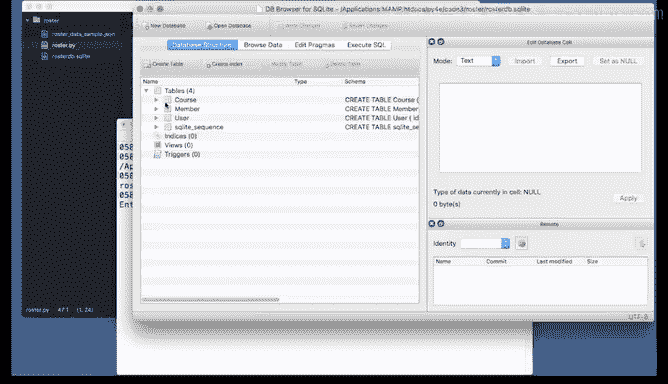

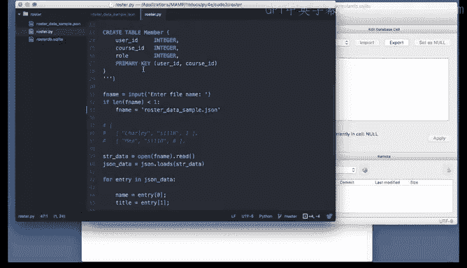

## 运行与验证 🚀

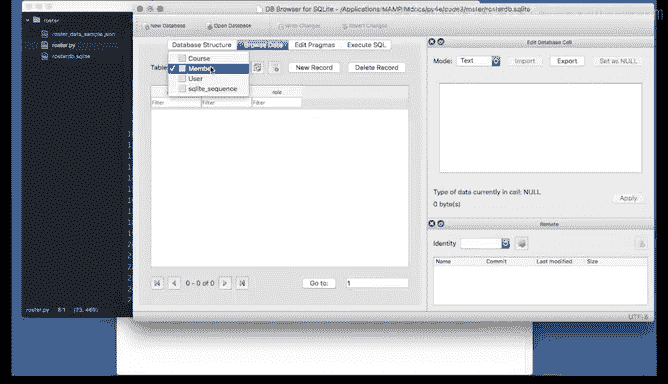

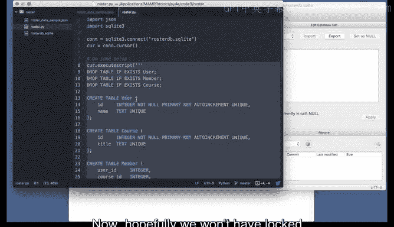

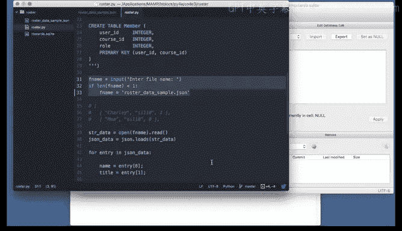

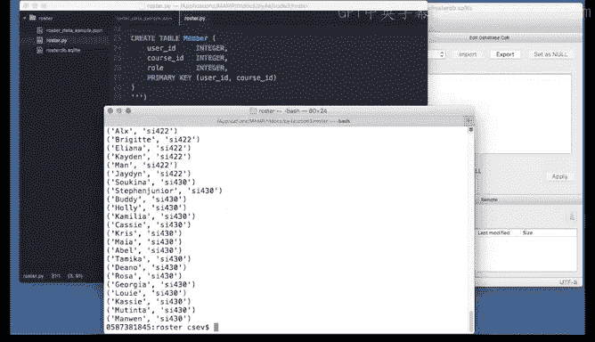

当运行程序 `python3 roster.py` 后，它会快速处理JSON文件中的所有条目。程序运行过程中，会打印出正在处理的姓名和课程标题。

运行完毕后，可以使用SQLite浏览器打开生成的 `rosterdb.sqlite` 文件进行验证。你会看到：
*   `User` 表：包含了所有唯一的用户及其自动分配的 `id`。
*   `Course` 表：包含了所有唯一的课程及其自动分配的 `id`。
*   `Member` 表：包含了 `user_id` 和 `course_id` 的组合，清晰地记录了所有成员关系。

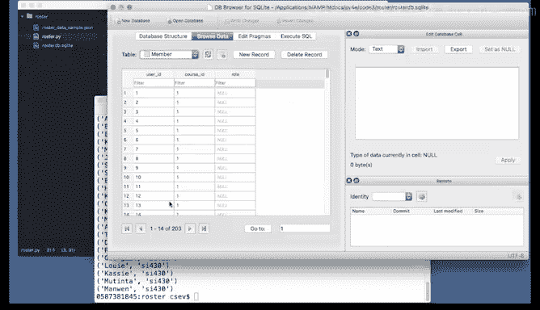

## 总结 📝

本节课中我们一起学习了如何构建一个管理“多对多”关系的Python数据库程序。我们掌握了几个关键技巧：
*   使用 **`UNIQUE` 约束** 和 **`INSERT OR IGNORE`** 语句来优雅地处理逻辑键的唯一性。
*   利用 **`AUTOINCREMENT` 主键** 和随后的 **`SELECT` 查询** 来获取新插入或已存在记录的ID。
*   通过 **复合主键 `PRIMARY KEY (user_id, course_id)`** 来维护连接表数据的完整性。
*   使用 **`INSERT OR REPLACE`** 来插入或更新连接表中的记录。

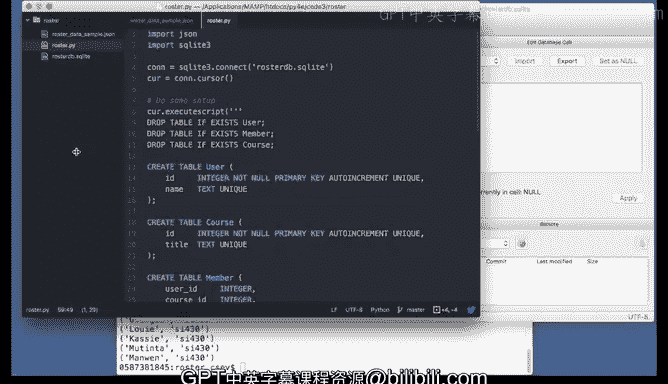

这个 `roster.py` 程序提供了一个清晰的模板，你可以在此基础上扩展，例如加入并完善 `role`（身份）字段的处理，或者编写复杂的 `JOIN` 查询来生成更有用的报表。希望这个示例能帮助你理解和创建自己的多对多数据模型。