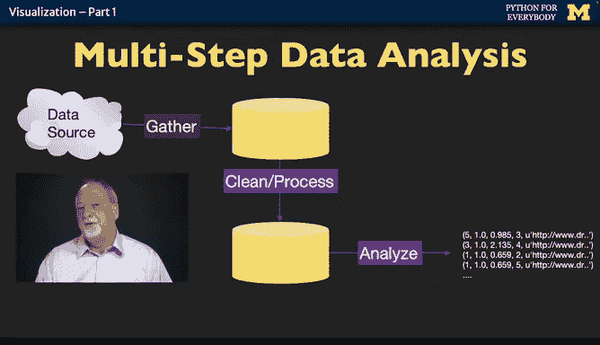
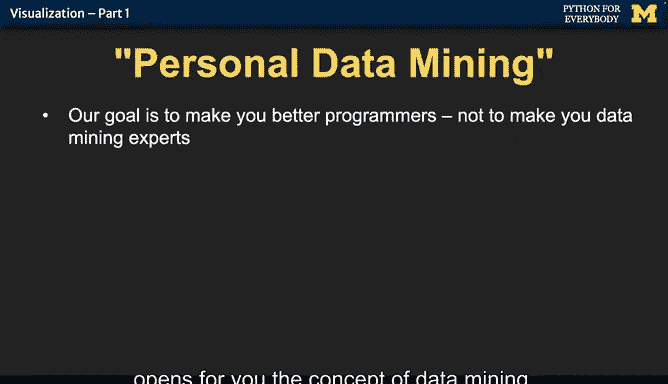

# 密歇根大学《给所有人的Python课》课程4：《使用数据库进行Python编程》｜P31：地理编码技术 🌍

在本节课中，我们将学习如何将之前学到的知识整合起来，构建一个多步骤的数据分析流程。我们将从不同来源检索数据，并进行可视化。这并非要将你培养成世界顶级的数据可视化专家，而是通过一些有趣的示例，向你展示可以实现的效果。

## 多步骤数据分析流程概述

到目前为止，我们运行Python程序时，通常是检索数据、进行解析，然后程序结束，数据被丢弃。但这种方法存在一些问题：如果需要从有速率限制的API检索海量数据，或者在处理过程中网络中断、电脑休眠，整个流程就会中断。

因此，我们需要一个可恢复的流程。一个有效的方法是将流程分为两个完全独立的阶段。

### 第一阶段：原始数据采集

这个阶段的核心是建立一个可恢复的数据采集过程。程序会访问数据源，遍历数据，但**不**进行复杂的清洗或解析。它只做一件事：将原始数据从互联网获取并存储到本地或云端的数据库中。

这个过程会记录哪些数据已获取，哪些尚未获取。例如，在网页爬虫中，你可能先获取一些页面，从中发现新链接，再获取新页面。这个采集过程是“可恢复的”，即使中断，重启后也能从断点继续，避免重复工作。

### 第二阶段：数据清洗与分析

当原始数据采集完成后（这个过程可能耗时数天），我们进入清洗和处理阶段。由于数据已存储在本地计算机上，这个阶段的Python程序可以运行得非常快。你可以进行数据清洗、解析、检查，甚至标记出需要重新采集的“坏数据”。

清洗完成后，数据被存入另一个“干净”的数据库。接着，在第三个独立的进程中，你可以对干净数据进行分析，例如使用字典、生成直方图，或者编写可视化代码。在本课的示例中，我们将对清洗后的数据进行地理编码，并在地图上进行可视化。

需要说明的是，这并非专业级的数据挖掘流程。在工业界，有各种可扩展的成熟工具来完成数据采集、存储等任务。但通过亲手实现整个过程，你能深入理解其核心原理。这样，当你未来使用更专业、更复杂的工具时，就能明白它在做什么，即使它出现问题，你也能知道问题出在哪里。

本节课的重点是软件工程实践，而非数据挖掘的最佳实践。它为你打开了数据挖掘概念的大门。

## 地理编码实践

接下来，我们将进行地理编码数据的实践。地理编码非常有趣，它能将任何地址转换为地图上的一个坐标点。这也是本节课的作业：你需要在地图上正确放置一个属于自己的标记点，而不是直接使用我的标记或截图。

我们将使用OpenStreetMap的代理地理API（geoAPI）来避免速率限制问题。流程是：先将数据获取并存入本地数据库（这是一个可恢复的过程），然后在浏览器中进行可视化。这种两阶段流程的好处是，你可以先获取几百条数据，然后立即开始可视化实验，无需等待所有数据抓取完毕。

以下是实现此流程的核心代码文件及其作用：

*   **`where.data`**: 这是一个文本文件，包含需要查询地理编码的位置列表。你的作业就是在此文件中添加一个你自己的位置条目。
*   **`geoload.py`**: 这是数据采集程序。它会读取 `where.data` 文件中的位置列表，查询地理编码API，并将原始结果（JSON格式）存储到名为 `geodata.sqlite` 的SQLite数据库中。这个程序是**可恢复**的，如果中断，重启后会检查数据库，跳过已获取的位置。
*   **`geodump.py`**: 这是数据清洗与导出程序。它会读取 `geodata.sqlite` 数据库，解析其中的JSON数据，提取出我们需要的信息（如地址、经纬度），并做两件事：
    1.  在屏幕上打印出已查询的位置信息。
    2.  将位置数据（特别是经纬度坐标）写入一个JavaScript数组文件 `where.js`。
*   **`where.html`**: 这是一个HTML网页文件。它会加载 `where.js` 文件中的数据，并使用OpenStreetMap的Leaflet库在地图上绘制标记点。你添加到 `where.data` 中的位置对应的标记点也会出现在地图上。

整个流程可以概括为：**修改 `where.data` -> 运行 `geoload.py`（采集） -> 运行 `geodump.py`（清洗导出） -> 打开 `where.html`（可视化）**。

你可以通过修改 `where.data` 文件，轻松地将此流程应用于任何你想进行地理编码和可视化的地点列表。这是对你之前所有辛勤工作的回报，最终你将得到一幅真实而美观的地图。

## 总结

本节课中，我们一起学习了如何整合之前学到的网络数据访问技能，构建了一个完整的、可恢复的多步骤数据分析应用。我们回顾了从URL检索数据、解析JSON和HTML等核心技能，并将它们应用于一个具体的地理编码可视化项目中。

这只是一个开始，你可以沿着这个方向进行更多探索和拓展，其乐无穷。