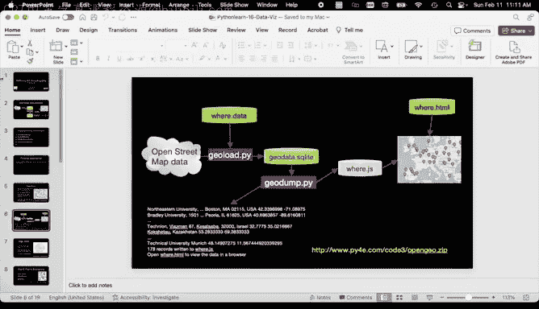
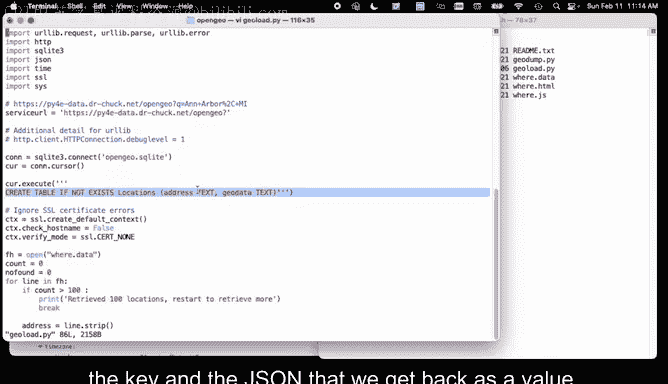
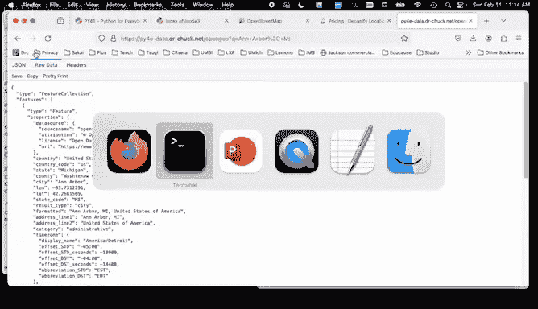
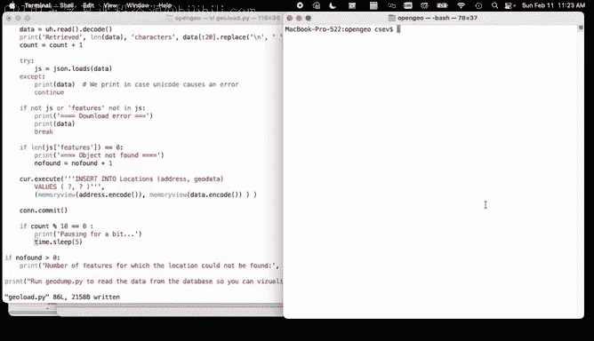
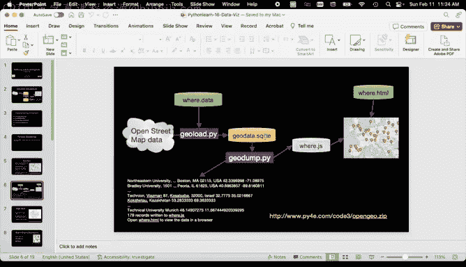
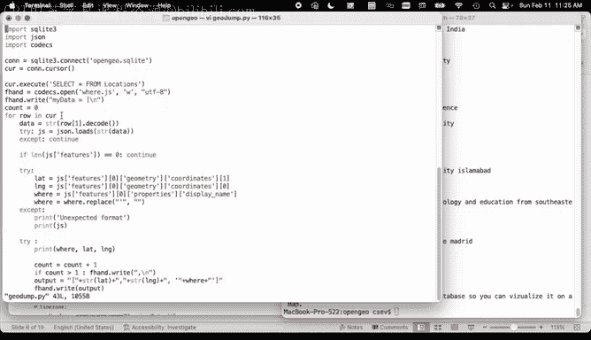

# 每个人的 Python 第四部分 32：实战示例：地理数据处理 🌍

## 概述

在本节课中，我们将学习如何构建一个可重启的地理数据处理流程。我们将编写一个Python程序，从一个API获取地理位置数据，将其存储到SQLite数据库中，并最终将数据可视化在地图上。整个过程被设计为可中断和可恢复的，这对于处理速度慢或不稳定的API非常有用。



## 项目结构与流程

上一节我们介绍了数据库编程的基本概念，本节中我们来看看如何将其应用于一个真实的地理数据处理项目。

整个项目流程分为两个主要阶段：
1.  **数据获取与存储 (`geoload.py`)**: 从一个代理API获取OpenStreetMap的地理编码数据，并将其存入SQLite数据库。这个过程是可重启的。
2.  **数据提取与可视化 (`geodump.py`)**: 从数据库中读取数据，提取经纬度和地点名称，生成一个供网页地图使用的JavaScript文件。

以下是项目包含的核心文件列表：
*   `geoload.py`: 负责从网络API获取数据并存入数据库。
*   `geodata.sqlite`: SQLite数据库文件，用于存储获取到的原始JSON数据。
*   `where.data`: 文本文件，包含所有需要查询的地理位置列表。
*   `geodump.py`: 负责从数据库读取数据并生成可视化所需文件。
*   `where.js`: 由`geodump.py`生成的JavaScript数据文件。
*   `where.html`: 一个HTML网页，用于加载`where.js`中的数据并在地图上可视化显示。

## 第一阶段：可重启的数据获取 (`geoload.py`)





这个阶段的目标是可靠地获取数据。我们使用一个代理API来简化访问，但该API有严格的速率限制，因此我们的代码必须能够处理中断并从断点恢复。

### 核心逻辑与代码

程序的核心思想是将查询地址作为键（Key），将API返回的完整JSON数据作为值（Value）存入数据库。这样，在程序重新启动时，可以先检查数据库中是否已存在某个地址的数据，从而避免重复请求。

以下是建立数据库连接和创建表的代码：
```python
import sqlite3
conn = sqlite3.connect(‘geodata.sqlite‘)
cur = conn.cursor()

cur.execute(‘‘‘
CREATE TABLE IF NOT EXISTS Locations (address TEXT, geodata TEXT)
‘‘‘)
```

程序的主要工作流程如下：
1.  读取`where.data`文件，获取待查询地址列表。
2.  遍历每个地址，检查它是否已存在于`Locations`表中。
3.  如果地址不存在，则构造URL向API发起请求。
    *   使用`urllib.parse.urlencode()`对地址进行正确的URL编码。
    *   示例：`‘Ann Arbor, MI‘` 被编码为 `‘q=Ann+Arbor%2C+MI‘`。
4.  获取返回的JSON数据，解码并解析。
5.  将地址和对应的JSON数据作为一条记录插入数据库。
6.  每次运行最多处理100个新地址，并在请求间暂停（例如5秒），以遵守API的速率限制。
7.  如果程序在任何时候被中断（如网络错误、手动停止），重新运行它会自动跳过已获取的数据，继续处理剩余部分。

## 第二阶段：数据提取与可视化 (`geodump.py`)

在数据成功获取并存入数据库后，我们需要将其转换为可可视化的格式。`geodump.py`脚本负责这项工作。

### 核心逻辑与代码

这个脚本读取数据库中的每一条记录，解析存储的JSON字符串，提取出我们关心的信息：经度、纬度和地点名称。

从JSON中提取经纬度的关键代码如下：
```python
import json
js = json.loads(geodata_str) # geodata_str是从数据库读取的JSON字符串

# 每个人的 Python 第四部分 假设返回的JSON结构包含一个‘features‘数组
if ‘features‘ in js and len(js[‘features‘]) > 0:
    lon = js[‘features‘][0][‘geometry‘][‘coordinates‘][0]
    lat = js[‘features‘][0][‘geometry‘][‘coordinates‘][1]
    name = js[‘features‘][0][‘properties‘].get(‘display_name‘, ‘N/A‘)
```



程序的工作流程如下：
1.  打开同一个SQLite数据库 (`geodata.sqlite`)。
2.  执行SQL查询，读取`Locations`表中的所有记录。
3.  对每条记录，使用`json.loads()`解析`geodata`字段。
4.  从解析后的JSON对象中导航到正确的位置，提取经度(`longitude`)、纬度(`latitude`)和显示名称。
5.  将这些信息写入`where.js`文件，格式为一个JavaScript数组，方便网页直接使用。
6.  同时，在控制台打印出提取的数据以供调试。

生成的`where.js`文件内容大致如下：
```javascript
var myData = [
[ -83.047, 42.281, “University of Michigan, Ann Arbor, MI“ ],
[ -83.046, 42.282, “Jamaican Jerk Pit, Ann Arbor, MI“ ],
// ... 更多数据点
];
```



## 可视化结果

最后，我们使用`where.html`文件来展示结果。这个HTML文件不涉及复杂的Python编程，它利用开源的OpenLayers或Leaflet等地图库（具体取决于提供的文件），加载`where.js`中定义的数据数组`myData`，并将每个地点作为图钉（Marker）标注在地图上。点击图钉可以显示地点的名称。

通过浏览器打开`where.html`，你就能看到一个交互式地图，上面标记了所有从`where.data`文件中查询到的地理位置。



## 总结

本节课中我们一起学习并实现了一个完整的、基于数据库的Python地理数据处理项目。我们掌握了以下关键技能：
*   构建**可重启、容错的数据采集流程**，通过将中间状态持久化到SQLite数据库来实现。
*   使用`urllib`库与网络API交互，并处理URL编码和JSON数据解析。
*   编写从数据库读取数据、处理嵌套JSON结构并生成新数据文件（`where.js`）的脚本。
*   理解了一个将后端数据获取与前端地图可视化结合起来的简单工作流。

这个项目演示了如何将数据库作为“记忆”单元，使长时间运行或可能失败的任务变得健壮和高效，这是数据处理中一个非常重要的模式。