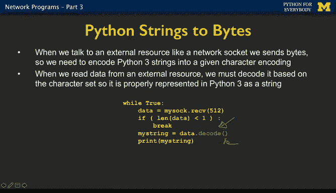
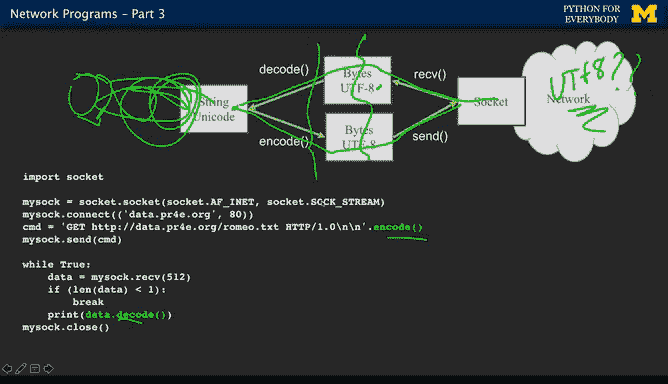

# 密歇根大学《给所有人的Python课》课程5：《毕业项目：使用Python检索、处理和可视化数据》｜python-data-visualization｜ - P2：02_01_02_Unicode字符与字符串 📚


## 概述

在本节课中，我们将要学习计算机如何表示文本字符，特别是从简单的ASCII编码到复杂的Unicode编码的演变。我们将理解为什么在网络通信和文件处理中，字符编码至关重要，并学习如何在Python 3中正确处理字节（bytes）和字符串（str）之间的转换。

## 字符编码的起源与ASCII

我们整个课程以打印“hello world”开始。在计算机的早期，这很简单，因为当时基本只有一套字符集。甚至在1970年代初期，我们只有大写字母，没有小写字母。

计算机面临的问题是它们需要一种方式将字母映射为数字，因为计算机本质上只理解数字。历史上出现过多种映射方案，其中20世纪80年代最常见的是**ASCII**（美国信息交换标准代码）。

ASCII定义了一个数字对应一个字母的映射。例如：
*   大写字母 `H` 对应的数字是 **72**。
*   小写字母 `e` 对应的数字是 **101**。
*   换行符 `\n` 对应的数字是 **10**。

在计算机内部，存储的是这些数字，而不是字母本身。ASCII只定义了128个字符，这远远不够容纳世界上所有的字符。

在Python中，有一个函数 `ord()` 可以获取一个简单ASCII字符对应的数字值（序数值）。

```python
print(ord('H'))   # 输出：72
print(ord('e'))   # 输出：101
print(ord('\n'))  # 输出：10
```

这也解释了为什么小写字母的序数值都大于大写字母。在ASCII的128个字符中，所有大写字母的序数值都小于所有小写字母。

早期，每个字符被存储在一个字节（8位）的内存中。因此，`ord()` 函数告诉我们一个简单ASCII字符的数值。

这些数字可以用十进制、十六进制或二进制表示。本质上，计算机硬件处理的就是这些0和1的序列。

在六七十年代，我们满足于这种简单的方案。但随着计算机全球化，问题出现了：世界上有各种各样的字符和文字。

## 从混乱到统一：Unicode的出现

现实世界并非只有ASCII字符。存在各种字符集，如拉丁字符集、阿拉伯字符集等。曾经有一段时间，不同地区（如日本和美国）的计算机使用互不兼容的字符编码方案，导致它们无法直接交换文本信息。

为了解决这个问题，**Unicode** 应运而生。Unicode是一个通用编码标准，旨在为全球数百万种字符（包括数百种字符集）提供唯一的数字代码。它为各种语言（甚至南太平洋岛屿的语言）的字符都预留了空间。

Unicode定义了海量的字符代码点，远远超过128个。随着互联网的发展，不同系统间交换数据的需求变得至关重要。我们需要一种方式让日本计算机和美国计算机能够通信。

Unicode本身是一个抽象的字符集标准，它定义了每个字符对应的唯一代码点。而在计算机内部存储和传输时，需要具体的**编码方案**来实现这些代码点。

## Unicode的编码方案：UTF-8、UTF-16与UTF-32

有多种方式在计算机中表示Unicode字符。以下是几种常见的编码方案：

*   **UTF-32**：使用固定的32位（4字节）来表示每个字符。虽然简单直接，但非常浪费存储空间和网络带宽。
*   **UTF-16**：使用16位（2字节）作为基本单位，但对于某些字符可能需要两个16位单元（共4字节）。它是一种折中方案。
*   **UTF-8**：使用可变长度（1到4字节）编码。这是最巧妙和高效的方案。

你可能会直觉认为UTF-32最好，UTF-8最差，但事实证明**UTF-8是最佳实践**。

UTF-8的优势在于：
1.  **向后兼容ASCII**：所有ASCII字符（0-127）在UTF-8中使用单字节编码，且编码值与ASCII完全相同。
2.  **高效**：对于纯英文文本，其大小与ASCII相同，非常节省空间。
3.  **自同步**：通过特殊的标记位，可以轻松地从字节流中识别字符边界。
4.  **成为标准**：在系统间移动数据（无论是文件还是网络数据）时，UTF-8是推荐和广泛使用的编码。

从趋势图可以看出，UTF-8的使用越来越广泛，而其他编码方式则在减少。

## Python 2 与 Python 3 的字符串处理


上一节我们介绍了Unicode和UTF-8，本节我们来看看Python是如何处理这些编码的。Python 3 在字符串处理上做了一个重大且积极的改变。

在Python 2中，有两种字符串类型：
*   **`str`**：原始的字节字符串。
*   **`unicode`**：Unicode字符串。
你需要在这两种类型之间进行转换，处理起来比较麻烦。

在Python 3中，情况变得清晰：
*   **`str`**：表示Unicode文本字符串。在Python内部，所有字符串都是Unicode，你不必担心其编码。
*   **`bytes`**：表示原始的字节序列（可能以UTF-8、ASCII或其他方式编码）。

这意味着在Python 3的世界里，`str` 和 `unicode` 是同一回事（都是`str`类型），而与 `bytes` 类型不同。这大大简化了文本处理。

然而，当我们与“外部世界”（如网络、文件、数据库）交互时，就需要处理 `bytes` 数据。因为外部数据通常是编码后的字节流。

## 编码与解码：连接内部与外部世界

当我们从外部资源（如网络套接字）接收数据时，得到的是 `bytes` 对象。我们需要将其**解码**（decode）为内部的 `str` 字符串。

相反，当我们要向外部发送数据时，需要将内部的 `str` 字符串**编码**（encode）为 `bytes` 对象。

以下是关键的操作：

```python
# 从外部接收字节数据，解码为字符串
external_bytes_data = b'...'  # 例如从socket.recv()获得
internal_string = external_bytes_data.decode()  # 默认使用 UTF-8 解码

# 准备向外部发送数据，将字符串编码为字节
internal_string = "Hello World"
external_bytes_data = internal_string.encode()  # 默认使用 UTF-8 编码
# 然后发送 external_bytes_data，例如使用 socket.send()
```

*   **`.decode()`** 是 `bytes` 对象的方法，用于将字节序列转换为字符串。默认编码是UTF-8，这涵盖了绝大多数情况（包括纯ASCII，因为UTF-8兼容ASCII）。
*   **`.encode()`** 是 `str` 对象的方法，用于将字符串转换为指定的字节序列。默认编码也是UTF-8。



你可以将它们想象为程序内部与外部世界之间的屏障。在内部，我们使用统一的Unicode字符串无忧工作；在与外部通信时，我们通过编码/解码来跨越这道屏障。

## 实践：重写网络程序

现在，我们将运用所学知识，重写之前的网络程序。虽然那已经是一个短程序，但我们会让它更简洁，并明确处理字符编码。

（此处应插入具体的代码重写示例和讲解，但根据提供的文本，此部分内容未详细展开。在实际教程中，这里会展示添加了`encode()`/`decode()`调用的socket客户端/服务器代码。）

核心思想是：在通过socket发送数据之前，对字符串调用`.encode()`；在从socket接收数据之后，对字节数据调用`.decode()`。这样就确保了即使在不同的系统或语言环境下，文本信息也能被正确理解。


## 总结

本节课中我们一起学习了字符编码的核心概念。我们从简单的ASCII编码开始，了解了其局限性，然后认识了为解决全球字符统一编码而生的Unicode标准。我们重点学习了高效的UTF-8编码方案，并比较了它与UTF-16、UTF-32的区别。

最关键的是，我们掌握了在Python 3中如何处理文本：
*   在程序内部，使用 `str` 类型处理Unicode文本。
*   在与网络、文件等外部系统交互时，使用 `bytes` 类型。
*   使用 `.encode()` 方法将 `str` 转换为 `bytes` 以进行发送。
*   使用 `.decode()` 方法将接收到的 `bytes` 转换回 `str` 以供处理。

理解并正确应用编码与解码，是编写能够处理国际化文本和进行网络通信的健壮Python程序的基础。




