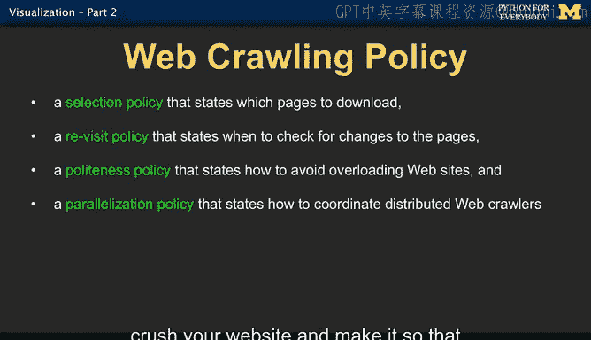

# 5：《毕业项目：使用Python检索、处理和可视化数据》｜P5：05_02_01_PageRank算法概述 📊

## 概述

在本节课中，我们将学习如何构建一个简单的网页搜索引擎核心组件。我们将编写一系列应用程序，包括一个网页爬虫、一个网页索引器，并使用PageRank算法分析链接关系，最后通过D3.js工具将结果网络可视化。

## 网页搜索引擎的基本流程

一个搜索引擎通常包含三个基本步骤。首先，是一个被称为“爬取”或“蜘蛛抓取”的前端过程。这个过程通常在计算机空闲时运行，通过检索网页、提取其中的所有链接，并维护一个待抓取的链接队列来系统地浏览网络。

上一节我们介绍了搜索引擎的基本概念，本节中我们来看看具体的实现步骤。

以下是搜索引擎的三个核心步骤：

1.  **网页爬取**：程序自动浏览网络，目的是获取网络的一个副本，以便在其内部进行数据挖掘，这比每次都需要访问实时网络要高效得多。
2.  **索引构建**：分析页面之间的链接，以确定哪些页面处于中心位置、更受“尊重”（这里的“尊重”定义为其他页面对它的指向）。
3.  **结果呈现**：在本项目中，我们不会进行传统搜索，而是在完成后将索引可视化。

## 网页爬虫的工作原理

网页爬虫是一个以某种自动化方式浏览网络的程序。像谷歌这样的搜索引擎，它们想要的不是实时网络，而是网络的一个副本，然后它们可以在自己的副本中进行数据挖掘。

它的目标是检索一个页面，提取所有链接，将这些链接添加到队列中，然后取出下一个链接重复此过程，并将所有这些页面的文本保存到存储中（对我们来说是数据库，对谷歌来说则是成千上万的服务器）。

网页爬取本身是一门学问，我们的实现将非常简单。我们的目标是爬取我们能找到的每一个页面一次。但在现实世界中，搜索引擎需要选择性地、以不同频率重新访问页面。它们会更频繁地访问被认为更有价值的页面，但也不会过于频繁，以免因请求过多而压垮目标网站。

此外，在网络爬虫领域还有一个名为 `robots.txt` 的文件。这是一个简单的网站文件，当搜索引擎首次看到一个域名或URL时，会下载此文件。它告知搜索引擎哪些地方可以查看，哪些地方不应查看。

## 构建索引与PageRank算法

在爬取数据并存储后，下一步是构建索引。其核心思想是找出哪些页面比其他页面更好。你当然可以从分析页面中的所有词语开始，但我们将要做的另一件事是查看页面之间的链接，并将这些链接作为一种评估价值的方式。

我们将运行一个包含几个不同步骤的过程。所有相关代码都位于 `page_rank.zip` 文件中。它的工作方式是：实际上只爬取单个网站（例如 `DrChuck.com` 或维基百科）。维基百科是一个不错的起点，因为它通常不会因为你使用过多而生气。

爬虫最终会得到一个URL列表。其中一些URL已获取数据，一些则没有。它会随机选择一个未检索的URL，获取并解析该URL，将该URL的数据存入数据库，同时读取内容以发现更多链接，并将这些新链接添加到我们的列表中。

即使你每次只处理一两个文档，链接数量也可能迅速膨胀。你不是谷歌，没有整个互联网。你会发现，一旦触及互联网的任何部分，未检索的链接数量就会激增。因此，在这个程序中，我们只专注于一个网站。

最终，我们会填充一些链接，并拥有多组指向关系。在数据库中，我们还会跟踪哪些页面指向哪些页面（用箭头表示）。每个页面在数据库中都有一个类似主键的编号，我们可以利用这些入站和出站链接来计算PageRank。

**PageRank的核心思想是**：一个页面拥有的入站链接越多，且这些链接来自自身拥有高质量入站链接的页面，那么这个页面就越好。

PageRank算法会读取这些数据，然后进行计算。它需要多次遍历所有数据，才能使PageRank值收敛。这些收敛后的数值代表了每个页面的“好坏”程度。你可以根据需要多次运行此算法。

这个计算过程本身运行得非常快，因为它只与数据库内部的数据交互。而爬取过程则很慢，因为它需要与网络通信并拉取数据。这也是为什么我们可以随时重启爬虫。

如果你想将PageRank值重置为初始值，可以运行重置操作，这通常会将所有页面的PageRank值设为1。随着计算次数的增加，这些数据会逐渐收敛。最初几次迭代，数值会大幅波动，之后波动会越来越小。

## 数据输出与可视化

在运行排名应用程序的任何时间点，你都可以提取数据并查看PageRank值。`sp_dump` 功能就是读取数据并将其打印出来。而 `sp_json` 功能则会读取所有数据，选取PageRank排名前20左右的链接，并将其转储到一个JavaScript文件中。

随后，配合一些HTML和D3.js（一个可视化库）代码，就能生成一幅漂亮的网络图。其中，较大的圆点代表PageRank较高的页面。你可以拖动这个网络图，移动所有元素，这既有趣又令人兴奋。

因此，我们最终实现了可视化。这又是一个多步骤的过程：一个缓慢、可重启的爬取过程，一个快速的数据分析清理过程，以及一个最终从数据库中提取数据并输出的过程。这是另一个典型的多步骤数据挖掘流程。

## 总结

本节课中我们一起学习了构建简易搜索引擎的核心流程。我们了解了网页爬虫如何自动抓取并存储网页数据，探讨了如何利用PageRank算法通过分析页面间的链接关系来评估页面重要性，并最终通过D3.js将复杂的网络关系以直观的图形方式呈现出来。这是一个从数据检索、处理到可视化的完整项目实践。