# 5：《毕业项目：使用Python检索、处理和可视化数据》｜P6：06_02_02_实例演练-PageRank网络爬取 🕷️

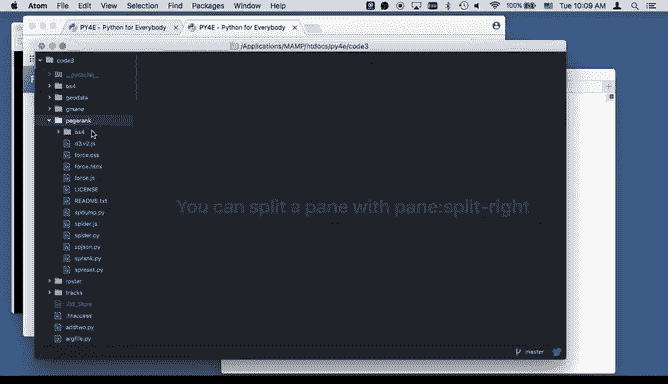

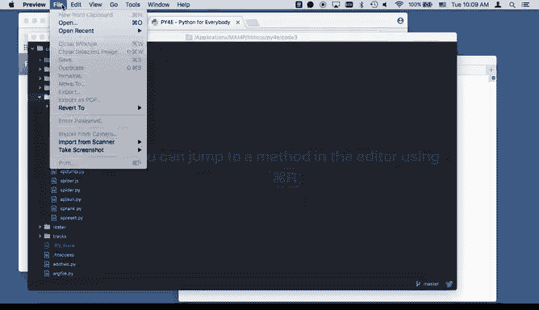

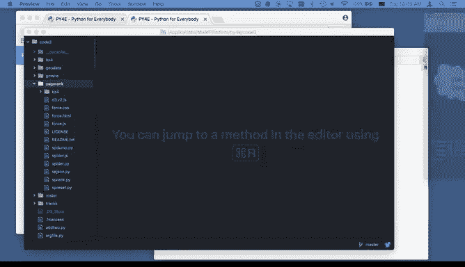

在本节课中，我们将要学习如何使用Python编写一个网络爬虫，为后续的PageRank算法准备数据。我们将解析网页、提取链接，并将所有信息存储到SQLite数据库中。

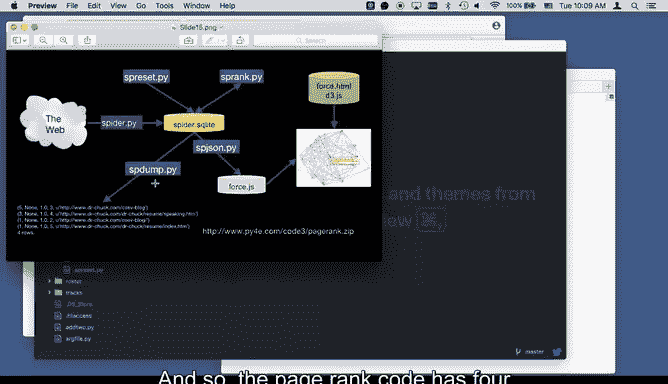

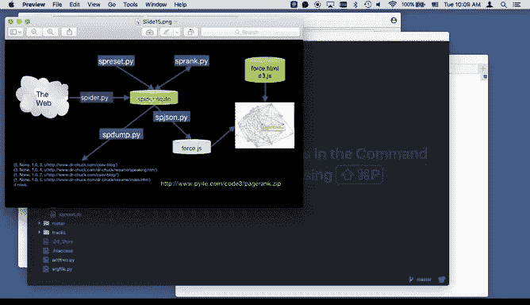

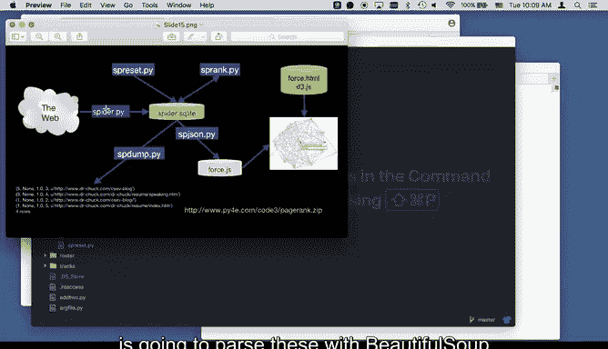

## 概述


我们将分析一个名为 `sp.py` 的爬虫程序。这个程序的核心任务是：从一个起始URL开始，下载网页，使用Beautiful Soup解析HTML，提取页面中的所有链接，并将这些链接信息存入数据库。这个过程会循环进行，逐步扩大抓取范围。

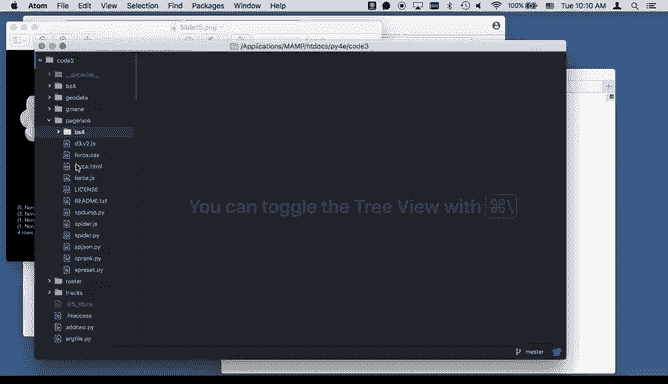

## 代码结构与数据库设计

首先，我们来看看程序如何创建和管理数据库。程序会创建一个名为 `spider.sqlite` 的SQLite数据库文件，其中包含几个核心表。

以下是创建数据库表的SQL语句：

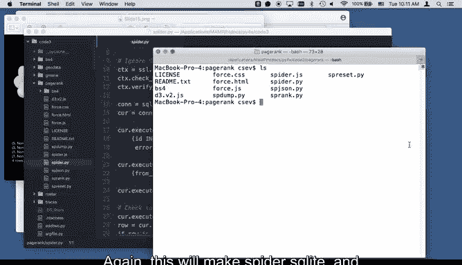

```sql
CREATE TABLE IF NOT EXISTS pages (
    id INTEGER PRIMARY KEY,
    url TEXT UNIQUE,
    html TEXT,
    error INTEGER,
    old_rank REAL,
    new_rank REAL
);

CREATE TABLE IF NOT EXISTS links (
    from_id INTEGER,
    to_id INTEGER,
    UNIQUE(from_id, to_id)
);

CREATE TABLE IF NOT EXISTS webs (url TEXT UNIQUE);
```

*   **`pages` 表**：存储每个网页的信息。`id` 是主键，`url` 是唯一的网页地址，`html` 存储网页内容，`error` 记录抓取错误，`old_rank` 和 `new_rank` 是为PageRank算法准备的字段。
*   **`links` 表**：这是一个“多对多”关系表，记录页面之间的链接关系。`from_id` 是链接来源页面的ID，`to_id` 是链接目标页面的ID。
*   **`webs` 表**：存储允许爬虫抓取的网站根域名，用于限制爬虫只抓取特定网站内的链接，防止无限扩散到整个互联网。

## 爬虫工作流程解析

上一节我们介绍了数据库的结构，本节中我们来看看爬虫的主循环是如何工作的。程序的核心是一个循环，它不断从数据库中选取尚未抓取的URL进行处理。

以下是爬虫主循环的关键步骤：

1.  **选择待抓取URL**：程序执行SQL查询，从 `pages` 表中随机选择一个 `html` 字段为 `NULL`（即未抓取）且 `error` 为 `NULL`（即未出错）的URL。
    ```python
    cur.execute('''SELECT id,url FROM pages WHERE html IS NULL AND error IS NULL ORDER BY RANDOM() LIMIT 1''')
    ```

2.  **获取起始点**：如果数据库中没有待抓取的URL（例如第一次运行），程序会提示用户输入一个起始URL，并将其插入 `pages` 和 `webs` 表。

3.  **抓取网页内容**：程序使用 `urllib` 库请求选中的URL，并检查HTTP状态码。只有状态码为200（成功）且内容类型为 `text/html` 的页面才会被进一步处理。

4.  **解析HTML与提取链接**：对于成功的响应，程序使用Beautiful Soup解析HTML，并查找所有的 `<a>` 标签以获取链接（`href` 属性）。

5.  **清洗与规范化链接**：提取的原始链接需要经过一系列处理：
    *   使用 `urljoin` 将相对URL转换为绝对URL。
    *   移除URL末尾的锚点（即 `#` 后面的部分）。
    *   忽略指向图片（如.jpg, .png）的链接。
    *   检查链接是否在允许的域名（`webs` 表）内，只保留站内链接。

6.  **更新数据库**：
    *   将抓取到的HTML内容更新到当前页面的记录中。
    *   将当前页面`new_rank`初始化为1.0。
    *   对于每一个提取出的、且符合要求的站内链接，将其URL插入 `pages` 表（如果不存在），并将其关系（从当前页面ID到目标页面ID）插入 `links` 表。

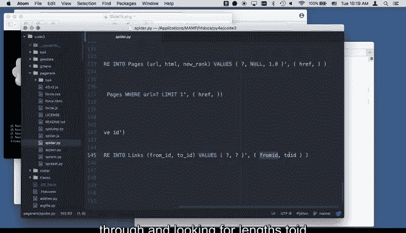

7.  **循环与容错**：整个过程被包裹在一个 `try...except` 块中，以处理网络请求超时、解析错误、用户中断（Ctrl+C）等异常情况。遇到错误时，会在对应页面的 `error` 字段做标记，避免重复尝试。

## 运行演示与交互

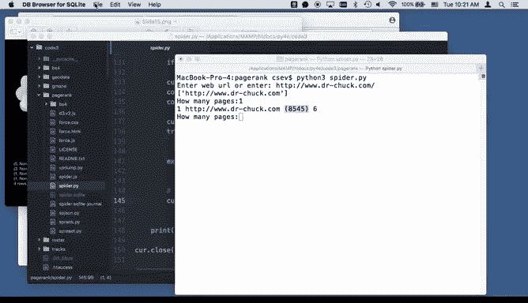

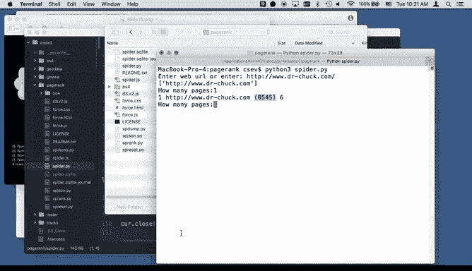

现在，让我们在命令行中运行这个爬虫程序，观察其工作过程。

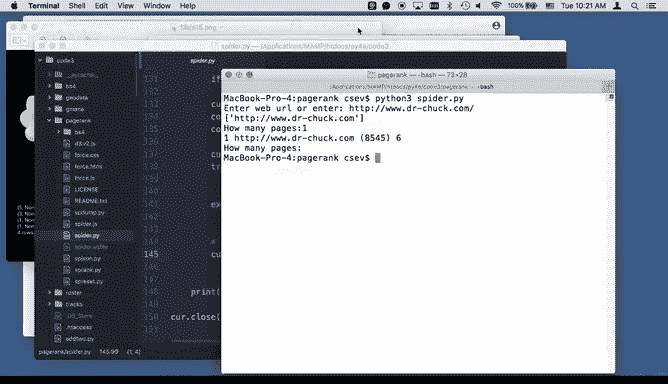

输入以下命令启动爬虫：
```bash
python3 sp.py
```

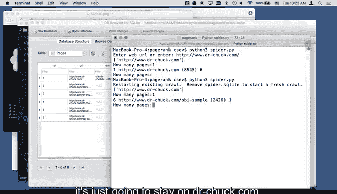

程序首先会提示输入一个起始URL。例如，我们输入 `http://www.dr-chuck.com/`。

程序开始运行后，会在终端打印抓取日志，例如：
```
1 http://www.dr-chuck.com/
Retrieved http://www.dr-chuck.com/ 18645 characters
Found 6 links
```
这表示它成功抓取了第一个页面，该页面有18645个字符，并从中找到了6个站内链接。

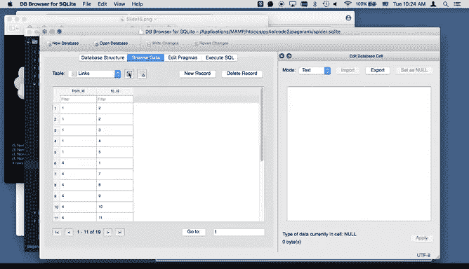

此时，我们可以使用SQLite浏览器查看 `spider.sqlite` 数据库。在 `pages` 表中，可以看到第一条记录的 `html` 字段已被填充。在 `links` 表中，可以看到 `from_id` 为1（第一个页面）连接到其他新页面ID的关系。

爬虫会持续运行，不断从数据库中选择新的未抓取URL进行处理。你可以随时按 **Ctrl+C** 中断程序。由于所有状态都已保存在数据库中，下次重新启动程序时，它会自动从上次中断的地方继续抓取，而不会丢失进度。

## 总结

本节课中我们一起学习了PageRank项目爬虫部分的核心代码。我们了解了如何设计数据库来存储网页和链接关系，详细分析了爬虫从选择URL、下载页面、解析链接到存储数据的完整工作流程。这个爬虫被设计为可中断和可恢复的，通过将中间状态持久化到数据库，实现了稳定的长时运行。在接下来的课程中，我们将利用这个爬虫收集的数据，运行PageRank算法并可视化结果。