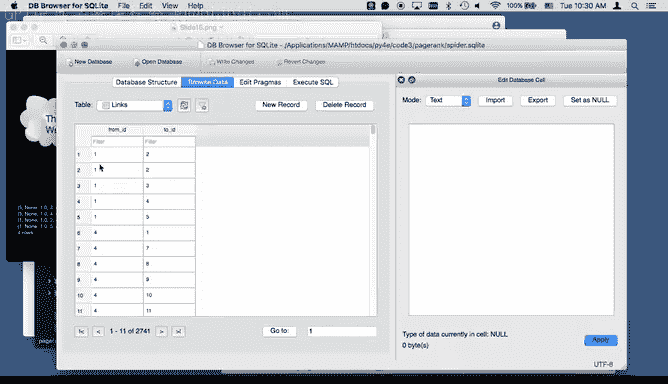
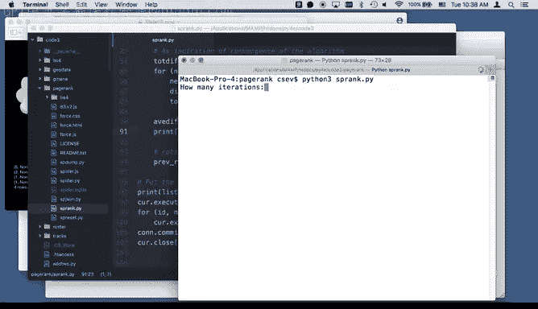
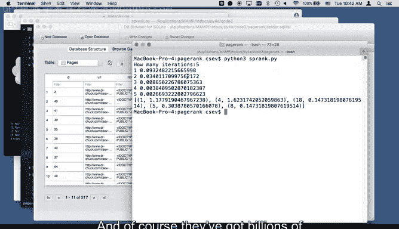
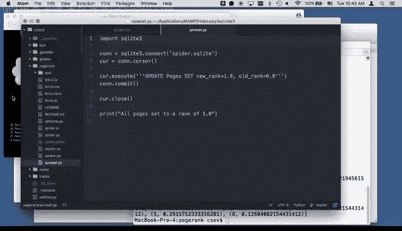
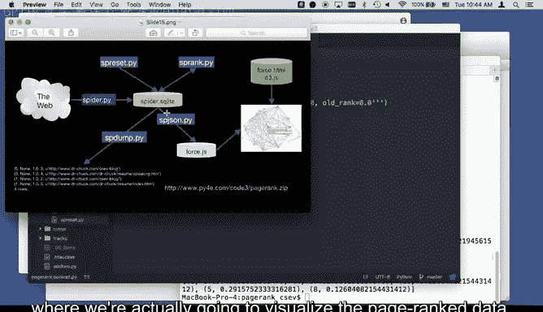

# 密歇根大学《给所有人的Python课》课程5：《毕业项目：使用Python检索、处理和可视化数据》｜P7：PageRank计算实例演练

## 📖 概述
在本节课中，我们将学习PageRank算法的核心概念，并通过一个具体的Python代码实例，演示如何计算网页的排名。我们将从数据库中读取链接数据，模拟PageRank的计算过程，并观察排名如何随着迭代而收敛。

---

## 🔍 PageRank算法简介
上一节我们介绍了如何从网络上爬取数据并存入数据库。本节中，我们来看看如何利用这些链接数据计算PageRank。

PageRank的基本思想是：一个网页的重要性取决于链接到它的其他网页的数量和质量。如果一个网页被许多重要的网页链接，那么它本身也很重要。算法通过迭代计算，为网络中的每个页面分配一个权重（即排名）。

其核心公式可以简化为：
**PR(A) = (1-d) + d * (PR(T1)/C(T1) + ... + PR(Tn)/C(Tn))**
其中：
*   `PR(A)` 是页面A的PageRank值。
*   `PR(Ti)` 是链接到A的页面Ti的PageRank值。
*   `C(Ti)` 是页面Ti的出站链接总数。
*   `d` 是一个阻尼因子（通常设为0.85），代表用户继续点击链接的概率。

## 💻 代码实例解析
现在，让我们深入查看用于计算PageRank的Python代码。代码主要使用SQLite数据库进行操作。

首先，代码会从`links`表中读取所有有效的链接关系。它只关注那些我们已抓取页面之间的链接（即“强连通分量”），忽略指向未知页面或自身的链接。

以下是代码准备阶段的关键步骤：
1.  获取所有拥有出站链接的页面ID（`from_id`）。
2.  获取所有链接关系，并过滤掉无效链接（如指向自身或未抓取页面的链接）。
3.  将所有目标页面ID（`to_id`）收集到一个集合中。

接着，代码进入核心的计算循环。以下是计算一次迭代的过程：

1.  **初始化**：从数据库的`pages`表中读取所有页面的当前排名（初始值为1），存入一个字典（`prev_ranks`）。
2.  **分配权重**：遍历`prev_ranks`字典中的每个页面（节点）。
    *   计算该页面可以分配给出站链接的“权重值”：`give = old_rank / len(outbound_links)`。
    *   将该权重值加到每个出站链接目标页面的新排名（`next_ranks`）中。
3.  **处理蒸发（Damping）**：为了模拟用户随机跳转到任意页面的行为，并防止排名陷入某些特殊结构，算法会引入一个“蒸发”因子。代码会从所有新排名中取出一小部分，然后平均重新分配给所有页面。
4.  **计算差异与迭代**：计算新旧排名之间的平均差异，以观察收敛情况。然后用`next_ranks`更新`prev_ranks`，开始下一次迭代。

循环结束后，代码将最终计算出的新排名值更新回数据库的`new_rank`字段。

## 🚀 运行与观察
运行代码`python3 sprank.py`并指定迭代次数（例如1次）后，我们可以观察数据库中的变化。

初始时，所有页面的`old_rank`和`new_rank`都是1。第一次迭代后，`new_rank`值会发生显著变化：有些页面排名上升，有些下降，但所有排名的总和保持不变。

当我们进行第二次迭代时，算法会基于第一次迭代产生的`new_rank`（此时已成为新的`old_rank`）重新计算。此时，新旧排名之间的平均差异会减小。

以下是多次迭代的收敛过程示例：
*   第1次迭代后，平均差异约为1.0。
*   第2次迭代后，平均差异降至约0.41。
*   连续运行多次（如10次）后，平均差异变得非常小（例如0.005），表明排名已基本稳定。

如果之后又爬取了新的页面（其初始排名为1），再次运行PageRank计算，排名会经历短暂的波动，然后迅速重新收敛到稳定状态。

## 🛠️ 辅助工具：重置排名
除了计算排名的`sprank.py`，还有一个简单的工具`sprreset.py`。它的功能非常单一：将所有页面的`old_rank`重置为1。这通常在开始全新的计算周期时使用。

## 📊 总结
本节课中我们一起学习了PageRank算法的基本原理和实现。
1.  **算法核心**：通过页面间的链接关系迭代计算重要性。
2.  **代码流程**：从数据库读取链接数据，过滤有效链接，在内存中进行快速迭代计算，最后更新结果。
3.  **收敛特性**：排名在数次迭代后会快速稳定，新增数据只会引起短暂扰动。
4.  **实际意义**：这模拟了搜索引擎如何持续抓取网页并更新其索引排名。

通过这个实例，我们看到了如何将理论算法转化为具体的、操作数据库的Python代码，并为下一步的数据可视化做好了准备。