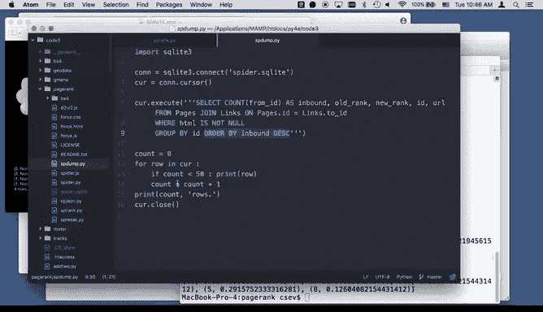
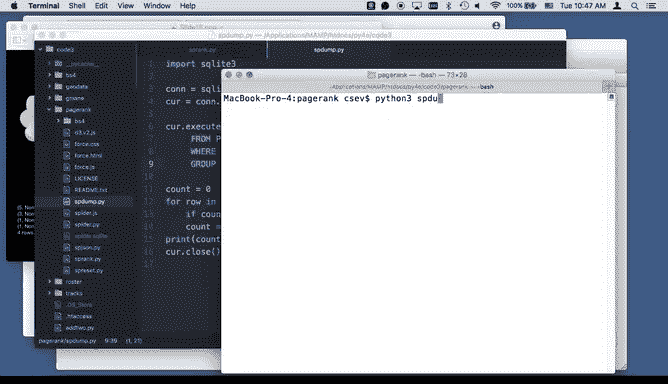
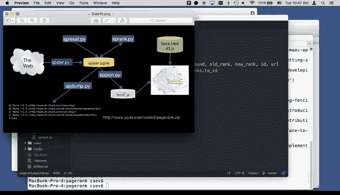
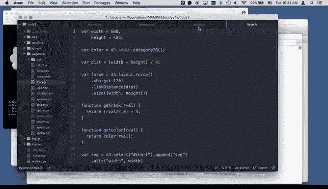
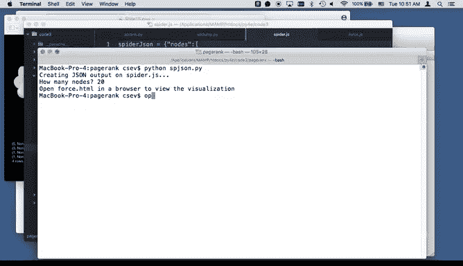
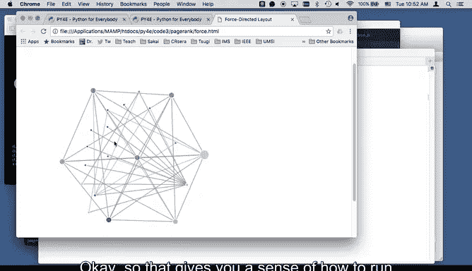

# 5：《毕业项目：使用Python检索、处理和可视化数据》｜P8：PageRank可视化实例演练 🎯

## 概述

在本节课中，我们将学习如何将计算得到的PageRank数据通过代码进行查询、导出，并最终利用D3.js库实现一个动态、交互式的可视化效果。我们将一步步解析数据提取、格式转换和可视化呈现的完整流程。

---

## 数据查询与展示

上一节我们完成了PageRank算法的计算。本节中，我们来看看如何从数据库中查询并展示这些排名结果。

以下是`spdump.py`脚本的核心功能，它负责执行SQL查询并打印排名靠前的页面。

```python
# 连接数据库并创建游标
cur.execute('''SELECT COUNT(from_id) AS inbound, old_rank, new_rank, id, url
                 FROM pages JOIN links ON pages.id = links.to_id
                 WHERE html IS NOT NULL AND error IS NULL
                 GROUP BY id ORDER BY inbound DESC''')
```

这段代码执行了一个连接查询，统计每个页面的入链数量，并按入链数降序排列，最终显示前50个结果。这只是一个辅助工具，用于快速验证数据是否正确，例如确认哪些博客页面在我的网站内部获得了最多的链接。






结果显示，在我的博客内部，某些页面获得了最多的内部链接。需要强调的是，这个分析仅针对我们爬取的有限数据，而非整个互联网。

---



## 数据导出为可视化格式

查询到数据后，下一步是为可视化准备数据格式。我们将使用`spjson.py`脚本将数据库中的数据转换为D3.js库能够读取的JavaScript文件。

这个脚本执行一个更复杂的SQL查询，连接多个表，并筛选出PageRank值最高的一些节点。

```python
# 执行查询，获取高排名的页面和链接关系
cur.execute('''SELECT DISTINCT from_id, to_id FROM links''')
links = list(cur.fetchall())
```

脚本会读取所有行数据，提取每个页面的PageRank值，并找出其中的最大值和最小值。因为PageRank值的范围可能从0.000到20或30，跨度很大，所以我们需要进行归一化处理。

以下是数据归一化和文件写入的关键步骤：

1.  **计算归一化权重**：将原始PageRank值缩放到一个合适的范围，用于决定可视化中节点（圆圈）的大小和连线的粗细。
    *公式*：`normalized_weight = (rank - min_rank) / (max_rank - min_rank)`
2.  **写入JavaScript文件**：脚本会生成一个包含`nodes`（节点）和`links`（连线）数组的JavaScript对象。节点信息包含id、权重和名称；连线信息包含源节点、目标节点和基于PageRank计算出的线条权重。

我们通常只处理排名最高的前20个节点，以避免可视化过于杂乱。


生成的`sp.js`文件内容结构如下，它定义了节点和连线的数据，供后续的HTML页面调用。


---

## 使用D3.js进行可视化

现在，我们已经准备好了数据文件。本节中，我们来看看如何使用D3.js这个强大的可视化库来渲染交互式图形。

我们有一个名为`force.html`的HTML文件，它会加载D3.js库、我们生成的`sp.js`数据文件以及一些自定义的绘制逻辑。

```html
<!-- 引入D3.js库和数据文件 -->
<script src="http://d3js.org/d3.v3.min.js"></script>
<script src="sp.js"></script>
```

D3.js的“力导向图”算法会自动根据节点间的链接关系，计算出一个视觉上清晰、平衡的布局。代码会：
*   根据权重（归一化的PageRank）绘制不同大小的圆圈。
*   根据连线权重绘制不同粗细的线条。
*   实现交互功能，例如可以用鼠标拖拽节点，当鼠标悬停在节点上时会显示页面标题。





最终，在浏览器中打开`force.html`文件，你就能看到一个动态、美观的网络图。较大的圆圈代表PageRank较高的页面，线条的粗细表示链接关系的强度。你可以与图形进行交互，探索网站内部的链接结构。

这个可视化效果生动地展示了PageRank算法的结果。为了得到足够多有意义的连接关系进行可视化，我们需要爬取数百个页面，这正是我们之前花费时间进行爬虫和数据收集的原因。



---

## 总结


本节课中，我们一起学习了PageRank项目的数据展示与可视化全流程。我们从使用SQL查询数据库开始，然后将数据转换为适合可视化的JSON格式，最后利用D3.js库创建了一个交互式的力导向图来直观展示页面间的链接关系和重要性排名。这个过程涵盖了数据检索、处理和可视化的核心步骤，为你将来处理类似的数据可视化项目提供了完整的范例。