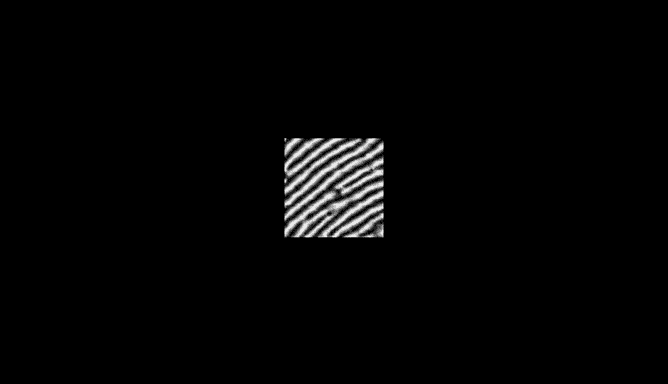
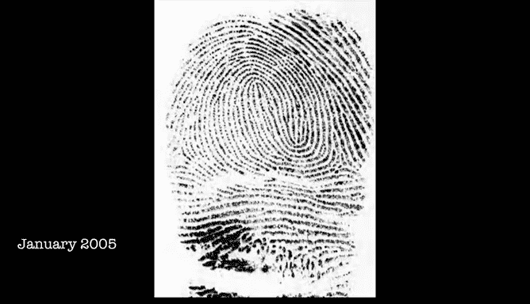
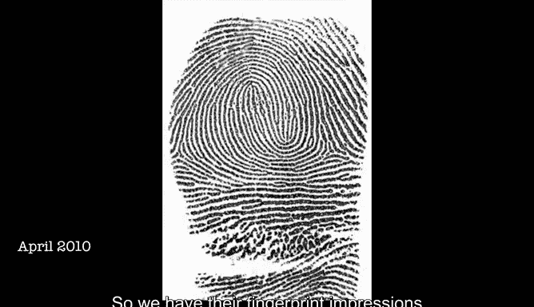
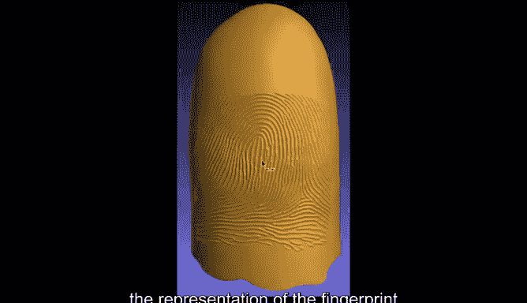

# 5：《毕业项目：使用Python检索、处理和可视化数据》｜P10：10_02_02_访谈-Anil Jain（图像处理）🧑‍💻

## 概述

在本节课程中，我们将跟随Anil Jain教授的访谈，了解图像处理与模式识别领域在过去40年的发展，特别是其在指纹识别技术中的应用与演变。我们将探讨从基础概念到前沿挑战的整个过程。

## 从FPGA到指纹识别：一个偶然的开始

上一节我们介绍了课程背景，本节中我们来看看Anil Jain教授如何进入指纹识别领域。我在模式识别、图像处理和计算机视觉领域工作了40年。1990年，一个偶然的机会，华盛顿特区有人联系我，他们提到美国国家安全局资助开发了FPGA处理器，并问我能否为这块FPGA处理板找到民用应用。

我们考虑到FPGA（现场可编程门阵列）可以配置和重构，以执行低级和高级操作。在图像处理领域，我们思考可以做什么。低级操作很容易，比如卷积：观察一个像素及其相邻像素，进行平滑或边缘检测。这是一种局部滤波操作。

对于高级操作，我们可以做什么？点匹配是一种通用的计算机视觉操作。例如，在立体对应中，你有左图像和右图像，提取两幅图像中的一些地标点进行对齐，然后估算深度。

我们思考它的应用场景，这时我们想到了指纹识别。因为指纹匹配本质上就是一种点匹配操作。如果你看过如今的犯罪剧集，比如CSI，他们会展示计算机从指纹中提取细节特征点并进行匹配。所以，指纹匹配本质上就是点匹配。而局部滤波操作意味着，采集的指纹图像通常质量较低，有些模糊，我们需要对其进行一些图像增强。这就是大约25年前我们开始研究指纹识别的缘由。

## 从特征点到纹理：指纹匹配的演进

上一节我们了解了项目起源，本节中我们来看看指纹匹配技术的核心发展。我认为我们现在已经开发了几种有影响力的指纹技术。我们做过的最好的事情之一是基于纹理的指纹匹配。

传统的指纹匹配基于特征点。但如果指纹图像没有足够数量的特征点，或者图像质量太差导致无法提取足够特征点，该怎么办？这时就需要观察由脊线和谷线形成的纹理图像，这些纹理表征了指纹。

我的一位博士生Arun Prabhakar在1999-2000年左右提出了一组滤波器，用于捕捉指纹的纹理特征。这可以用于指纹匹配。令人欣喜的是，这种纹理匹配技术正被用于嵌入式移动手机的小型指纹传感器中。

为了减小嵌入式手机指纹传感器的尺寸并降低成本，这些指纹读取传感器的尺寸大约是**80像素 x 80像素**。传统的指纹传感器是**512 x 512**大小的图像。因此，80 x 80的图像只捕获了指纹的一小部分，而不是整个指纹。

如果只捕获一小部分指纹，其中的细节特征点可能只有四到五个，这不足以建立两个不同指纹按压之间的对应关系。这就是纹理信息发挥作用的地方。因此，我们大约15到25年前在纹理匹配方面的一些工作，现在正重新引起人们的兴趣。

## 持续认证：安全模式的新范式

上一节我们探讨了匹配技术的进步，本节中我们来看看移动设备安全认证的新思路。我们现在在做许多有趣的事情。例如，传统的移动空间或任何登录的身份验证或安全模型是：登录一次，永久使用。

但这种模式是围绕台式电脑设计的。现在，手机很容易被他人接触。因此，这种“一次认证，永久使用”的观念对于更高级别的安全性来说并不合适。这就是为什么系统中内置了这种“麻烦”机制：你解锁手机后，如果5分钟不使用，就必须再次解锁。一个人每天可能解锁手机40到50次。

如今，你花在手机上的时间比任何其他设备都多。那么，为什么设备不能根据你的行为模式来学习你是谁呢？例如，根据你滑动屏幕的方式、持握方式、GPS信息，甚至摄像头偶尔开启捕获你的部分面部图像，从而确认这是手机的主人。

这种操作模式被称为**持续认证**。早上，你可以向摄像头呈现正面面部图像，进行强身份验证，或者使用指纹。在一天中的其余时间，除非系统真的不确定使用者不是机主，否则只要系统有足够的信心认为使用者是机主，它就可以保持手机解锁状态。这是一个相当有吸引力的领域。

## 生物特征的根本问题：唯一性与持久性

上一节我们介绍了新的认证模式，本节中我们来看看生物识别技术面临的两个根本性科学问题。另一个非常有趣的领域，这适用于任何生物特征模态，无论是指纹、面部还是虹膜（这是三种最广泛使用的身体特征），那就是这些生物特征的持久性和唯一性问题。

如果我有一个10位数的密钥，我知道我可以有多少个不同的身份：**10^10**。但对于指纹，我们能说出同样的话吗？原则上，它能区分多少个唯一身份？原则上，每个手指都有不同的图案。

目前地球上大约有70亿人。假设每人有10个手指，那么就有700亿个手指。原则上，我们应该能够区分700亿个个体。但实际情况并非如此，因为手指上的图案可能与你用于识别的按压印记或获取的图像有很大不同。

指纹或其他模态的个体性或唯一性问题尚不清楚。这是我们正在研究的问题：我们如何确定可以说这两个指纹是不同的概率？或者你的指纹与我的指纹之一匹配的概率，这被称为**错误对应概率**。

这个概念在法律程序中非常重要，特别是当一个人基于犯罪现场发现的部分指纹被定罪时。有许多无辜者因为错误的证词或结论而被监禁。因此，我们基本上需要有一些科学依据来理解错误对应概率是多少。

任何生物特征的第二个基本前提是**持久性**。即，指纹图案会随时间变化吗？虹膜图案会随时间变化吗？我们知道人会衰老，所以面部特征会随时间变化。确实，当同一个人的两张图像之间的年龄间隔超过大约10年时，最先进的面部识别系统就会开始失效。

但在指纹和虹膜的情况下，我们一直被引导相信它们能永久保持，但这并没有科学证明。就在去年，我们对大约20，000名个体进行了一项研究，数据来自密歇根州警察，因为他们经常反复遇到同一个人。在15年的时间里，这大约20，000名个体曾被多次逮捕，因此我们拥有他们多次与警方接触时的指纹按压图像。

我们使用多级统计模型科学地表明，在这段时间内，指纹的准确性并没有下降。这是两个重要的问题。

## 生物特征模板的安全与撤销

上一节我们讨论了唯一性与持久性，本节中我们来看看生物特征应用中的安全挑战。第三个重要问题是，生物识别技术将取代密码和身份证，或与之结合使用。但如果有人窃取了你的生物特征怎么办？这意味着存储在数据库中的指纹模板或表示，无论是在你的手机中还是在你的本地银行中，如何保护它，使得即使被盗也无法使用？或者，你能否重新颁发一个表示？

这就像一种可以撤销的信用卡号码类型，然后你获得一个新的信用卡号码。也就是说，我采集你的指纹，但我从不使用它的原始版本，而是使用它的某种转换版本。

## 总结

本节课中，我们一起学习了Anil Jain教授在图像处理和指纹识别领域的研究历程。从基于FPGA的早期探索，到从特征点匹配发展到纹理匹配的技术演进，再到移动设备持续认证的新安全范式。我们还探讨了生物识别技术的两个根本科学问题——唯一性与持久性，以及生物特征模板的安全与撤销挑战。这些内容展示了计算机视觉和模式识别如何从理论走向广泛的实际应用，并持续面对新的科学和工程挑战。