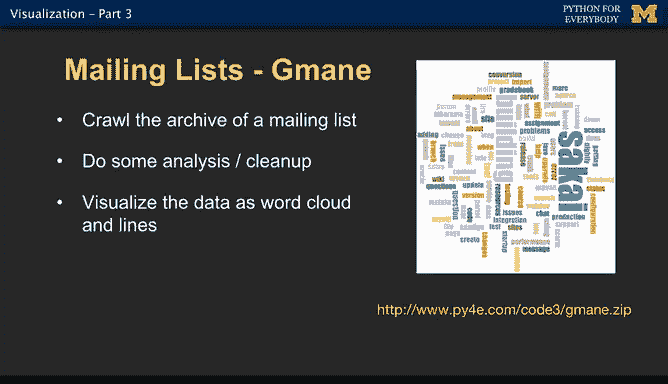
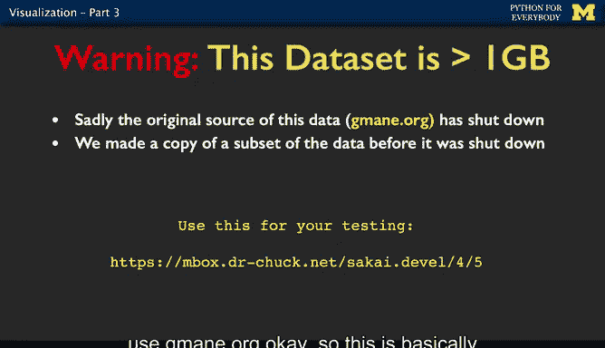
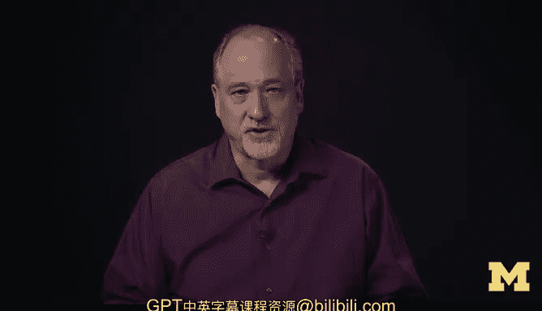

# 每个人的 Python 第五部分 13：Gmane系统介绍 📧

## 概述

在本节课中，我们将要学习毕业项目的最后一个数据可视化案例。我们将回到电子邮件数据，但这次处理的规模是千兆字节级别。我们将介绍一个名为Gmane的系统，学习如何通过API爬取大量邮件列表数据，进行数据清理和分析，并最终以多种方式进行可视化。

---

## 项目简介：处理千兆字节邮件数据

上一节我们介绍了数据可视化的基本概念，本节中我们来看看一个更复杂的实际项目。我们将不再处理几千行的电子邮件，而是挑战一个千兆字节级别的邮件数据集。你需要编写一个爬虫程序来获取这些数据。

实际上，如果你查看Gdo.zip文件中的README文档，它会告诉你如何通过一个语句先获取前675兆字节的数据，从而获得一个良好的开端，然后再逐步填充细节。

项目的核心思想是：我们有一个外部API，只要不断访问一个URL并修改其中的一个数字参数，它就能向我们提供邮件列表数据。我们将拉取这些原始数据，然后经历一个分析和清理阶段，最后用几种不同的方式将这些数据可视化。

---

## 数据来源与系统架构

这是一个庞大的数据集，大约有1GB。它最初来自一个叫Gmane.org的网站。我已经将这些数据放在了`http://mbox.drchuck.net`上。这个网站使用了名为Cloudflare的全球缓存服务，服务器速度极快，非常可靠。

你可以放心地对`drchuck.net`进行大量请求。我保证你不会对它造成伤害，也无法让它宕机。祝你好运尝试让它宕机，因为它非常强大。因此，在测试时，请务必使用`drchuck.net`，而不是`Gmane.org`。

以下是整个项目的基本数据流：

我们将访问`drchuck.net`，它拥有所有数据并提供了一个API。我们基本上是按数字序列（如message1, message2, message3...）来请求数据。程序启动时会检查数据库中已经获取了多少数据，然后从下一个序号开始调用API获取消息，将其存入数据库，再获取下一个，如此循环。

这个过程可能很慢，但它是可重启的。例如，程序可能在获取到第300条消息时崩溃。重启后，它会发现数据库中已有300条记录，于是从第301条开始继续获取。我第一次完整爬取所有这些数据时，大约花了三天时间。

这很有趣，但请注意：如果你使用的是需要付费的网络连接，请不要这样做，因为这会消耗大量流量。如果你使用的是不限流量的网络或大学的高速网络，那么可以尽情尝试，运行几个小时，观察它的工作状态——它会持续不断地运行。

---

## 数据清理与规范化

接下来我们看看数据处理阶段。这些数据本身有些特殊，这在README中也有说明。这些数据来自Sakai开发者邮件列表近十年的记录，期间甚至有人更改过电子邮件地址。

因此，有一个名为`gmodel.py`的额外补丁代码，它读取配置信息并清理数据。原始爬取的数据量非常大。如果你还记得数据库章节的内容，这些原始数据没有经过很好的规范化。它非常原始，没有建立索引，主要是为了支持爬虫和确保重启能力。

如果我们想真正理解这些数据，就需要运行一个清理过程。这个过程会读取庞大的原始数据库，完全清空它，然后写入一个全新的、规范化的数据库。

以下是两种数据库的对比：
*   **原始数据库 (`raw.sqlite`)**：体积非常大，读取缓慢。
*   **规范化数据库 (`content.sqlite`)**：体积小得多，使用了索引键、外键、主键等我们在数据库课程中学到的所有技术，数据表示效率高得多。

清理过程可能会花费几分钟时间，具体取决于你的电脑速度。这是一个展示非规范化数据与规范化数据区别的绝佳例子。

清理阶段完成后，会生成`content.sqlite`文件。后续的所有分析都将读取这个文件。

你可以先运行爬虫一段时间，然后停止，运行清理程序。清理程序每次运行都会丢弃旧的规范化数据库并重建它。之后，如果你想继续爬取更多数据，可以重新启动爬虫。爬虫结束后，再次运行清理程序即可更新整个规范化数据库。

---

## 数据分析与可视化

一旦数据被正确处理，我们就可以进行分析和可视化。

以下是主要的分析步骤：

*   **基础分析**：运行`gbasic.py`。它主要进行数据库分析并输出一些统计信息。
*   **折线图可视化**：运行`gline.py`。它会遍历所有数据，并生成供`gline.js`使用的数据。然后，你可以结合HTML文件和D3.js库来可视化这些数据。
*   **词云可视化**：运行`gword.py`。它会遍历数据，生成一些JavaScript代码，这些代码再与HTML结合，就能生成一个漂亮的词云。

README文档详细说明了所有这些步骤，告诉你该运行什么、如何运行以及大致需要多长时间，从而引导你完成整个项目。

---

## 总结

本节课中我们一起学习了毕业项目的最后一个综合案例。通过这三个例子，我们实际上是在编写更复杂的应用程序。虽然我提供了这些应用程序的大部分源代码，但你可以从中看到一个更成熟的应用是什么样子。

基于这些知识，你或许可以构建自己的数据抓取程序，甚至开发数据可视化技术，并改编其中的一些代码。感谢你的学习，我们网络上再见！

