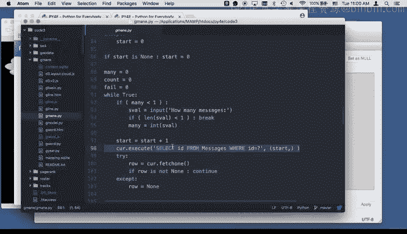
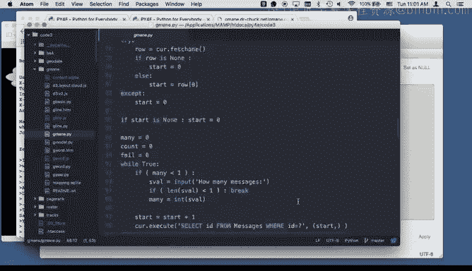
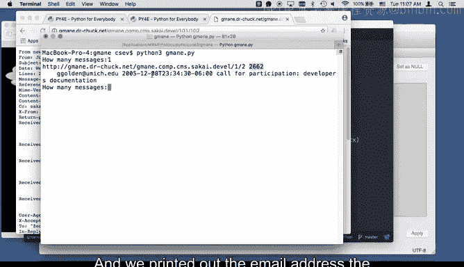
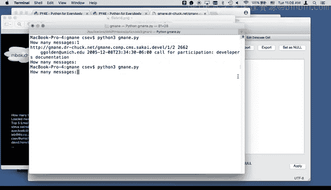
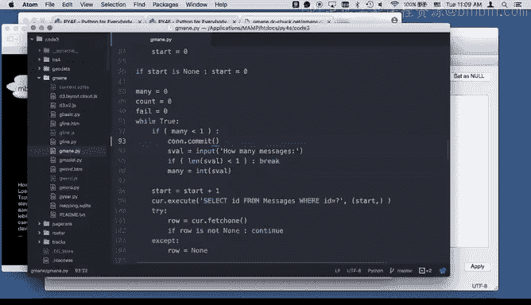
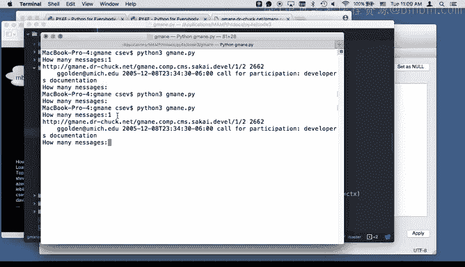
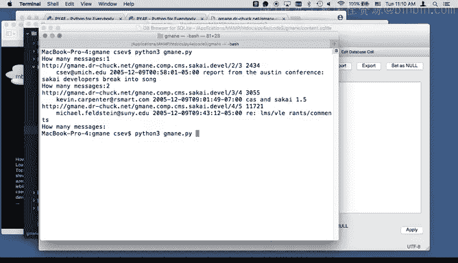

# 密歇根大学《给所有人的Python课》课程5：《毕业项目：使用Python检索、处理和可视化数据》｜P14：14_04_02_实例演练-Gmane邮件检索 📧

在本节课中，我们将学习如何从Gmane邮件存档服务中检索邮件数据，并将其存储到SQLite数据库中。这是一个多步骤数据处理项目的第一部分，重点是数据的抓取和初步存储。

## 概述

我们将编写一个Python脚本，用于从特定的API端点按顺序抓取邮件数据。该脚本需要处理网络请求、解析邮件格式、提取关键信息（如发件人、日期、主题），并将这些信息存入数据库。同时，脚本需要具备容错和断点续传的能力。

## 代码结构与核心概念

以下是脚本的核心流程和关键代码段。

### 数据库设计

我们首先创建一个SQLite数据库表来存储邮件信息。表结构如下：

```python
CREATE TABLE IF NOT EXISTS Messages (
    id INTEGER PRIMARY KEY,
    email TEXT,
    sent_at TIMESTAMP,
    subject TEXT,
    headers TEXT,
    body TEXT
)
```

这个表包含邮件的ID（主键）、发件人邮箱、发送时间、主题、邮件头和正文。



### 断点续传机制


为了避免重复抓取和应对网络中断，脚本需要知道从何处继续。我们通过查询数据库中已存在的最大ID来实现这一点。



```python
cur.execute('SELECT max(id) FROM Messages')
row = cur.fetchone()
start_id = row[0] if row[0] is not None else 0
if start_id > 0:
    start_id = start_id + 1
```

这段代码获取当前数据库中最大的邮件ID，并将下一个ID作为起始点。如果数据库为空，则从0开始。

### 数据抓取与解析

接下来，我们进入主循环，按ID顺序抓取邮件数据。

#### 构建请求URL

Gmane API允许我们通过指定ID范围来获取邮件。URL格式为：`{base_url}/{start_id}/{end_id}`。

```python
url = base_url + str(message_id) + '/' + str(message_id + 1)
```

#### 处理响应与解析邮件

获取到邮件原始文本后，我们需要将其拆分为邮件头和正文两部分。邮件头以第一个空行结束。

```python
# 查找第一个空行（即 `\n\n`）的位置
pos = data.find('\n\n')
if pos == -1:
    # 处理格式错误的邮件
    continue
headers = data[:pos]
body = data[pos+2:]
```

#### 提取关键信息

我们使用正则表达式从邮件头中提取发件人邮箱、日期和主题。

*   **提取发件人邮箱**：查找 `From:` 行中的 `<email@example.com>` 格式内容。
*   **提取发送日期**：查找 `Date:` 行，并解析其后的日期字符串。
*   **提取邮件主题**：查找 `Subject:` 行。

以下是提取日期的示例代码：

```python
date_line = re.findall(r'^Date:.*', headers, re.MULTILINE)
if date_line:
    date_text = date_line[0][5:].strip()
    # 进一步清理和解析 date_text
```

#### 数据清理与标准化

提取出的原始数据往往格式不一，需要进行清理：
*   将邮箱地址统一转为小写。
*   使用 `datetime` 库将各种格式的日期字符串解析为标准化的时间戳。
*   移除主题行中不必要的空白字符。



### 容错与性能优化



在实际抓取过程中，网络波动或数据格式异常是常见问题。我们的脚本需要具备一定的容错能力。



*   **失败重试与退出**：设置一个失败计数器。如果连续多次请求失败或解析失败，则停止脚本，避免陷入死循环。
*   **分批提交**：每成功抓取并解析50封邮件，才向数据库提交（`commit`）一次事务，这可以显著提升写入效率。
*   **请求限速**：每处理1000封邮件，让脚本暂停1秒，以减轻对服务器的压力，同时也为用户提供了中断脚本（按Ctrl+C）的机会。



```python
count = count + 1
if count % 50 == 0:
    conn.commit() # 每50条提交一次
if count % 1000 == 0:
    time.sleep(1) # 每1000条暂停一秒
```

## 运行脚本



在命令行中，你可以通过以下方式运行脚本，并指定要抓取的数量：

```bash
python3 gmane.py
# 程序会提示你输入要获取的邮件数量，例如输入 100
```

脚本运行后，会在控制台打印抓取进度，并将数据存入 `content.sqlite` 数据库文件中。你可以使用SQLite浏览器或命令行工具查看抓取的结果。

## 总结

本节课中，我们一起学习了构建一个健壮的邮件数据抓取脚本。我们实现了从API按序抓取、解析复杂邮件格式、提取并清理关键数据，以及将数据存储到SQLite数据库的完整流程。这个脚本的核心优势在于其**断点续传**和**容错机制**，使得它能够稳定地处理大规模数据抓取任务，即使过程需要数小时甚至数天。

在下一节中，我们将以此数据库为基础，进行数据的进一步清理、分析和可视化。