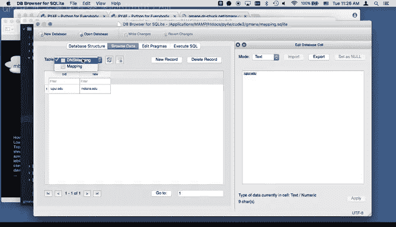
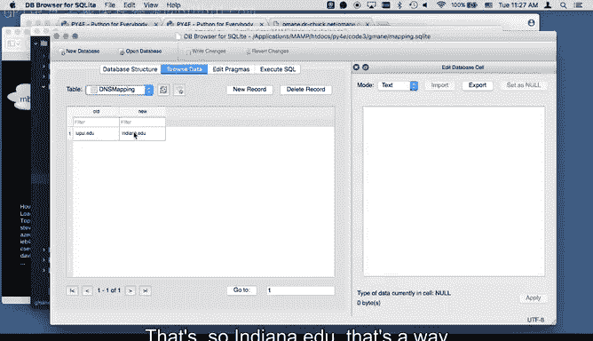
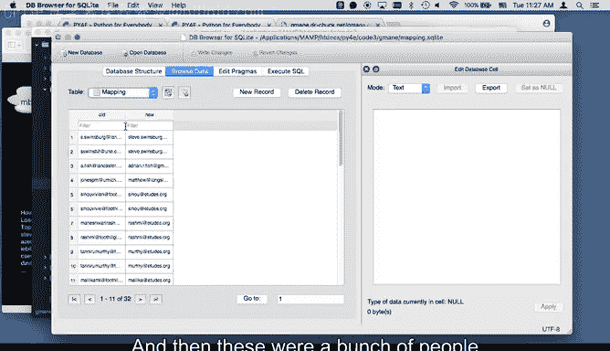
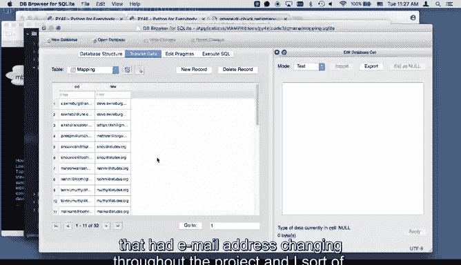
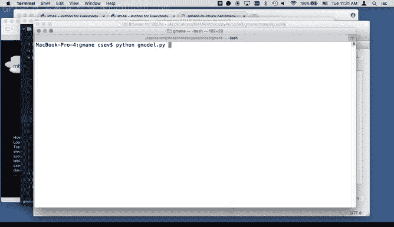
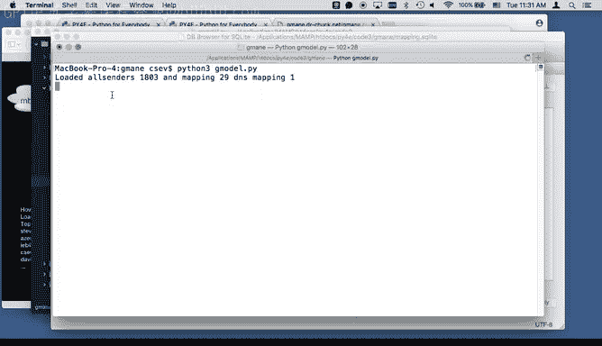
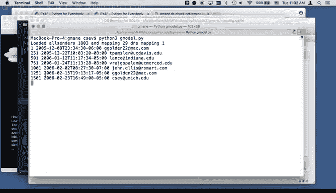
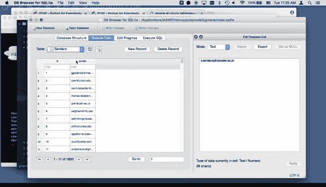
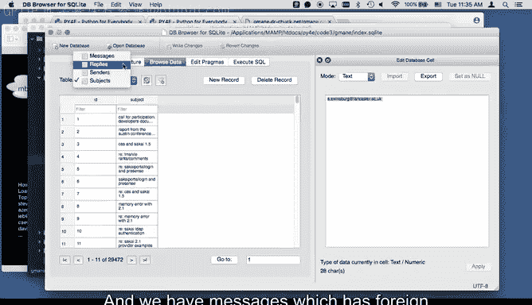

# 每个人的 Python 第五部分 15：15_04_03_实例演练-Gmane邮件建模 📧

## 概述

在本节课中，我们将学习如何对从Gmane邮件列表获取的原始数据进行清洗、建模和规范化处理。我们将把数据从一个简单的“内容”数据库，转换成一个结构更优、查询效率更高的“索引”数据库。这个过程涉及数据清洗、地址映射、数据压缩以及数据库规范化。

## 数据准备与背景

上一节我们介绍了如何使用爬虫从Gmane网站抓取邮件数据并存入`content.sqlite`数据库。本节中，我们来看看如何对这些原始数据进行清洗和建模。

我们已经运行了`gmane.py`脚本，成功抓取了约60，000封邮件数据，并存放在`content.sqlite`数据库中。通过数据库浏览器，我们可以看到每条记录都包含邮件头、主题、发件人地址和邮件正文等原始信息。

## 数据清洗与建模脚本：`gmodel.py`

现在，我们将重点分析数据清洗和建模的核心脚本`gmodel.py`。这个脚本的任务是读取原始的`content.sqlite`，经过一系列处理后，生成一个规范化的`index.sqlite`数据库。

以下是该脚本执行的主要步骤：

1.  **导入模块与初始化**：脚本导入了`sqlite3`、`re`（正则表达式）和`zlib`（用于数据压缩）等模块。
2.  **加载映射数据**：脚本首先从`mapping.sqlite`数据库中读取预定义的映射关系。这个文件包含两个手动处理的表：
    *   `DNS Mapping`：用于处理组织域名随时间变化的问题（例如，将`@iupui.edu`映射为`@indiana.edu`）。
    *   `Email Mapping`：用于处理个人邮箱地址变化或标准化问题。
    这些映射关系被读入两个Python字典（`dnsmapping`和`emailmapping`）中，以便快速查找。
3.  **连接数据库与创建新表**：脚本以只读方式连接`content.sqlite`，同时创建（或清空）`index.sqlite`。在`index.sqlite`中，它创建了四个规范化的表：
    *   `Senders`：存储唯一的发件人地址。
    *   `Subjects`：存储唯一的邮件主题。
    *   `Messages`：存储邮件核心信息，使用外键关联`Senders`和`Subjects`表。邮件的头部和正文内容会使用`zlib.compress()`进行压缩后，以BLOB（二进制大对象）格式存储。
    *   `Replies`：存储邮件之间的回复关系（这是一个多对多关系表，本节课代码未完全展示其填充过程）。
4.  **处理每封邮件**：脚本遍历`content.sqlite`中的每一封邮件。
    *   **解析与清洗**：使用正则表达式解析邮件头，提取发件人、主题、日期、Message-ID等信息。对发件人地址应用`dnsmapping`和`emailmapping`进行清洗和标准化。
    *   **管理外键**：脚本维护了两个内存字典（`sender_id`和`subject_id`），用于缓存“发件人地址/主题”到其数据库主键ID的映射。这避免了为每条记录重复查询数据库，极大提升了处理速度。
        *   如果遇到新的发件人地址，则插入`Senders`表并获取其ID，同时更新缓存字典。
        *   对邮件主题进行类似处理。
    *   **插入消息**：将清洗后的发件人ID、主题ID、压缩后的邮件头和正文，以及发送时间戳插入`Messages`表。
5.  **提交与关闭**：处理完所有邮件后，提交事务并关闭数据库连接。

## 运行脚本与结果分析

运行`gmodel.py`脚本需要约3分钟来处理60，000封邮件。虽然需要计算时间进行压缩，但最终得到的`index.sqlite`数据库体积更小，结构更清晰。

处理完成后，我们比较两个数据库：
*   `content.sqlite`：约1.2GB，包含原始、未规范化的数据。
*   `index.sqlite`：约263MB，是一个完全规范化的数据库，文本内容已被压缩。

在数据库浏览器中查看`index.sqlite`，可以看到规范化的表结构以及高效的外键关联。虽然邮件头和正文因压缩而无法直接阅读，但这种设计极大地节省了存储空间并提升了后续数据读取和分析的速度。

## 总结

本节课中我们一起学习了数据清洗和建模的关键步骤。我们通过`gmodel.py`脚本，将原始的、杂乱的邮件数据，转换成了一个干净、规范、高效的`index.sqlite`数据库。这个过程涵盖了地址映射、数据压缩、数据库规范化以及使用内存缓存优化性能等重要技术。虽然建模过程需要一些时间（约3分钟），但相比于原始数据抓取的数小时，以及为后续数据可视化分析带来的秒级查询速度提升，这一步的投入是非常值得的。下一节，我们将基于这个清洗好的数据库，开始进行数据的提取与可视化。