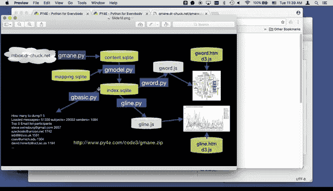
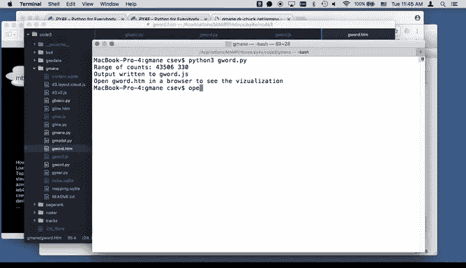
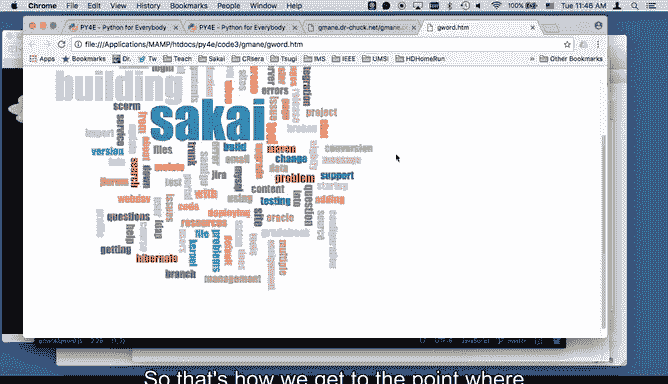
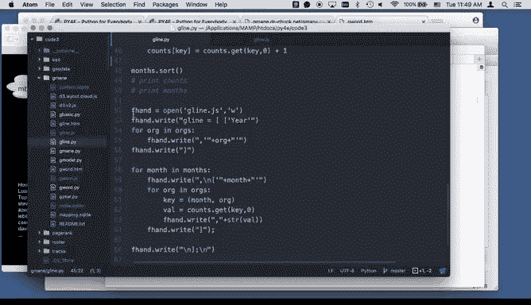
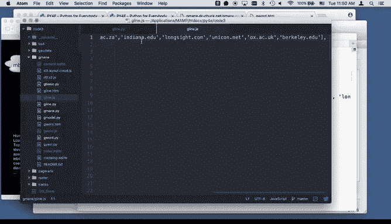
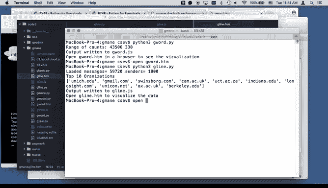
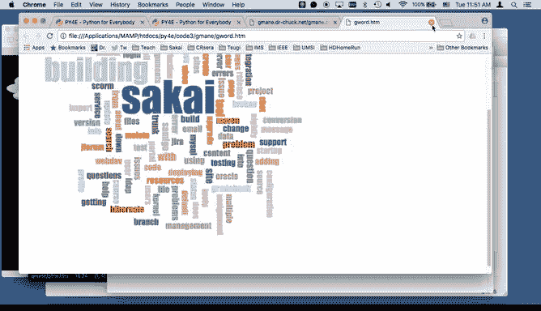

# 5：《毕业项目：使用Python检索、处理和可视化数据》｜P19：19_06_01_实例演练-Gmane邮件可视化 📊

## 概述



在本节课中，我们将学习如何对已清理的Gmane邮件存档数据进行可视化分析。我们将通过编写几个简单的Python脚本来提取数据、进行基本统计，并最终生成两种可视化图表：词云图和折线图。整个过程将展示从数据查询到生成可视化结果的完整流程。

---

## 数据准备与基本统计

上一节我们完成了数据的爬取和复杂清理，得到了一个名为 `index.sqlite` 的SQLite数据库文件。本节中，我们首先进行一些基本的数据统计，以验证数据质量并获取初步洞察。

以下是第一个脚本 `gbasic.py` 的主要功能：

1.  **连接数据库**：脚本连接到清理后的 `index.sqlite` 数据库。
2.  **预加载数据**：为了提高效率，脚本将发件人（`senders`）和主题（`subjects`）信息预加载到内存字典中。
3.  **遍历消息**：脚本遍历所有邮件消息（不包含邮件正文和头部，以提升速度），提取发件人信息。
4.  **数据拆分与统计**：将发件人邮箱地址按 `@` 符号拆分为个人部分和域名（组织部分）。然后对个人和域名分别进行计数，生成直方图。
5.  **排序与输出**：对计数结果进行排序，并打印出发送邮件最多的前10个人和前10个组织。

运行该脚本的命令是：
```bash
python gbasic.py
```
输出结果显示了加载的消息总数、主题数、发件人数，以及排名前列的个人和组织。这种基础统计有助于进行数据完整性检查。

---

## 生成词云图

在了解了数据的基本构成后，我们进一步分析邮件主题中的关键词。我们将创建一个词云图来直观展示主题中出现频率最高的词汇。

以下是 `gword.py` 脚本的构建步骤：



1.  **加载主题数据**：从数据库中读取所有邮件主题。
2.  **文本预处理**：
    *   移除标点符号和数字（使用 `str.maketrans` 方法）。
    *   将所有字母转换为小写。
    *   将主题字符串拆分为单词列表。
3.  **词频统计**：对预处理后的单词进行计数。
4.  **数据归一化**：计算每个单词的频率，并将其映射到一个合适的字体大小范围内，为可视化做准备。
5.  **生成JavaScript数据文件**：将处理后的数据（单词及其对应字体大小）写入 `gword.js` 文件。这个文件的格式是为特定的D3.js词云可视化库准备的。



运行脚本生成数据文件：
```bash
python gword.py
```
生成的 `gword.js` 文件包含了词云所需的数据。随后，我们打开 `gword.htm` 文件，该HTML文件会引用D3.js库和我们的 `gword.js` 数据文件，在浏览器中渲染出动态、随机布局的词云图。

---

## 生成时间序列折线图

最后，我们来分析不同组织随时间推移的邮件发送活动。我们将创建一个折线图，展示排名前10的组织在每个月内的邮件发送量。

以下是 `gline.py` 脚本的执行过程：



1.  **预加载与统计**：与之前类似，预加载发件人数据，统计出邮件发送量前10的组织。
2.  **按时间与组织分组**：遍历所有消息，提取发送日期和发件人组织。将日期转换为“年-月”格式（例如 `2005-08`），然后以 `(月份， 组织名)` 为键，累计该组织在该月的邮件数量。
3.  **数据排序与格式化**：将累计结果按键（即时间顺序）排序。
4.  **生成JavaScript数据文件**：将排序后的数据转换为特定的JSON格式，并写入 `gline.js` 文件。这种格式符合另一个D3.js折线图示例代码的要求。




运行脚本生成折线图数据：
```bash
python gline.py
```
生成的 `gline.js` 文件包含了时间序列数据。接着，我们打开 `gline.htm` 文件。这个HTML页面会加载D3.js库和我们的数据文件，绘制出展示2005年至2015年间，各主要组织在SI（可能是某个邮件列表主题）讨论中参与度变化的折线图。

---

## 总结



本节课中我们一起学习了数据可视化流程的后半部分。我们编写了三个Python脚本：
*   `gbasic.py` 用于基础数据统计和验证。
*   `gword.py` 用于分析主题词频并生成词云图数据。
*   `gline.py` 用于分析组织参与度的时间趋势并生成折线图数据。



通过这些脚本，我们掌握了如何从SQLite数据库中提取信息、进行聚合计算、格式化数据以匹配特定可视化库（如D3.js）的要求，并最终在网页中呈现图表。虽然具体的D3.js绘图代码本身可能比较复杂，但本课的重点在于使用Python完成数据准备和转换的核心工作，这是实现数据可视化的关键一步。