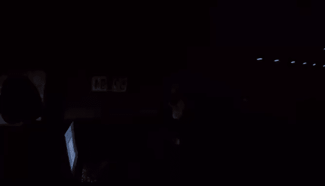

# 每个人的 Python 第五部分 20：办公时间-加拿大蒙特利尔

## 概述

在本节课中，我们将回顾课程第五部分的办公时间环节，地点位于加拿大蒙特利尔。本节并非传统的编程教学，而是记录了讲师与学生们的线下交流。我们将看到不同背景的学习者分享他们学习Python的动机、体验与收获。

---

## 课程内容回顾

上一节我们完成了数据可视化项目的核心部分。本节中，我们来看看学生们在实际应用课程知识时的真实反馈与交流。

编程能力结合数学与计算机科学知识可以完成许多事情。计算机科学专业的人会告诉你，其中大部分是数学，并且需要学习非常艰深的数学课程。然而，要成为一名计算机科学家，你并非必须精通数学；要成为一名技术专家，同样不必如此。

在许多高中课程中，你可以将编程与物理结合起来教学。我同意这个观点。我并非意指我有12门课程，并要求每位高中生仅仅因为这是我的领域就必须全部学习。

因此，他们可能只学习两到三门课程，这没有问题。他们可能仍然会上一门化学课，这相当于用编程温和地取代了部分化学课的内容。

让我们开始吧。宏观愿景关乎一个事实：让我们设想一下，向13到18岁（或13到17岁）的学生教授知识，目标是让他们掌握并记住，而不是进行筛选。

---

## 学生自我介绍与学习体验

以下是参与本次蒙特利尔办公时间的部分学生介绍及其学习感受。

*   **Katya**: 我两门课（Python和互联网历史）都上了，它们非常棒，谢谢您的教学。
*   **Car Hans**: 你好，我叫Car Hans。我是一名网站架构师，正在学习更多新知识。
*   **Seravvy**: 我是Seravvy，在麦吉尔大学攻读博士学位，计划从事PC相关工作。因为我会使用相关软件，所以我想学习Python来使用随机评估工具。
*   **Bni**: 我遇到过一位来自麦吉尔大学的最聪明的人，他是计算机科学家Ti。我是Bni，我正在享受这门Python课程。
*   **Jamatist**: 嘿，我是Jamatist，是一名视觉特效艺术家。谢谢Dr. Chuck，让我通过学习Python成为一名更好的艺术家。
*   **Mcwell**: 我是Mcwell，最近在蒙特利尔成立了一家科技公司。Python课程非常精彩，我打算夏天再学一遍。非常感谢。
*   **And**: 我是And。我很高兴向Chuck学习Python，它非常有趣且简单。谢谢。
*   **Sergio**: 我是Sergio，是Icare公司的航空分析师。我对Python感到惊奇，它为我完全打开了一些新的大门。谢谢你。
*   **Tim Mccherin**: 我是Tim Mccherin，正在学习“Python for Informatics”课程，感谢Chuck带来的这段美好经历。
*   **Olga**: 我叫Olga，这是我第一次上Cora的课程，我真的很喜欢。我希望它能帮我找到一份工作。恭喜你！
*   **Steve**: 我是Steve，我正在同时学习互联网历史和Python课程，两门课都让我非常愉快。
*   **Nancy**: 我是Nancy，我代表“Women who Code”洛杉矶分会感谢您，Dr. Chuck。
*   **Flor I on tooar**: 我是Flor I on tooar，我正在学习Python。这是我认真学习的第二门（实际上也是第一门）语言。我真的很享受这个过程，也非常喜欢您设置的课程方式，它真的非常有帮助。很高兴能上您的课，谢谢。
*   **Joanna**: 我是Joanna，我正在上Python课程，这是我的第一门编程语言，体验非常棒。
*   **Ramona**: 我是Ramona，我正在学习互联网历史课程，并计划在夏天学习Python课程。
*   **Pierre**: 我叫Pierre，我已经完成了Python课程，并希望继续学习其他课程。
*   **Matt**: 我叫Matt，是一名IT管理员。我已经学习Python几年了，它对我所做的每件事都很有帮助。谢谢Dr. Chuck。
*   **Saib**: 我叫Saib，我正在跟随Dr. Chuck学习Python。
*   **Dominda**: 我是Dominda，是麦吉尔大学的学生。我是初学者，所以今天的活动让我很感兴趣。

---

## 总结

本节课中，我们一起回顾了在蒙特利尔举行的课程办公时间。通过学生们的分享，我们看到了Python学习者的多元背景——从学生、研究人员到艺术家、分析师和创业者。尽管他们起点和目标各异，但都通过这门课程获得了宝贵的技能和新的可能性。本次交流因参与人数众多，甚至不得不从大厅更换到需要消费的会议室，最终在又一次成功的办公时间后结束。