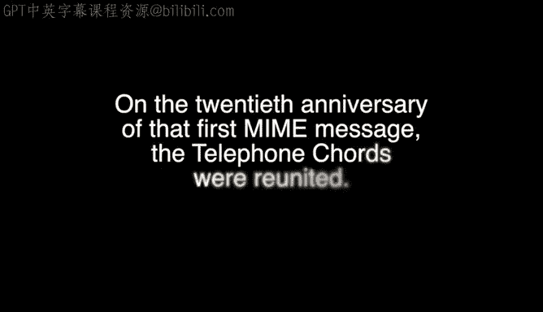

# 密歇根大学《给所有人的Python课》课程5：《毕业项目：使用Python检索、处理和可视化数据》｜P21：21_06_02_访谈-Nathaniel Borenstein（MIME协议之父）🧑💻

## 概述

在本节课中，我们将通过MIME协议之父Nathaniel Borenstein的访谈，了解互联网早期电子邮件系统的发展、MIME协议诞生的背景及其设计哲学。这有助于我们理解现代数据交换格式背后的历史与兼容性考量。

---

## 早期经历与问题发现

我从未打算进入电子邮件业务领域。我进入卡内基梅隆大学研究生院时，学校有一个名为“Liberman Q”的制度，研究生需要排队参与部门公共服务。轮到我时，任务是维护一个运行在TOPS-10系统上的古老电子邮件系统。

这个系统设计得非常精巧，促使我决定在Unix系统上重写一个邮件系统。完成后，我以为工作就此结束。我的论文研究方向是用户界面设计。

完成论文后，当我正在寻找工作时，我的论文导师（同时也是安德鲁项目的负责人）在我结束所有面试后问我：“你愿意留在这里一段时间，构建世界上最伟大的邮件系统吗？”

## 早期电子邮件的局限

当时的电子邮件（E-mail）只是纯英文文本。虽然存在针对其他语言的扩展，但它们只能在特定的国家或语言社区内使用。例如，一个日本人到法国使用当地的电脑，就无法阅读日文邮件。这显然不是理想的情况。

此外，那时我们拥有的不仅仅是互联网。我们有一整套网络：Binet、Usenet、NSFnet等。人们通过这些网络互相发送邮件，这些网络通过网关连接。但网关并不完美，因为它并不总能完全按照原意保留所有信息。

我喜欢这样形容：我从未见过一个能让邮件变得更好的网关。最好的情况是它不让邮件变得更糟。

## 多媒体邮件与标准化契机

我来自一个研究背景，曾构建过一个支持多媒体邮件的系统。这意味着邮件可以包含图片、声音、动画等各种内容，这在当时是相对超前的。这是卡内基梅隆大学一个团队项目的一部分。

真正让我开始思考标准化问题的是有一天史蒂夫·乔布斯来访。我们向他演示了安德鲁消息系统。他立即试图雇佣我们整个团队，但没有人接受。我猜那是他招聘史上最糟糕的日子之一。

他回到当时所在的NeXT电脑公司，组建了一个团队来构建多媒体邮件系统。因此，NeXT Mail可以说是安德鲁邮件系统的一个仿制品。模仿是最真诚的恭维，这很好，我没有任何意见。

但一旦它被构建出来，就很难忽视一个事实：虽然我的用户之间可以互发图片，他的用户之间也可以互发图片，但我的用户无法向他的用户发送图片，因为我们实现的方式不同。

于是我开始思考：这里确实需要一个标准。

## 多方需求的汇聚

与此同时，许多（几乎全部在美国以外）的人正在担心语言问题，即如何在电子邮件中处理非英文字符和其他语言。

还存在第三个问题：一些致力于解决我之前描述的网关问题的人，他们希望建立格式化标准，以便能向其他系统网关传递更高级别的信息。

MIME协议正是这三种需求幸运地汇聚在一起的产物。

启动这一过程的关键人物是Einar Stefferud，他是互联网的伟大无名英雄之一。他从70年代初就活跃在互联网上，发起了第一个互联网邮件列表，在许多方面都是先驱。他几年前去世了。

他介绍我认识了Ned Freed。Ned当时正在研究网关问题。我们很快结识了许多对语言问题感兴趣的人，而我则对多媒体问题感兴趣。我们很快发现，我们可以为所有这些问题提供一个统一的解决方案。

从标准化的角度来看，这样做的好处是能形成“跟风效应”。那些不关心多媒体邮件的人也会采用它，因为他们想要多语言邮件功能。当你将多媒体、多语言和网关这三种动机结合在一起时，就吸引了大量相关人士的关注。

## 标准制定的挑战与成功

当有这么多人参与时，无论有多少善意，总会有意见分歧。大约有70人参与，活跃程度不一。我们花了大约一年半的时间，才产出了我们认为稳定的第一版草案，也就是第一个作为RFC发布的版本。

它几乎一夜之间取得了巨大成功。我认为其中一个原因是，在我撰写草案的整个过程中，我编写了一个名为Metamail的程序，并不断更新它以适应草案的每个版本。

Metamail的作用是允许你对现有的纯文本邮件系统进行非常简单的修补，然后调用能够显示MIME部分的程序。因此，这些古老的系统只需极少的工作量，突然就能处理这些很酷的东西——各种语言、图片。这极大地加快了它的采用速度。

事实上，我们发布了MIME标准，然后我发布了Metamail软件，第二天就开始收到补丁，人们对其进行增强。在第一周内（这是一个Unix程序），我就收到了DOS端口和Amiga端口的补丁。那时，我相当确信我做对了事情。

## MIME的设计哲学与影响

对于今天的电子邮件，我们能否将其追溯回MIME？发展过程其实非常线性，而且演变并不算太大。我倾向于说这是因为我们很多事情都做对了。但为了避免显得傲慢，我也必须说，MIME是我见过的最丑陋的东西之一。它简直就是一堆“黑客技巧”堆砌起来的塔。

说实话，确实如此。而这也是它成功的原因之一。我们面临着与现有安装基础兼容的巨大问题。即使在那时，全球可能已有数百万人在使用电子邮件，大量软件不会被轻易抛弃。因此，设计受到了很多限制，这也导致了MIME的丑陋。

但正因为设计时考虑了这一点，它才为被广泛采用做好了准备。它不需要太大演变的另一个原因是，从某种意义上说，它几乎是另一个东西（X.400）的第二个版本。

X.400是来自OSI协议栈的电子邮件标准，本应取代整个TCP/IP协议栈，但从未成功。我们很多人研究了X.400，它极其复杂，很难与现有的邮件系统集成。因此，我们更简化的方法是对此的一种反应。

这就是为什么MIME中有一些东西，如果你从头设计是绝不会采用的。例如，80字符的行限制（实际上略长一些，但基本上是限制行长度的）。为什么？这可以追溯到电传打字机。实际上，它甚至可以追溯到更早的打孔卡机，因为第一批视频终端有80列，以便轻松处理打孔卡。所以，基本上你今天的邮件被限制在80列左右，是因为一百年前打孔卡机的规格。

我们创造了这个丑陋的东西来实现向后兼容。我认为这就是它像火箭一样腾飞的原因。

它像火箭一样腾飞的另一个原因是，当我们即将完成时，我收到了一位在瑞士从事某个项目（我从未听说过）的同事的邮件。他说：“我正在做一个名为万维网的项目，目前它只是纯文本的，我们正在寻找实现多媒体的方法，我们认为MIME可能是实现方式。你有什么意见或想法吗？”因此，万维网采用MIME无疑也极大地推动了它的普及。

万维网确实借鉴了MIME，特别是其“内容类型”注册机制。MIME有几个部分被网络借鉴。其核心，也是最重要的部分，正如你所说，是内容类型注册表。

因此，如果我需要向你发送一些我刚发明的奇怪数据类型，我必须以某种方式标记它。对于实验性内容，有一种标记方式；而对于你希望至少能半永久性互操作的内容，则有一个注册表可供使用。

当我们发布MIME标准时，我认为它定义了大约10到20种内容类型。我上次查看时，IANA的MIME类型注册表已超过1000或1200种。这种可扩展性也起到了积极作用，因为许多动机完全不同的人，无论是为了网页还是电子邮件，都有一个简单的方法来标识数据。

---

## 总结

本节课中，我们一起学习了MIME协议诞生的历史背景。我们了解到，MIME的成功源于它巧妙地整合了早期互联网对多媒体内容、多语言支持和跨网络网关兼容性的三大需求。其设计虽然为了向后兼容而显得复杂甚至“丑陋”，但正是这种对现实约束的考量，以及通过“内容类型”机制实现的强大可扩展性，使其被迅速采纳，并成为现代互联网（包括万维网）数据交换的基石。这提醒我们，优秀的技术标准往往是在理想设计与现实约束之间寻求平衡的产物。