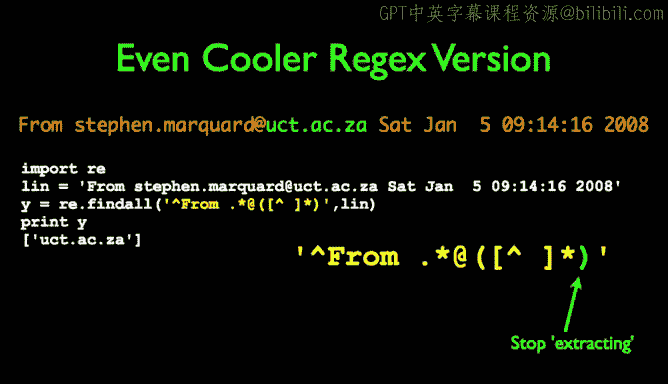

# 每个人的 Python 第五部分 23：史蒂夫·乔布斯、NeXT与互联网 🌐💻

## 概述
在本节课中，我们将回顾一段历史，探讨史蒂夫·乔布斯及其公司（苹果与NeXT）所创造的技术如何对互联网和万维网的早期发展产生了深远影响。我们将看到，这些技术不仅是工具，更是激发早期创新者构想的灵感源泉。

---

## 引言：技术先驱的遗产

欢迎来到《与计算对话》专栏。本节内容着眼于史蒂夫·乔布斯职业生涯中所创造技术的一系列连锁效应。我们将看到，来自苹果和NeXT的技术，如何为互联网和万维网的众多早期创新者提供了灵感。

我发现史蒂夫·乔布斯去世的消息是在10月5日晚上，当时我正在录制一堂关于在Python中使用正则表达式的讲座。这堂课是为之后的播客准备的。你或许之后会想深入探究这个技术话题，这完全可以理解。虽然避免深入技术细节也没有问题，但本节内容确实涉及技术，并且非常专业。我认为这很了不起。

## NeXT工作站与万维网的诞生

就在下一周，在同一间教室，我讲授了关于互联网和万维网历史内幕的课程，分享了我对早期先驱的一些采访。在讲课和观看采访视频、思考乔布斯时，我开始意识到苹果和NeXT的技术对那些早期创新者有多么重要。在某种程度上，这些技术的存在本身就推动了互联网和网络革命向前发展。

在我1999年对万维网联合发明人罗伯特·卡里奥的采访中，我们坐在他的办公室里，旁边就是那台运行了第一个网络服务器的NeXT Cube。罗伯特描述了NeXT的开发环境如何让他们在1990年快速构建出网络浏览器的原型版本。你能感觉到，NeXT的硬件和软件在他们早期的网络构想中是平等的合作伙伴。

> “显然，整个高能物理学界从很早以前，从网络出现时起，就形成了一个微型信息社会。因为我们有传播文档的需求，所以我们建立了像集中式数据库这样的东西……但当网络出现时，你需要知道连接哪台电脑、对那台电脑说什么等等的必要性就消失了。人们发布这些带有链接的页面，你可以直接跟随链接到达你想去的地方并找到一切。而且它们都是同一种格式，这非常重要……我们打破了那种垂直市场的专有商业系统……我认为，我们在顶层的浏览器和底层的数据库之间所做的横向分割，对我们自己有用，对其他人也有用。这就是最初的样子。蒂姆和我都是在这台NeXT机器上完成这一切的，大约在1990年。第一台服务器就是它。大约1990年底，美国的第二台服务器大约一年后在斯坦福大学上线……”

## 先进开发环境的影响

NeXT的开发系统远优于当时任何其他系统，以至于将他们的成果移植到其他平台需要多花一两个数量级的时间。

> “例如，每次你点击这里，就会打开另一个窗口。每次你点击一个图表，图表就会在另一个窗口中显示。你点击一张地图，就能得到可缩放、完美可打印的PostScript格式地图。如果你试图把它移植到另一个系统，你会遇到阻碍。做一个编辑器和做一个只能显示页面、你无法与之交互的东西，是有很大区别的……我们的系统从1990年开始也与此相关。我的意思是，直到NeXT停止生产硬件，我不得不从NeXT换回Macintosh时，我才不得不学习HTML。在那之前，我们生成所有文档和东西，但我们从未见过HTML，也从未见过任何URL，因为你通过说‘把这个链接到那个’来链接，而不是输入URL。有一个特殊的窗口你可以调出来输入URL，如果需要的话，但那不是通常的做法。我是在那之后，以艰难的方式学会了所有那些导航部分，比如HTTP等等，因为你失去了那个系统。”

**核心观点**：史蒂夫·乔布斯的NeXT工作站对于最早网络软件的创建至关重要。其先进的开发环境和丰富的显示能力，引导早期创新者将互联网视为一种引人入胜的多媒体体验，而不仅仅是纯文本。

## 早期网络服务器的普及

在我2007年对保罗·昆斯的采访中（他于1991年12月在斯坦福线性加速器中心的IBM大型机上建立了美国第一个网络服务器），我们看到他的办公室里仍然有一台可工作的彩色NeXT工作站。当保罗为IBM大型机开发软件时，全世界大约只有20台网络服务器。如果你想用一个网络浏览器来测试你的服务器，拥有一台NeXT工作站是必不可少的。

> “所以当我在1991年9月在欧洲核子研究中心时，蒂姆·伯纳斯-李博士在他的办公室给我演示了网络。起初我不是很感兴趣，但当他演示如何查询大型机上的帮助系统数据库时，我立刻明白了，我说，好吧，如果你能查询大型机上的帮助系统，你就能查询大型机上的数据库……那个数据库本身大约有30万个条目，在被放到网上之前和之后都被大量使用……人们注册了大型机上的计算机账户，他们可以进行查询，来自世界各地，我想大约有4000个注册用户……我使用了用C语言编写的CERN服务器软件。不幸的是，那时我们在大型机上刚好有一个C编译器，但时间不长。所以我所要做的就是写一些额外的C代码，来获取用户所做的查询并将其转换为数据库查询。这不是最初在NeXT上的网络服务器吗？所有的网络软件最初都是在欧洲核子研究中心的NeXT上开发的。”

## 从学术走向大众：图形化浏览器的出现

当网络和网络技术在学术界和研究界（他们桌上通常有强大的UNIX工作站）获得关注时，世界其他地区还在使用面向文本的Gopher客户端和服务器浏览互联网。1993年，伊利诺伊大学厄巴纳-香槟分校的国家超级计算应用中心发布了NCSA Mosaic。Mosaic是第一个在UNIX、Macintosh和Windows上运行的图形丰富的网络浏览器。

在我1997年对拉里·斯马尔的采访中，他指出NCSA Mosaic浏览器的成功部分归功于早期开发NCSA图像库的工作，该库利用了早期苹果Macintosh计算机的图形能力。

> “我们在那个时期基本上所做的是……为图像创造一个安全的世界。NCSA图像所做的基本上是，我们说我们想建立一个基础设施世界，在其中移动一张图像就像移动一个单词一样容易。那是我们的设计口号，当时我们就是这么说的。这意味着我们必须扩展网络，扩展磁盘驱动器，扩展计算能力。我们必须转向全彩。当Mac II刚出来时，有256色。我们得到了50台，苹果给了我们50台Mac II，这在当时是惊人的，事实上我们是当时苹果先进技术组在全国学术团体中获得资助最多的团体。IBM当时告诉他们的客户，你不需要彩色。我们已经提供了，黑色、白色、青色、洋红四种，你为什么需要更多？我们所做的是，我们把那些价值10万美元的计算机图形工作站上的图像处理技术（医学成像人员使用的，卫星侦察人员使用的）全部拿来，放进软件里，做成Mac上的NCSA图像。这样你只需移动鼠标就能做到原本需要花费10万美元、并且必须是精英专家才能做到的事情。这就是把精英人士知道怎么做、负担得起做的事情，变得大众化。”

## 乔布斯的理念与持久影响

在我得知史蒂夫去世消息的第二天，我碰巧在纽约市有一个晨会，所以我去了曼哈顿的苹果商店，感受一下我们对失去这样一位以多种方式影响我们的杰出远见者的集体反应。

> “我在曼哈顿的苹果商店。我给你们看看我们看到的情况。我们看到媒体，我们看到一个为史蒂夫·乔布斯举行的临时纪念活动。有苹果，有鲜花，有各种各样非常酷的东西，但人群似乎非常安静。有媒体在采访所有人，你可以看到媒体，他们从街上拉人采访，我肯定他们在捕捉人们的想法。我们就在这里，在史蒂夫·乔布斯去世一天之后。”

在苹果和NeXT，以及后来重返苹果的整个职业生涯中，史蒂夫·乔布斯从未对最廉价或利润最高的技术感兴趣。他追求最好和最先进的技术。在他的许多设计和决策中，他为整个消费技术市场提供了路线图。难怪我们许多人会屏息期待每一次苹果的发布会。它们总是对未来技术令人兴奋的一瞥。在过去的30年里，来自乔布斯公司的产品使用起来是一种乐趣，而更重要的是，它们激励了许多创新者将目光聚焦在激动人心且未被探索的未来上。

---

## 总结
本节课我们一起回顾了史蒂夫·乔布斯、NeXT公司与早期互联网发展的紧密联系。我们看到，NeXT先进的工作站和开发环境为万维网原型和早期服务器的创建提供了关键平台。随后，从NCSA Mosaic图形化浏览器的诞生中，也能看到苹果Macintosh在推动图像处理大众化方面的基础性影响。乔布斯对卓越技术和用户体验的执着追求，不仅创造了伟大的产品，更重要的**是为整个行业树立了标杆，并持续激励着创新者去探索技术的未来**。理解这段历史，有助于我们认识到技术发展并非孤立，而是建立在先驱者的远见和扎实的工具基础之上。