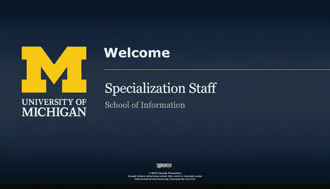
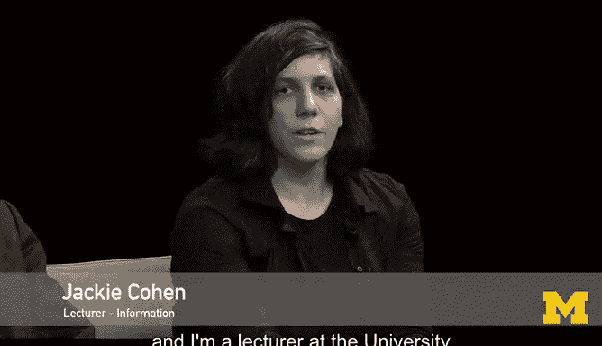
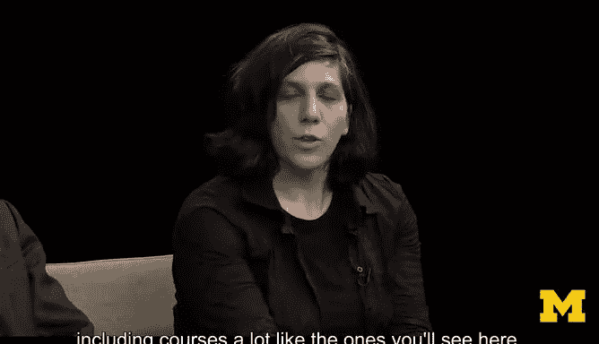
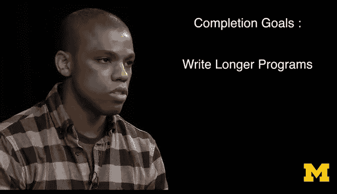
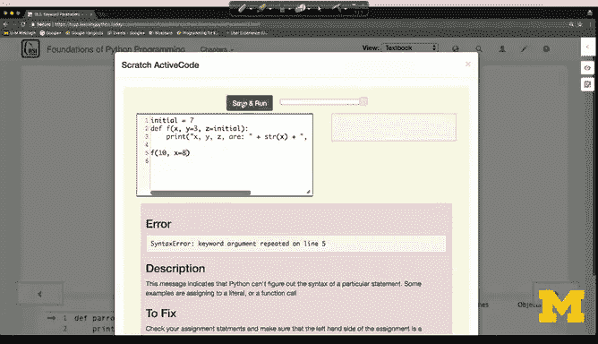
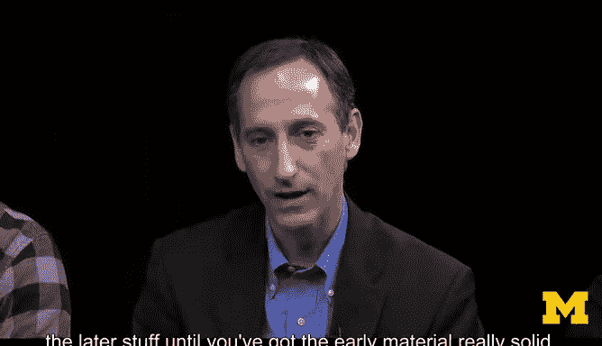
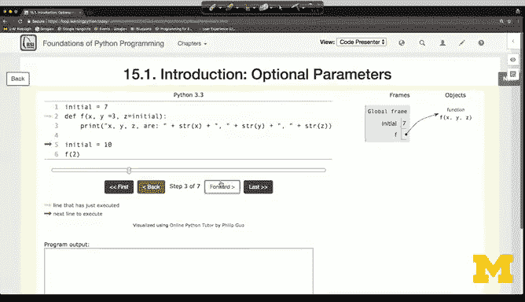

# 1：专项课程导论 🎬

在本节课中，我们将了解密歇根大学《Python 3 编程》专项课程的概览、教学团队以及课程的核心特色与学习工具。本课程旨在帮助初学者打下坚实的 Python 编程基础。

## 教学团队介绍 👨‍🏫

大家好，我是密歇根大学信息学院的助理教授 Steveonni。我在信息学院教授一些编程入门课程。编程正日益成为一种基础且重要的素养，能帮助我们处理日常生活中日益增长的数据量，因此我非常高兴你能加入我们。我的研究主要致力于让编程工具更易用，即围绕人们的思维方式和我们实际的编程方式来设计工具。在课程一、二和四中，你将看到我的身影。

大家好，我是 Paul Resnick，密歇根大学信息学院的教授兼研究副院长。作为院长，我授课不多，但我非常享受在这个专项课程中将要教授给你们的内容。你们将在课程一、二、几乎整个课程三以及课程四的部分内容中见到我。我喜欢“书呆子式”的双关幽默，也就是所谓的“老爸笑话”，我将在一些课程结束时与你们分享一些。在研究方面，我以“推荐系统”而闻名。近年来，我的工作集中在在线社区和教育技术领域。

大家好，我是 Jackie Cohen，密歇根大学信息学院的讲师。我教授许多编程课程，并负责构建、设计和支持大量课程资源。在这里，我将引导你们完成期末项目，并提供一些有用的提示和技巧。我希望你们能享受这些项目，因为它们非常有趣，并能为你提供在日常工作中使用编程的许多工具。

大家好，我是 Chris Brooks，密歇根大学的教员。在这个专项课程中，我将教授最后一门课程。在那门课程中，你们将学习使用图像处理库和大型图像集，并利用 Python 将其转化为有用的信息。我的研究专注于教育技术，并教授许多数据科学课程。我期待在最后一门课程中见到你们。

大家好，我是 Charles Severance。你们可能之前在《Python for Everybody》专项课程中见过我。在这个课程中，我扮演的是“程序员之道”的角色，这意味着我可以自由地展示一些我认为有趣的东西，而不是教授核心内容。我的研究领域是教育技术。我最近的一个爱好是在赛道上驾驶赛车。

大家好，我是 Lauren Murphy。几年前我学习了这个课程的校园版本，后来作为教学助理帮助其他学生学习。现在我回来帮助构建本课程的测验、评估和项目。我非常高兴你们有机会学习同样的材料，并希望你们学得愉快。

## 课程目标与结构 🎯

在这个 Python 3 编程专项课程中，你将通过学习语言的细节基础，成为一名合格的 Python 程序员。你将学习如何导航复杂的数据结构并从中累积结果，还将学习如何将数据转换为可供其他程序使用的格式。

在专项课程结束时，你将能够编写数百行的 Python 程序，能够在代码中使用和集成 Python 模块，并且能够通过阅读文档来使用外部工具（如 API）。

我们从零开始，不预设任何先验知识，但我们会深入 Python 的基础，确保你理解代码的每一个方面。

## 核心学习工具与环境 🛠️

上一节我们介绍了课程目标，本节中我们来看看支持我们学习的核心工具。

我们将使用 **Runestone 交互式教科书** 环境。这个环境允许你将学习材料与主动代码评估交织在一起，使你能够实际编写代码。我们发现动手编写代码非常重要，因为即使你从理论上理解了一个概念是如何工作的，实际编写代码才能获得更深的工作理解，并知道如何在实践中应用这些概念。

以下是 Runestone 环境的主要特点：
*   **代码透镜工具**：这是一个可视化工具，可以让你逐行查看程序执行时发生的情况。你可以前进和后退，观察变量的值以及列表内容的变化。这对于理解和调试程序非常有帮助。
*   **即时反馈**：你不仅可以在浏览器中运行代码，系统还会立即告诉你是否正确。你可以尝试任意多次，直到完全掌握。
*   **掌握式学习**：我们设计的评估要求你必须达到 100% 的正确率才能通过。这样做的原因是我们希望你建立扎实的掌握，在深入学习后续内容之前，确保早期材料非常牢固。

## “程序员之道”与项目实践 💡

除了学习 Python 特性和如何使用 Python，课程还包含“程序员之道”环节。编程更像是一门艺术而非纯粹的科学，做事情有很多正确的方法，但存在最佳实践。

以下是“程序员之道”环节涵盖的部分内容：
*   **增量式编程**：学习如何逐步构建程序。
*   **编写自动化测试用例**：学习如何编写良好的自动化测试（这部分将在课程四深入介绍）。
*   **项目实践**：在所有项目中，你将找到方法，将在课程中学到的概念转化为现实生活中的应用。例如，构建对工作、学习或爱好有用的程序。

## 学习路径与持续练习 🔄

学生们经常问：“学完这个之后该做什么？” 我们在这个专项课程的最后设置了一个项目课程，专注于教你如何利用外部的 API 或软件包，并利用它们做一些新颖的事情，而不仅仅是学习。

编程环境多种多样。Runestone 是其中之一，你们在《Python for Everybody》中使用的工具也是。**Jupyter Notebook** 是另一个非常常见的环境，我们在数据科学专项课程中会教授它。我们试图展示 Python 编程环境和生产环境的多样性。

练习在编程语境中至关重要。Lauren 编写了一些优秀的练习题供你们在整个课程中练习。我们还有一个很棒的**练习工具**，它会根据你的掌握情况，动态地为你复习过去的问题。如果你完成了当天的所有练习题，它还会显示有趣的烟花效果作为奖励。

## 总结与祝福 ✨

本节课中，我们一起了解了《Python 3 编程》专项课程的教学团队、核心目标、特色学习工具（如 Runestone 交互式环境和代码透镜）以及“程序员之道”的理念。课程强调动手实践、掌握式学习和在不同环境中的应用，旨在帮助你从零开始，逐步成长为一名能编写数百行代码、使用外部模块和 API 的合格 Python 程序员。

我们所有人都非常兴奋能与你们分享这些材料，希望你们学得开心，并祝你们好运！

（密歇根大学的校色是 maize 和 blue，我们称之为“玉米黄与蓝”。无论我走到哪里，只要身上有密歇根大学的标志，就会有人在机场对我说：“加油，蓝色！”（Go Blue）。）