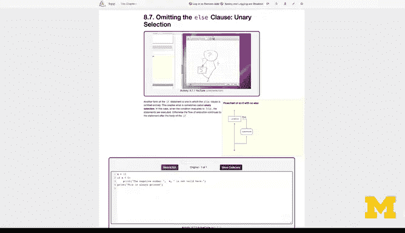

# 3：Python 3编程入门｜第1课：如何使用交互式教材 📚

在本节课中，我们将学习如何有效使用本专项课程提供的免费交互式教材。该教材包含多种互动功能，能帮助你更好地学习和练习Python编程。

---

大家好。我很高兴向大家展示这款免费交互式教材的一些实用功能，它将作为本专项课程的一部分提供给大家。

前四门课程的内容与教材内容紧密对应。因此，无论你从哪门课开始，都建议观看本视频以了解重要的互动功能。如果你在之前的课程中已经看过，可以跳过。

Runestone交互式教材环境是我的朋友Brad Miller的创意。在过去的四年里，我对软件环境和教材内容都做出了一些贡献，但Brad应获得几乎所有的赞誉。让我们来看一下。

每次访问Runestone教材时，你都需要从类似这样的Coursera页面进入，该页面链接到教材中的特定章节。点击这里的对勾标记，然后启动应用。它会带我进入一个像这样的教材页面。系统会自动识别并登录我的身份，因为我是从Coursera跳转过来的。

在教材中，你会看到文本、图片和图表。但你还会发现一些互动元素。

## 互动代码窗口

以下是所谓的“活动代码窗口”。它里面有一些代码。我可以点击“保存并运行”。代码会运行，并在旁边的输出窗口打印出结果。我可以修改这段代码，然后再次运行。你所有保存并运行的代码版本都会被记录下来。这里有一个小滑块，我可以移动它来查看我所有的旧版本。这些版本不仅在页面打开时被保存，而且是永久保存的。例如，让我们重新加载这个页面。页面加载后，我们回到了原始的窗口内容。但我可以点击“加载历史记录”，然后就会出现滑块，显示我最后一次运行的代码。现在，如果我重新运行一个之前的版本，它不会在滑块中显示为最新版本。但如果我修改它，例如将`17`改为`18`，现在它就成了历史记录中的最新版本。

## 代码透镜功能

代码透镜是活动代码窗口的一个非常有用的功能。这是由加州大学圣地亚哥分校的Philip Ge教授开发的一个神奇工具。😊 它允许你逐行单步执行程序。我可以点击“前进”，它会显示一行代码执行后发生的情况，然后是下一行，以此类推。现在可能看起来没什么大不了，但当你开始编写包含条件执行、循环和自定义函数等更复杂的程序时，它将变得非常有用。

我们在这个专项课程中的教育理念之一是揭示所有“魔法”。我们希望为你提供一种理解程序执行方式的方法，因为这是通过理解而非试错来调试代码的基础。代码透镜对此大有帮助。

有时，这些代码透镜示例直接内置在教材页面中。但你也可以通过点击任何活动代码窗口的“显示代码透镜”或“隐藏代码透镜”来随时启用它。这里有一些直接内置在教材页面中的例子。

## 其他互动功能

教材中还有其他互动功能。这里有一个多项选择题。你可以回答这些问题，并通过点击“检查我”获得即时反馈。实际上我已经回答过这个问题了，但假设我说这里会打印出“Thursday”，因为变量`day`被设置为“Thursday”。我点击“检查我”，它会给我一些反馈。确实，“Thursday”是`day`的值，但它后来被覆盖了。所以正确答案是`19`。

在页面底部，有一个按钮可以点击以“标记页面完成”。这会在教材目录中用特殊颜色标记该页面，但除此之外没有其他影响。如果你希望目录能跟踪你的进度，可以随意点击；你也可以忽略这个按钮。

在Coursera上，我们通常会提供指向特定页面的链接，因此你可以只阅读那一页。但如果你愿意，一旦进入Runestone网站，你可以通过教材导航。我们有这些“前进”和“后退”按钮，可以前往本书的下一页或上一页。如果你点击教材标题，就像我刚才展示的那样，你会进入一个非常详细的目录，其中列出了每一页，有时还包括页面内的子章节。

最后，还有一个搜索选项。我可以搜索“变量”，它会告诉我教材中所有出现“变量”这个词的页面。还有一个索引。我可以查找各种内容，点击它们，就会跳转到教材中的相应位置。

## 练习工具

Runestone教材还包含一个练习功能。有两种方式可以从Coursera进入：你可以打开在许多地方重复出现的“练习活动”，就像我在这里一样，然后启动它，就能进入练习工具。另一种选择是，从任何Runestone教材页面内部，你都可以点击“练习”，通过这种方式进入练习工具。

练习工具会向你呈现你之前打开过的页面中的问题。当你在这里练习时，你可以再次回答问题。如果你答对了，Runestone会记住，并且在一段时间内不会再问你同一个主题的问题。如果你答错了，它可能会在明天再次问你。所以如果我向下滚动，我可以看到它计划在何时再次问我不同主题的问题。由于我还没有在书中打开很多页面，它只有几个主题供我练习。而且由于我没有在这些主题上回答太多问题，它准备很快再次问我，比如它计划在一天后问我关于序列长度的问题，还有关于变量、变量名和关键字的问题。关于更新变量，它计划在五天后问我。而下面的这些主题，它准备今天就问我。事实上，它即将在顶部显示的第一个问题是关于第2章第15节“输入”的。

在你对一个主题练习几次之后，你会看到再次被问到的间隔时间越来越长。例如，我之前正确回答了这个问题，现在它今天又来问我了。你还不太了解Python，所以我们假设你知道这些内容，然后回答它。是的，我答对了。我说“完成，问我另一个问题”。它问了另一个问题，但我可以向下滚动，看到“输入”这个主题将在六天后再次被问到。当它在六天后再次问我时，如果我又答对了，那么再次问到该主题的间隔时间会更长。

这个练习工具是我的博士生Iman Yazdanmehr的创意。我们向校内课程的学生提供了这个工具，那些更多使用它的学生在课程考试中的表现比不使用的学生好得多。这对我来说是一个相当显著的结果，因为多年来我一直在观察仅仅在教材上花费更多时间是否对学生表现有类似的影响，结果是没有。使用练习工具确实对学生产生了积极影响。因此，现在在我的校内课程中，使用这个练习工具是必须的，并且能为最终成绩赢得几分。我们甚至有一个系统，学生根据使用天数而非问题数量来获得积分，这就是为什么你在页面顶部看到类似“你已因使用此练习工具3天而获得3分（满分50分）”的提示。

对于Coursera课程，这不是强制要求的，但根据我在校内学生身上看到的结果，我强烈建议你每天使用一点。我想你也会发现它很有收获。我们的校内学生喜欢他们获得的烟花效果。所以在这里，我要回答我今天要完成的五个问题。还需要再做四个。一个列表不一定只能包含整数。所以那个错了，让我们纠正它。这里会打印什么？第四个字符是‘H’。现在我到了最后一个问题。我已经正确回答了最后一个问题，准备领取我的完成积分。它让我稍等。然后告诉我做得很好。你可能注意到了那些烟花，如果你觉得不够，可以点击获得更多来庆祝你完成练习。在一天内正确回答五个问题后，你会获得烟花。但你不必就此停止。你可以继续回答任何计划在今天完成的问题，所以我实际上还有三个今天可以回答的问题，我可以继续做。

## 评分作业

对于那些为了获得证书而学习本课程的同学，你还会看到评分作业的链接，通常出现在每节课或每组课程结束时。在前四门课程中，评估和项目都在Runestone教材中，并且都是自动评分的。只有在付费学习课程以获得证书的情况下，你才能在Coursera上看到这些内容。如果你没有付费，你可以在Runestone教材每章末尾的评估页面找到类似的问题。

让我们点击第一个评估的链接。这个评估只有两个问题。实际上我之前已经正确回答了其中一个。那是一个多项选择题。他们希望我写一些代码。这个问题的答案是`print("Hello World")`。我保存并运行它，会得到一些即时反馈。这里有一个自动测试，它告诉我我得到了正确的输出。如果我说`print("hello word")`，我会得到反馈说我失败了。实际上，当我告诉它给我评分时，它会使用我给出过的最佳答案。所以，如果我曾经设法通过了测试，我就会通过这个评估。

我们设置的评估通常要求你获得100%才能通过，但你可以不断尝试并获得反馈，直到达到100%。我们这样做是因为我们认为掌握早期材料非常重要，因为后续内容会不断建立在这些基础之上。所以我点击“给我评分”。它返回结果，你可以看到现在分数从0更新为1。我在这项评估中总共得了2分（满分2分）。如果我回到Coursera的这个页面并刷新它，它会告诉我我已经通过了，而不是“再试一次”。它以100%通过。

## 关于教材视频

关于教材的另一件事：许多教材页面在顶部包含视频。有些是Steve Only创作的非常酷的动画。😊 有些是由Google Education团队在Brad Miller指导下制作的带旁白的动画。我推荐观看这两种，它们都非常好。然而，有些只是对教材内容的解释，并且其中一些视频分辨率较低。我建议跳过那些，转而观看我们在Coursera上对教材内容的讲解。

---

这就是Runestone环境。对于我们所有在过去几年中作为开源项目为之努力的人来说，这都是一项充满热爱的工作，尤其是项目发起人Brad Miller。我希望在你掌握Python基础的过程中，你会发现它对你非常有帮助。

我通常会在镜头前以一个小笑话结束，所以这里有一点幽默的建议：今天就拖延，总是今天，不要拖到明天。好吧，那么别听我的建议，今天不要拖延，去开始本课程的第一课吧。下次见。