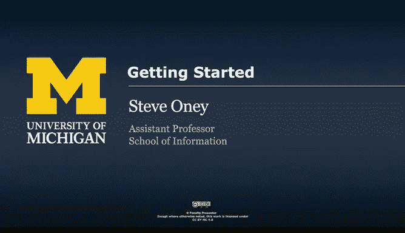
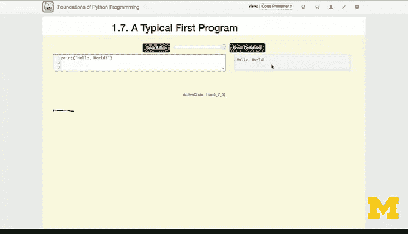

# 课程1：Python编程入门指南 🐍




在本课程中，我们将学习如何使用Python编程语言编写计算机程序。但在深入学习之前，我们需要明确编程究竟是什么。

## 什么是编程？

编程本质上是为计算机提供一系列需要遵循的指令。在编程语境中，这些指令有时被称为**算法**。

计算机非常擅长可靠且快速地执行这些指令，但缺乏创造性。我们不能直接用英语或其他自然语言给计算机下达指令，因为自然语言存在歧义——词语或句子可能有多种含义，而计算机无法自行判断。

因此，我们需要使用**编程语言**来给计算机下达指令。编程语言是一种计算机能够理解的语言，因为它具有正式的语法或规则集。

## 为什么选择Python？

世界上存在许多编程语言，包括JavaScript、C++、Java、Haskell等等。在本课程中，我们将学习使用**Python编程语言**。

学习编程不仅仅是学习Python语言的规则，更重要的是学会如何分解和解决问题，这种能力适用于任何编程语言。我喜欢将编程视为一个**翻译过程**：程序员将自己的目标从自然语言翻译成编程语言。

例如，如果我想编写自己的《命运之轮》游戏版本，就需要将游戏规则翻译成用Python编写的一套明确指令，告诉计算机如何运行游戏。

随着你成为一名程序员，你将学会如何构思解决问题的策略或算法，以及如何将这些策略翻译成计算机可以执行的Python代码。

## 开始动手实践

学习编程的最佳方式是通过实践。在本课程中，你将能够在浏览器中直接编写Python代码。

你会在教材中看到所谓的“活动代码窗口”，它们看起来像这样：

```python
print("Hello World")
```

大多数编程课程都以一个“Hello World”程序开始，即一个运行时在屏幕上打印出“Hello World”的程序。在Python中，打印“Hello World”的程序看起来就像上面那样。

为了实际运行这段代码，我们需要点击“保存并运行”按钮。点击后，右侧会出现一个输出窗口。

## 代码窗口详解

左侧是我们的**Python源代码**，右侧是**输出**。

当我们点击“保存并运行”时，背后有一个隐藏的**Python解释器**在工作。它会查看源代码中的内容，并打印出任何相关的输出。

请记住，源代码是一组指令。在这个例子中，源代码的指令是打印引号内的内容，即“Hello World”。

如果我们想改变这组指令，例如，我想让它打印“Hello, Michigan”，那么我需要通过再次点击“保存并运行”来让解释器处理它。现在，你会看到我的输出从“Hello World”变成了“Hello, Michigan”。

## 使用注释

Python解释器通常会尝试运行我们放入源代码窗口的所有代码。但有时，为自己或其他查看源代码的程序员留下自然语言的笔记或解释会很有帮助。

为此，我们使用**注释**。在Python中，我们使用井号（`#`）来编写注释，并在其后写下我们想说的内容。

```python
# 这是一个注释，解释器会忽略它
print("Hello World")  # 这行代码会执行，打印Hello World
```

当我们编写注释时，Python会忽略井号之后的所有内容。这意味着我们可以在这里写任何东西。在下一行，Python会再次开始运行代码。注释的作用是告诉Python解释器忽略源代码的这些部分，只运行未被注释的代码。

## 处理语法错误

值得注意的是，Python解释器并不宽容。回想一下，当你编写源代码时，你是在给计算机一组指令，这些指令必须是明确的，并且需要遵循Python编程语言的规则。

Python的规则之一是，当我们有一个开括号时，就必须有一个闭括号与之匹配。

假设我忘记了这条规则，删除了这个闭括号，然后尝试运行我的程序。结果是我会得到一个**语法错误**。

语法错误是Python在说它不理解你写的东西的规则，因此它不会尝试执行源代码窗口中的内容。换句话说，语法错误发生在你没有遵循Python编程语言规则的时候。在这个例子中，我们违反了开括号后必须有闭括号的规则。

在本课程中，我们会遇到语法错误和其他类型的错误，包括运行时错误和语义错误。当我们遇到语法错误时（这在课程中会发生很多次），我们可以通过编辑源代码来修复它，使其遵守Python编程语言的语法规则。在这个例子中，我将添加一个闭括号来匹配这里的开括号。

现在，当我再次点击“保存并运行”时，你会看到语法错误消失，我的程序再次运行。

## 总结



本节课我们一起学习了编程的基本概念，了解了Python作为一种编程语言的角色，并动手运行了第一个Python程序。我们认识了代码窗口、解释器、注释，并初步了解了如何处理语法错误。

通过更多的练习，你将更好地理解Python解释器的工作原理，并能够编写更大、更复杂的程序。我们下次再见。