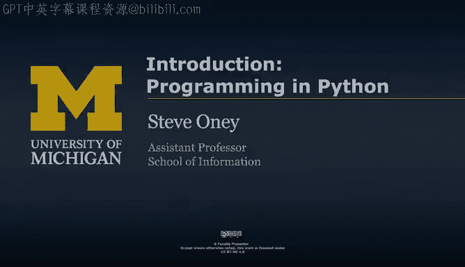

# 5：Python编程导论 🐍

在本节课中，我们将开始学习如何使用Python编程语言。我们将了解Python的特点、编写程序的基本概念，并学习如何编写能与用户进行简单交互、执行计算并输出结果的代码。

---

## Python作为入门语言的优势

上一节我们介绍了本课程的目标，本节中我们来看看为什么Python是一个优秀的编程入门语言。

Python因其**可读性**和**多功能性**而备受推崇。它的语法清晰、接近自然语言，这使得初学者更容易理解和编写代码。Python被广泛应用于众多领域，包括**数据科学**、**人工智能**，甚至**艺术创作**。

---

## 什么是编程？

在了解了Python的优势后，我们来看看编程的核心概念。

当我们编写一个程序时，我们实际上是在给计算机下达一系列**逐步的指令**，告诉它如何执行某个动作或解决某个问题。你可以把程序想象成一个详细的食谱，计算机则是严格遵循每一步的厨师。

---

## 本课学习目标

以下是本课程结束时，你应该能够完成的任务：

*   编写能与用户进行有限交互的Python代码。
*   编写能执行一些计算的Python代码。
*   编写能向用户呈现输出结果的Python代码。

---

## 总结

本节课中我们一起学习了Python作为第一门编程语言的优势，理解了编程的本质是向计算机提供步骤指令，并明确了本课程的学习目标。接下来，我们将开始动手编写你的第一个Python程序。