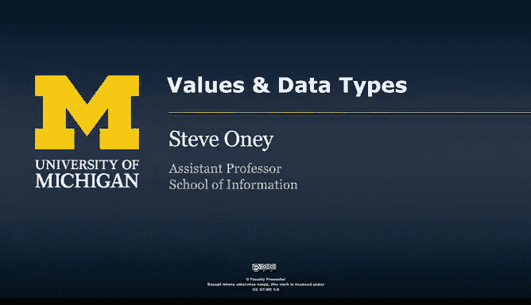
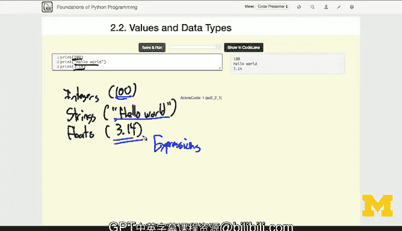

# 课程1：Python 3编程基础｜第2讲：值与数据类型 📊

在本节课中，我们将学习编写Python程序的一些基础知识。Python作为入门语言的一大优点是，编写一个简单的程序并不需要太多代码。

## 概述

我们将探讨Python程序的基本构成，理解什么是表达式、值和数据类型，并学习如何使用`print`函数在输出窗口中显示结果。

## 源代码、解释器与输出

当我们编写Python程序时，代码会写入一个窗口。这些代码随后会传递给**Python解释器**——一个在后台运行的程序。解释器会解读我们编写的代码，并根据指令可能向输出窗口发送信息。

因此，我们拥有三个关键部分：**源代码**、**Python解释器**和**输出**。

## 表达式与值

我们编写的代码实际上是由**表达式**构成的。学习编程，部分就是学习如何编写正确的表达式来计算我们想要的结果。

例如，`100`就是一个表达式。Python解释器会计算每个表达式的**值**。表达式`100`的值就是`100`。

## 数据类型

每个值都有一个**类型**。类型是数据的类别。

*   `100`的类型是**整数**，即没有小数部分的数字。
*   `3.14`的类型是**浮点数**，即包含小数点的数字。

我们之前也见过另一种类型：**字符串**。例如，在`print("Hello, world")`中，`"Hello, world"`就是一个字符串，它代表一个字符序列。

以下是目前我们接触到的三种基本数据类型：
*   **整数**：例如 `100`
*   **浮点数**：例如 `3.14`
*   **字符串**：例如 `"Hello, world"`

## 使用Print函数输出

通常，我们希望程序能给出反馈，在输出窗口中显示结果。如果只写`100`或`3.14`这样的表达式，程序会正确运行，但输出窗口不会有任何显示。

为了看到结果，我们需要使用**print函数**。`print`是一个特殊的表达式，它能将指定内容显示在输出窗口中。

其基本语法是：`print(表达式)`

例如：
*   `print(100)` 会在输出中显示 `100`。
*   `print(3.14)` 会在输出中显示 `3.14`。
*   `print("Hello, world")` 会在输出中显示 `Hello, world`。

## 字面量表达式

到目前为止，我们编写的表达式都是**字面量表达式**，即表达式的值就是它本身。
*   表达式 `100` 的值是 `100`。
*   表达式 `3.14` 的值是 `3.14`。
*   表达式 `"Hello"` 的值是字符串 `"Hello"`。

## 总结

本节课我们一起学习了Python编程的基础构件。我们了解了程序如何通过解释器运行，认识了**表达式**、**值**和**数据类型**（整数、浮点数、字符串）的概念，并掌握了使用**print函数**将结果输出到屏幕的方法。表达式是编程的基石，在下一节中，我们将看看如何使用**运算符**来组合这些表达式，构建更复杂的计算。