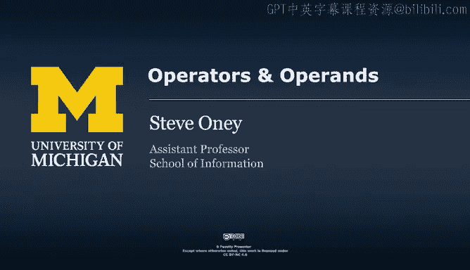
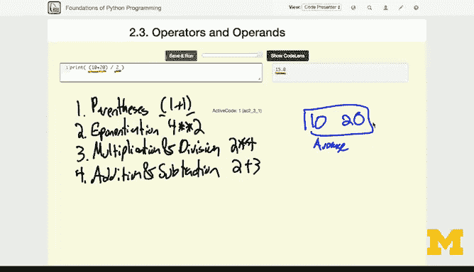

# 7：运算符与操作数 🧮




在本节课中，我们将要学习Python中**运算符**与**操作数**的基本概念。你将了解如何使用不同的运算符来组合表达式，以及Python如何遵循数学中的运算顺序规则来计算这些表达式的值。

---

## 概述

到目前为止，我们已经见过像 `100`、`"Hello world"` 或 `3.14` 这样的简单表达式。这些都是**字面量表达式**，其值就是表达式本身。

但表达式就像积木，可以组合起来形成更庞大、更复杂的表达式。**运算符**是组合表达式的一种方式。

---

## 加法运算符

我们将学习的第一个运算符是**加法运算符**。

为了使用它，我们可以这样写：
```python
print(100 + 200)
```
运行这段代码，你会得到值 `300`。当我们执行 `print` 语句时，打印的不是表达式 `100 + 200` 本身，而是这个表达式的**值**。因此，这个表达式的值是 `300`。

加法运算符使用加号 `+` 表示。它期望左边有一个表达式，右边也有一个表达式。它的作用是计算左边表达式的值和右边表达式的值，然后将这两个值相加。整个表达式的值就是这两个值相加的结果。

---

## 其他算术运算符

除了加法运算符，Python还包含许多其他类型的运算符。

以下是Python中主要的算术运算符：

*   **减法**：使用减号 `-`。
    ```python
    print(5 - 2)  # 输出 3
    ```
*   **乘法**：使用星号 `*`。
    ```python
    print(2 * 4)  # 输出 8
    ```
*   **除法**：使用斜杠 `/`。即使两个操作数都是整数，结果也通常是浮点数。
    ```python
    print(10 / 3)  # 输出 3.3333333333333335
    ```
*   **整除**：使用双斜杠 `//`。它会丢弃余数，只返回商的整数部分。
    ```python
    print(10 // 3)  # 输出 3
    ```
*   **取模**：使用百分号 `%`。它返回除法运算的余数。
    ```python
    print(10 % 3)  # 输出 1
    ```
*   **幂运算**：使用双星号 `**`。
    ```python
    print(4 ** 2)  # 输出 16 (4的2次方)
    ```

---

## 运算符优先级

在执行代码时，Python遵循你可能在数学中熟悉的正常运算顺序（优先级）。

运算优先级从高到低依次为：
1.  **括号** `()`：优先级最高。
2.  **幂运算** `**`。
3.  **乘法** `*`、**除法** `/`、**整除** `//`、**取模** `%`。
4.  **加法** `+`、**减法** `-`。

这意味着，在计算表达式时，Python会先计算优先级高的部分。

---

## 优先级示例：计算平均值

让我们通过一个计算两个数字平均值的例子来理解优先级的重要性。

假设我们想计算 `10` 和 `20` 的平均值，正确结果应该是 `15`。

如果我们凭直觉写成：
```python
print(10 + 20 / 2)
```
运行后，我们得到 `20.0`，而不是 `15`。

**原因**：因为除法 `/` 的优先级高于加法 `+`。Python会先计算 `20 / 2` 得到 `10.0`，然后再计算 `10 + 10.0`，最终得到 `20.0`。

如果我们希望先计算 `10 + 20`，然后再除以 `2`，就需要使用括号来改变运算顺序：
```python
print((10 + 20) / 2)
```
现在，Python会先计算括号内的 `10 + 20` 得到 `30`，然后再计算 `30 / 2`，最终正确得到平均值 `15.0`。

---

## 总结

本节课中，我们一起学习了Python中**运算符**与**操作数**的核心概念。我们介绍了如何使用各种算术运算符（`+`, `-`, `*`, `/`, `//`, `%`, `**`）来构建表达式，并理解了Python遵循的**运算符优先级**规则。记住，使用括号 `()` 可以明确控制运算的顺序，这对于编写正确的数学计算代码至关重要。

---



下次见 👋