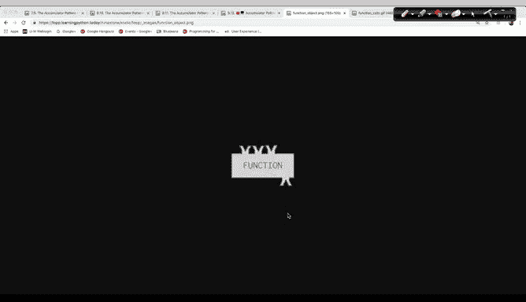
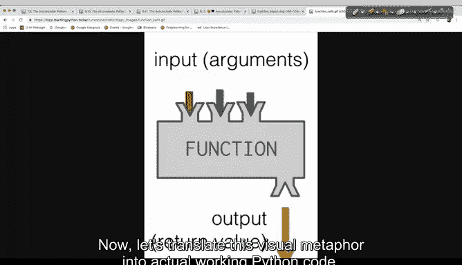
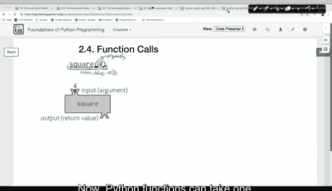
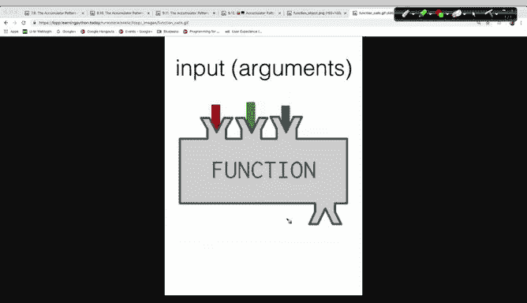
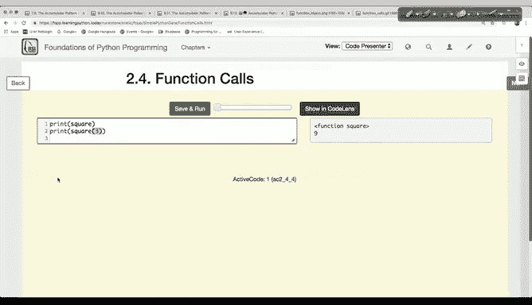

# 密歇根大学《Python3编程》课程1-2｜第8课：函数调用 🧩


在本节课中，我们将要学习Python中一个核心概念：函数调用。我们将了解函数是什么，如何调用函数，以及函数如何接收输入（参数）并产生输出（返回值）。

---

上一节我们介绍了表达式的基本概念，本节中我们来看看一种特殊的表达式：函数调用表达式。



你可以将函数想象成一个内部装有某种“机械装置”的盒子。视觉上，我们可以用一个灰色方框来表示它。函数接收一些输入（称为参数），这些输入从顶部进入盒子。内部的“机械装置”对这些输入进行处理，完成工作后，会输出一个结果。


如上图所示，一个函数接收三个输入（或参数），经过内部处理，最终输出一个返回值。



现在，让我们将这个视觉比喻转化为实际可运行的Python代码。

---


以下是一个在Python中编写函数调用表达式的例子。

假设我们有一个名为 `square` 的函数，它接收一个数字作为参数，然后返回该数字的平方值。例如，如果我们调用 `square(4)`，这就是用参数 `4` 来调用 `square` 函数。

在Python中，我们这样写：先写函数名 `square`，然后紧跟一对圆括号 `()`，参数就放在这对圆括号内。

```python
square(4)
```

这个整体表达式的值，就是函数的返回值。对于 `square` 函数，如果你传入 `4`，返回值将是 `16`。

这对应了我们刚才提到的视觉表示：`square` 函数是一个盒子，它接收一个输入（参数 `4`），经过处理，输出返回值 `16`。

在Python代码中，我们通过 `函数名(参数)` 的形式来调用函数。Python函数可以接收一个、两个或任意数量的参数，但**总是只返回一个值**。

---




例如，上图函数接收三个参数，但只输出一个返回值。重申：函数可以接收任意数量的参数，但函数调用的结果永远是一个值。



---

现在，让我们看更多关于调用函数的Python代码。

```python
print(square(3))
```

在第一行，我们实际上调用了两个函数。`print` 本身是一个函数，我们传递给 `print` 的参数是一个表达式，而这个表达式恰好是另一个函数调用 `square(3)`。

这里定义的 `square` 函数并非Python内置函数，只是为了解释函数调用而假设存在的。它接收一个参数并返回其平方值。因此，`print(square(3))` 会打印出整数 `9`。

如果只调用函数而不打印结果：

```python
square(5)
```

这个表达式的值是 `25`，但由于我们没有使用 `print` 输出它，所以运行代码时控制台不会显示任何内容。

---

假设我们有另一个函数叫 `sub`，它接收两个参数。视觉上，它接收两个输入，并输出一个返回值。

我们假设 `sub` 函数用第一个参数减去第二个参数。例如，`sub(6, 4)` 会返回 `2`，因为 6 - 4 = 2。

在Python中，我们这样调用它：

```python
print(sub(6, 4))  # 输出 2
print(sub(5, 9))  # 输出 -4
```

注意，当有多个参数时，我们用逗号 `,` 分隔它们。

---

函数调用可以与其他运算符结合使用。

```python
print(square(3) + 2)  # 输出 11
```

Python会先计算 `square(3)` 得到 `9`，然后将结果 `9` 与字面值 `2` 相加，最终得到 `11`。

---

更复杂的表达式也是可能的：

```python
print(sub(square(3), square(1 + 1)))  # 输出 5
```

在这个表达式中，我们调用了 `sub` 函数，并传入了两个参数：
*   第一个参数是 `square(3)`。
*   第二个参数是 `square(1 + 1)`。

Python计算函数调用表达式时，遵循“由内向外”的原则。它会先计算最内层表达式的值：
1.  计算 `1 + 1` 得到 `2`。
2.  计算 `square(2)` 得到 `4`。
3.  计算 `square(3)` 得到 `9`。
4.  最后，调用 `sub(9, 4)`，用 `9` 减去 `4` 得到 `5`，并打印出来。

---

需要注意的一点是，在Python中，函数本身也是对象。如果我们直接打印函数名：

```python
print(square)  # 输出类似 <function square at 0x...>
```

Python会告诉我们 `square` 是一个函数对象。要真正**调用**函数（运行其内部“机械装置”），必须在函数名后加上圆括号 `()` 并传入参数。圆括号是触发函数执行的标志。

---



本节课中我们一起学习了Python函数调用的核心机制。我们了解了函数如何作为接收输入、进行处理并返回输出的“黑盒”，掌握了调用函数的基本语法 `函数名(参数)`，并理解了Python计算复杂表达式时“由内向外”的执行顺序。记住，函数调用本身是一个表达式，其值就是函数的返回值。


我们下次再见。