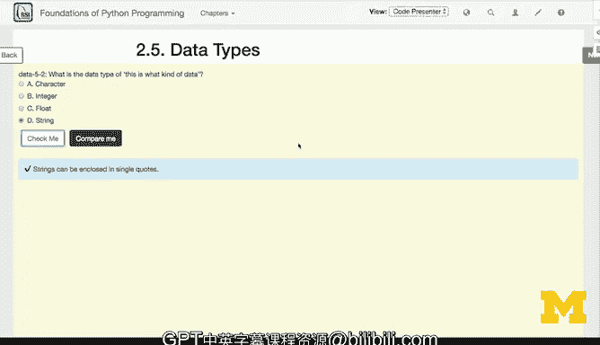

# Python 3 编程（课程1、2）｜第9讲：数据类型详解 🔍


在本节课中，我们将要学习如何确定Python中数据的类型，并了解创建字符串和整数时需要注意的一些细节。掌握这些知识有助于我们更准确地处理不同类型的数据。

## 确定数据类型

如果你不确定某个值的类型，Python提供了一个名为 `type()` 的内置函数。这个函数可以告诉我们给定值的具体数据类型。

例如，如果我们打印调用 `type()` 函数并传入字符串 `"Hello world"` 作为参数的结果，Python会告诉我们这是一个字符串。同样，对于数字 `17`，它会告诉我们这是一个整数。对于数字 `3.2`，它会告诉我们这是一个浮点数。

以下是代码示例：

```python
print(type("Hello world"))  # 输出：<class 'str'>
print(type(17))             # 输出：<class 'int'>
print(type(3.2))            # 输出：<class 'float'>
```

运行这段代码，你会看到相应的类型输出。这对于你不确定某个值类型的情况尤其有帮助。

例如，这里有一个值 `"17"`。尽管它是一个数字，但由于它被引号包围，这个表达式的值将是一个字符串。因此，打印这个表达式的类型会输出 `class 'str'`。同样，`"3.2"` 也是一个字符串。

```python
print(type("17"))  # 输出：<class 'str'>
print(type("3.2")) # 输出：<class 'str'>
```

## 创建字符串的不同方式

上一节我们介绍了如何使用 `type()` 函数，本节中我们来看看创建字符串的不同方法。

在Python中，实际上有三种不同的方式来创建字符串字面量：
*   使用单引号 `'`。
*   使用双引号 `"`。
*   使用三个双引号 `"""` 或三个单引号 `'''`。

需要注意的是，尽管这些表达式以不同的方式创建字符串，但如果我们询问每个表达式的类型，Python都会告诉我们它们是字符串。

```python
print(type('Hello'))      # <class 'str'>
print(type("Hello"))      # <class 'str'>
print(type("""Hello"""))  # <class 'str'>
print(type('''Hello'''))  # <class 'str'>
```

所以，尽管这里有四种创建字符串的方式，但它们在Python中都归结为同一种类型——字符串。

## 处理字符串中的引号

创建字符串时，有时你可能希望在字符串内部包含单引号或双引号。

例如，你可能想打印字符串 `"Bruce's beard"`。如果你尝试用单引号创建这个字符串，Python会报语法错误，因为它认为第一个单引号是字符串的开始，而 `Bruce` 后面的单引号是字符串的结束。

```python
# 这会导致语法错误
# print('Bruce's beard')
```

解决这个问题的一种方法是，如果我们知道字符串内部会有单引号（撇号），就使用双引号来定义字符串。

```python
print("Bruce's beard")  # 输出：Bruce's beard
```

反之，如果字符串内部包含双引号，则可以使用单引号来定义字符串。

```python
print('She said, "Hello!"')  # 输出：She said, "Hello!"
```

我们将在后续课程中更详细地介绍，当字符串同时包含单引号和双引号时，可以使用三引号。

```python
print("""Oh no, she exclaimed. "Ben's bike is broken!" """)
```

三引号还允许我们创建跨越多行的字符串，关于这一点我们稍后会详细学习。

## 创建整数的注意事项

在创建整数时，有一点需要注意。在美国，我们经常在较大的数字中每三位使用一个逗号分隔，例如 `42,500`。但在Python中，如果在整数内部使用逗号，Python会认为这是两个独立的值（`42` 和 `500`）。

```python
# 这会打印两个独立的值：42 和 500
print(42,500)
```

因此，在Python中创建大数字时，**永远不要**使用逗号来分隔每三位数字。我们需要像下面这样书写整数：

```python
print(42500)  # 输出：42500
```

## `print` 函数的多参数特性

关于 `print` 函数，还有一点需要注意：我们可以向 `print` 传递任意数量的参数。当我们这样做时，`print` 会获取每个参数，打印出它们的值，并用空格（而不是逗号）分隔它们。

以下是示例：

```python
print(1, 2, 3, 4, 5)  # 输出：1 2 3 4 5
print('a', 'b', 'c')  # 输出：a b c
```

这里，我们在同一行打印了所有值。

## 小测验

让我们做几个选择题来巩固所学。

**问题1：如何确定变量的类型？**
一种确定变量类型的方法是使用 `type()` 函数。

**问题2：表达式 `'this is what kind of data'` 的数据类型是什么？**
换句话说，如果我们对这个表达式调用 `type()`，我们会得到什么？
Python会告诉我们这是一个字符串，因为它以单引号开始和结束。

---

本节课中我们一起学习了：
1.  如何使用 `type()` 函数来确定Python中任何值的数据类型。
2.  创建字符串的三种主要方式（单引号、双引号、三引号）及其适用场景。
3.  在字符串中处理内部引号的技巧。
4.  在Python中创建整数时不应使用逗号分隔。
5.  `print` 函数可以接受多个参数并用空格分隔打印。



掌握这些基础知识是理解后续更复杂数据类型操作的关键。下次见！