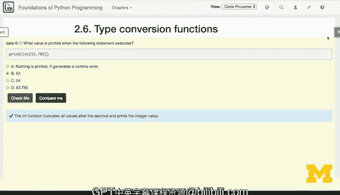

# 10：类型转换函数 🧮


在本节课中，我们将要学习Python中的类型转换函数。这些函数允许我们将数据从一种类型转换为另一种类型，例如将字符串转换为整数，或将浮点数转换为整数。掌握类型转换对于处理不同类型的数据和避免程序错误至关重要。

## 概述

有时，在Python编程中，我们需要或将值从一种类型转换为另一种类型。为此，Python提供了一系列类型转换函数。本节我们将学习三个核心函数：`int()`、`float()`和`str()`。

## 类型转换函数介绍

Python提供了几个内置函数来执行类型转换。每个函数都期望接收一个参数，通常是我们希望转换的另一种类型的值。

以下是三个主要的类型转换函数：
*   **`int()`**：将值转换为整数类型。
*   **`float()`**：将值转换为浮点数类型。
*   **`str()`**：将值转换为字符串类型。

## 将浮点数转换为整数

上一节我们介绍了类型转换的基本概念，本节中我们来看看`int()`函数如何将浮点数转换为整数。

当Python将浮点数转换为整数时，它会直接舍弃小数点及之后的所有部分，而不是进行四舍五入。

**代码示例：**
```python
print(3.14)          # 输出: 3.14
print(int(3.14))     # 输出: 3
print(int(3.99999))  # 输出: 3
print(int(-3.99999)) # 输出: -3
```
如代码所示，`3.14`和`3.99999`转换后都得到`3`，`-3.99999`转换后得到`-3`。

## 将字符串转换为整数

除了转换浮点数，`int()`函数也常用于将字符串转换为整数。

**代码示例：**
```python
print(int("2345"))  # 输出: 2345
print(int(17))      # 输出: 17 (整数转换后保持不变)
```
需要注意的是，并非所有字符串都能成功转换为整数。如果字符串包含非数字字符，Python会报错。

**错误示例：**
```python
# 以下代码会引发 ValueError 错误
# int("23 bottles")
```

## 使用`float()`函数进行转换

`float()`函数的工作方式与`int()`类似，但它将值转换为浮点数。

**代码示例：**
```python
result = float("123.45")
print(result)        # 输出: 123.45
print(type(result))  # 输出: <class 'float'>
```

## 使用`str()`函数进行转换

我们也可以使用`str()`函数将其他类型的值转换为字符串。这在需要拼接字符串时特别有用。

**代码示例：**
```python
print(str(17))       # 输出: '17' (这是一个字符串)
print(str(123.45))   # 输出: '123.45' (这是一个字符串)
print(type(str(123.45))) # 输出: <class 'string'>
```

## 类型转换的实际应用

一个常见的需要使用类型转换的场景是字符串拼接。当我们尝试将字符串与整数直接结合时，Python会报错。

**错误示例及修正：**
```python
v = 55
# 错误写法：print("The value is " + v) # 会引发 TypeError
# 正确写法：使用 str() 转换整数
print("The value is " + str(v)) # 输出: The value is 55
```

## 小测验

为了巩固理解，请思考以下问题：当执行语句 `print(int(53.95))` 时，会输出什么值？

选项：
A. 53.95
B. 53
C. 54
D. 错误

**答案：B. 53**

解析：`int()`函数转换浮点数时会直接截断小数部分，因此`53.95`转换为整数后是`53`。

## 总结



本节课中我们一起学习了Python中的类型转换。我们掌握了三个核心函数：**`int()`**用于转换为整数，**`float()`**用于转换为浮点数，**`str()`**用于转换为字符串。记住，`int()`在转换浮点数时会直接舍弃小数部分。合理使用这些函数可以帮助我们处理不同类型的数据，并让程序运行得更顺畅。