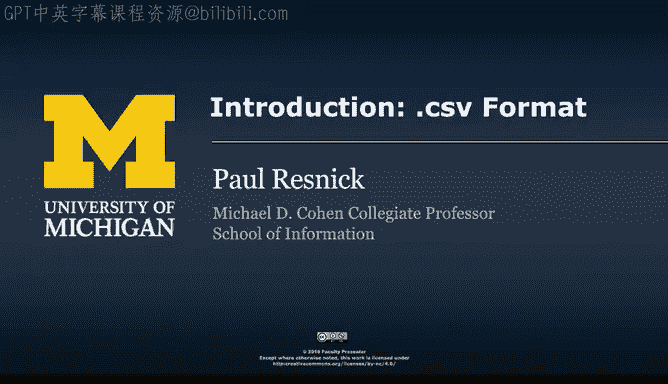
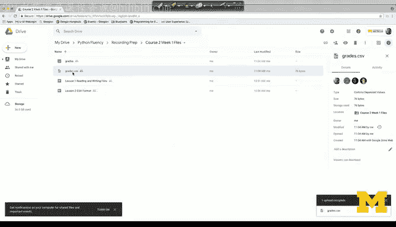
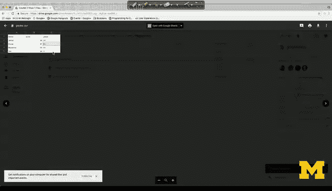
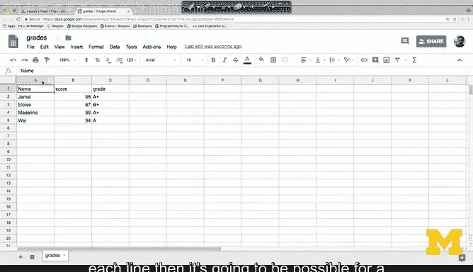

# 密歇根大学《Python3编程》课程1、2｜第100课：CSV格式导论 📊




在本节课中，我们将要学习CSV格式的基础知识。CSV是一种常见的数据交换格式，广泛用于存储表格数据。我们将了解其结构、用途以及如何在Python中读写CSV文件。

---

## 什么是CSV格式？

CSV是一个缩写词，代表“逗号分隔值”（Comma Separated Values）。一个CSV格式的文件就是一个遵循特定约定的文本文件。

CSV格式规定，文件中的值将由逗号分隔。同时，文件的每一行都具有相同的结构。

例如，我们有以下数据：
```
Name,Age,Grade
Alice,90,A+
Bob,85,B
```
在这个例子中，每一行在第一个逗号前、第一个和第二个逗号之间、以及第二个逗号之后，都有三个数据项。

通常，文件的第一行是特殊的，用于提供列名。之后的所有行都彼此相似，每一行都包含具体的数值。例如，第二行的第一个值是姓名，第二个值90是分数，A+是等级。

---

## CSV格式的优势

这种格式的优势在于，通过遵循这个标准格式，数据可以被许多不同的程序读取。

例如，我选择将文件命名为 `grades.csv` 并保存在计算机的某个文件夹中。在Mac系统上，当文件名以 `.csv` 结尾时，除非你以其他方式配置了系统，否则当你尝试打开它时，系统默认会认为你想用Excel电子表格程序打开它。

因此，系统不会将其显示为纯文本文件，而是会将其分割，并将第一个值放入A列，第二个值放入B列，第三个值放入C列。

同样的CSV格式不仅可以被Excel读取，还可以被各种统计程序（如R、SPSS等）读取。你也可以在Google Sheets中打开它。



例如，在我的Google Drive文件夹中，我存放了用于录课的笔记，并将同一个 `grades.csv` 文件放在了那里。当我双击它时，它会给我一个预览，并给我一个用Google Sheets（另一个电子表格程序）打开的选项。打开后，数据再次以列的形式显示。

所以，CSV格式是一种交换格式。它只是一个文本文件，但如果你遵循约定，确保每一行有相同数量的逗号，那么这个文件就可以被任何支持CSV的程序读取。



---

## 本节课的学习目标

在本节课结束时，你将能够：
1.  读取内容为CSV格式的文本文件，并使用 `.split()` 方法解析行。
2.  编写内容为CSV格式的文本文件，可以使用字符串模板的 `.format()` 方法，也可以使用 `.join()` 方法。



我们将在课程结束时再会，届时我将解释“cat”和“comma”之间的区别。

---

## 总结


本节课中，我们一起学习了CSV格式的基础知识。我们了解到CSV是“逗号分隔值”的缩写，是一种以纯文本形式存储表格数据的标准格式。它的优势在于通用性强，可以被Excel、Google Sheets及多种统计软件轻松读取和处理。我们还明确了本课的学习目标：掌握使用Python读取和写入CSV文件的基本技能。在接下来的课程中，我们将深入实践这些操作。