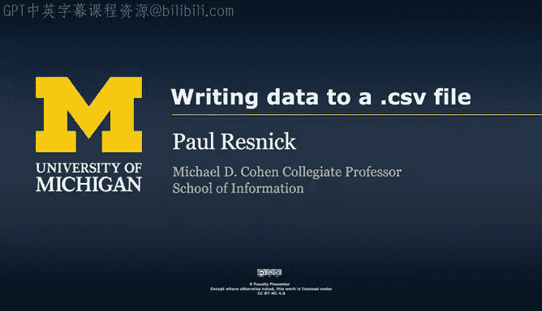
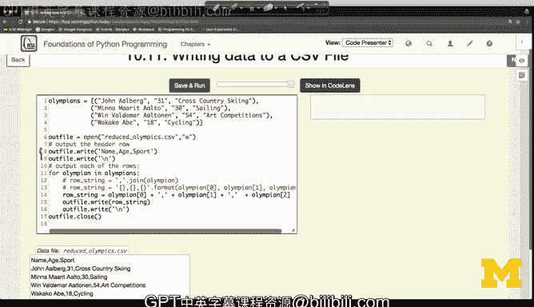

# 102：14_01_03_CSV数据写入 📝




在本节课中，我们将要学习如何使用Python将数据写入CSV文件。我们将了解CSV文件的基本格式，并探索几种生成符合格式要求的文本行的方法。

## 概述

CSV文件是一种以逗号分隔值的纯文本格式，常用于存储表格数据。要写入CSV文件，本质上就是生成遵循特定格式的文本字符串，并将其写入文件。

## CSV写入的基本结构

写入CSV文件的基本流程是：首先写入一行表头，其中包含用逗号分隔的字段名；然后遍历你的数据对象列表，为每个对象生成一行输出数据。

以下是一个基础示例，它只是将CSV格式的内容打印到输出窗口：

```python
# 打印CSV格式到输出窗口
print("name,age,sport")
for olympian in olympians:
    print(f"{olympian[0]},{ollympian[1]},{olympian[2]}")
```

如你所见，我们有一行表头，包含三个字段：`name`、`age`和`sport`。随后的每一行都具有相同的结构：姓名、逗号、年龄、逗号、运动项目。

## 将数据写入文件

上一节我们介绍了如何生成CSV格式的字符串。本节中我们来看看如何将这些字符串写入一个实际的磁盘文件，而不是仅仅打印到屏幕。

我们需要将`print`语句替换为文件对象的`.write()`方法，并确保在操作前后正确地打开和关闭文件。

以下是实现代码：

```python
# 打开文件用于写入
outfile = open('olympians.csv', 'w')

# 写入表头行
outfile.write('name,age,sport\n')

# 遍历数据列表，写入每一行
for olympian in olympians:
    row_string = f"{olympian[0]},{olympian[1]},{olympian[2]}\n"
    outfile.write(row_string)

# 关闭文件
outfile.close()
```

关键点在于，写入文件时，我们必须显式地在每行末尾添加换行符`\n`。现在，数据被写入到`olympians.csv`文件中。

## 生成CSV行的几种方法

生成以逗号分隔值的字符串行有多种方法。以下是三种主要方法，其中两种推荐，一种不推荐。

### 方法一：使用格式化字符串（推荐）

这是最清晰、最推荐的方法。使用f-string或`format`方法可以直观地看到值的数量和分隔符的位置。

```python
row_string = f"{olympian[0]},{olympian[1]},{olympian[2]}"
```
在这个格式化字符串中，三个花括号`{}`清楚地对应三个值，逗号明确地分隔了它们。

### 方法二：使用`.join()`方法

`.join()`方法是`.split()`的逆操作，用于将一系列字符串连接起来。当你的所有数据已经是字符串时，这个方法很简洁。

以下是使用`.join()`方法的步骤：

1.  确保要连接的所有元素都是字符串类型。
2.  在作为分隔符的字符串（这里是逗号）上调用`.join()`方法。
3.  将一个字符串列表（或元组）作为参数传入。

```python
# 假设olympian中的元素都是字符串
row_string = ",".join(olympian)
```
需要注意的是，`.join()`方法的调用顺序可能与直觉相反：是`分隔符.join(列表)`，而不是`列表.join(分隔符)`。此外，如果列表中包含非字符串类型（如整数），则需要先进行转换。

### 方法三：字符串拼接（不推荐）

你也可以直接使用加号`+`来拼接字符串，但这种方法可读性差，且仍需处理类型转换，容易出错。

```python
row_string = olympian[0] + "," + str(olympian[1]) + "," + olympian[2]
```
对于初学者来说，这种方法很容易在引号、逗号和加号上出错，因此不推荐使用。

## 总结



本节课中我们一起学习了如何将数据写入CSV文件。我们掌握了写入CSV文件的核心结构：先写入表头行，然后遍历数据对象并逐行写入。我们重点探讨了三种生成CSV数据行的方法，其中**使用格式化字符串**最为直观可靠，而**使用`.join()`方法**在处理纯字符串列表时非常高效。请避免使用易错的字符串拼接方法。记住，写入文件时务必不要忘记在行尾添加换行符`\n`。