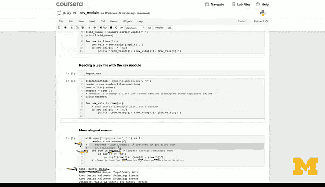

# 103：使用 `csv` 模块读取文件 📖

欢迎回来。现在你已经在概念上理解了如何读写 CSV 文件。

你已经准备好学习 Python `csv` 模块的魔力了，它让这一切变得更加简单。

与其他模块一样，你需要一个导入语句。像这样：`import csv`。

在此之后，你的代码就能够调用函数来创建一个 CSV 读取器或 CSV 写入器对象。

与仅仅读写文本行相比，使用 `csv` 模块的优势在于，它能处理逗号分隔字符串的解析，并在读取文件时将它们转换为列表。

在写入文件时则相反，我们只需传递一个值列表，它就能处理将它们转换为逗号分隔的文本字符串。

顺便说一下，我展示的这个页面是 `csv` 模块的官方文档页面。

最终，你将能够阅读像这样的文档页面。

这个页面上使用了很多我们目前尚未涉及的术语。

因此，在你当前的学习阶段，可能很难完全理解所有内容。

但开始熟悉这些文档页面的样子是个好主意。

例如，你至少可以从中了解模块中定义了哪些函数。

有 `csv.reader` 函数，还有一个 `writer` 函数，你可以在听完这个讲解后尝试阅读这份文档。

`csv` 模块在 Runestone 环境中不可用，但在我们的 Jupyter notebook 中可用，所以我将用它来演示。

你之前在第一段代码中见过类似的内容，用于从 CSV 文件读取数据，并从某些行中提取和打印几个字段。

我对教科书中的代码所做的唯一更改是，在第 11 行使用了 f-string 而不是 `.format` 方法。

所以请回想一下，f-string 是另一种在字符串中特定位置插入变量值以生成字符串的方法。

我认为在这种情况下，f-string 非常易于阅读。我们只需打印出运动员的名字、项目（即 `row[4]`）以及获得的奖牌（即 `row[5]`）。

但请注意，在第 9 行，我们不得不解析逗号分隔的字符串。

是的，为了提取每一行的字段。如果我们让 `csv` 模块来完成将每行文本转换为字段列表的工作，代码会更清晰。

所以我先运行一下这段代码，提醒你它产生什么结果。

我们从第 6 行获取字段名，就是这个。然后对于每一行，我们打印出名字、项目和奖牌。

如果我们让 `csv` 模块来完成将每行文本转换为字段列表的工作，代码会更清晰。

在那个单元格下面，我有一个替代版本，为了更容易看到对应关系，我将隐藏第一个单元格的输出。

所以现在我有两个版本。上面和下面这两个版本做的是同一件事，但第二个版本使用了 `csv` 模块。

在第二个版本中，我将其称为 `rows` 而不是 `lines`。我这样做是因为我想强调我们从读取器得到的是一个已经以某种方式解析过的行集合。

每一行将是一个字符串列表，而不是一个长的逗号分隔的字符串。

这意味着我不需要做任何解析。在第 10 行。而在旧版本中，我必须获取字符串，去除任何空白，然后按逗号分割。

在我的新版本中，它已经是一个列表，`csv` 模块已经为我完成了解析。

在这里，解析相当简单，所以这没什么大不了的。但我们将看到一个更复杂的例子，其中解析很困难，而 `csv` 模块会为我们处理。

除此之外，这两个版本完全相同。并且，事实上，它们产生相同的输出。所以如果我运行这两个单元格，我会得到相同的结果。

对。让我也向你展示一个更优雅、更 Pythonic 的相同功能版本。这是你可能会在专业 Python 程序员的文档或代码示例中看到的代码，所以可能值得熟悉一下。

我隐藏了输出，然后向下滚动，这样我们也能看到更优雅的版本。这里有两个区别。

首先，我们使用了一个 `with` 代码块。所以是 `with open('olympics.csv') as f:`。然后在下面缩进的代码中，我可以使用变量 `f`，它将被绑定到文件对象。

当我到达末尾并有一些取消缩进的代码时，`f` 将消失。它会自动为我们关闭文件，只是让代码更具可读性，很容易看出我们只会在缩进的代码块中使用 `f`。

第二个区别是，在我们之前的版本中，我将所有行读入了一个列表。所以我创建了读取器对象，然后将读取器对象转换为列表，这获取了所有那些可迭代的行序列，并将其转换为一个实际的列表对象。

在新版本中，我将按需逐行处理。所以，这里有 `next()` 函数，它作用于可迭代对象，返回可迭代对象的第一个元素。

文件对象或 CSV 读取器对象，它们都是可迭代对象。所以我可以通过调用 `next()` 来获取它的第一个元素。

然后，我可以遍历读取器对象的其余部分，从而获取其余的行。当我执行这个时，我得到：打印表头，这给了我第一行。然后我遍历了读取器对象，但我没有获取所有行，只获取了剩余的行。

为了向你说明这一点，如果我将调用 `next` 和打印表头的两行代码注释掉，然后重新执行。

我们将看到输出会有些不同。因为第一行，我们原本只是打印出字段列表，现在它将在迭代中被处理，并且我们只会打印出 `row[0]`、`row[4]` 和 `row[5]`。

让我们看看这个。现在你会看到，输出的第一行改变了，并且遵循了与所有获奖者相同的格式。

它没有被消耗掉，因为我们注释掉了调用 `next` 的这行代码。因此，当我们遍历读取器时，我们得到了所有行。

在未注释的版本中，第一行已经被消耗掉了。

下次见。