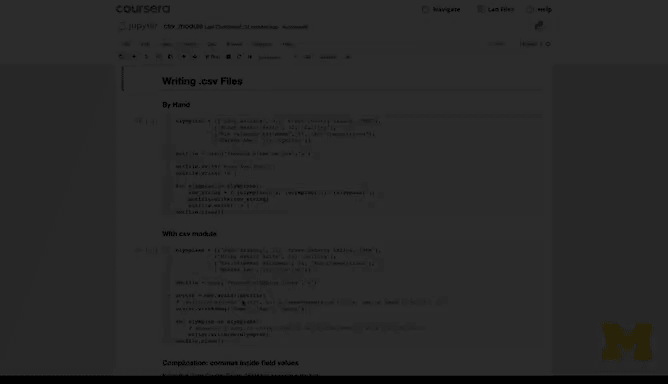
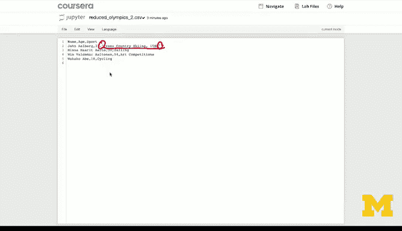

# 104：使用 `csv` 模块写入文件 📚




在本节课中，我们将学习如何使用 Python 内置的 `csv` 模块来写入 CSV 文件。我们将比较手动写入和使用 `csv` 模块的区别，并理解后者在处理复杂数据时的优势。

---

## 概述

CSV（逗号分隔值）是一种常见的数据存储格式。之前我们已经学习了如何手动将数据写入 CSV 文件。本节我们将重点介绍 `csv.writer` 对象，它能更高效、更准确地完成写入任务，尤其是在处理包含特殊字符（如逗号）的数据时。

## `csv.writer` 对象简介

`csv.writer` 对象的功能与 `csv.reader` 相反。它接收一个值列表作为输入，并将这些值转换为逗号分隔的字符串写入文件。

以下是手动写入 CSV 文件的代码示例，我们以此作为对比：

```python
olympians = [("John Aalberg", 31, "Cross Country Skiing, 15KM"),
             ("Minna Maarit Aalto", 30, "Sailing"),
             ("Win Valdemar Aaltonen", 54, "Art Competitions"),
             ("Wakako Abe", 18, "Cycling")]

outfile = open('reduced_olympics.csv', 'w')
outfile.write('Name,Age,Sport\n')
for olympian in olympians:
    row_string = '{},{},{}'.format(olympian[0], olympian[1], olympian[2])
    outfile.write(row_string)
    outfile.write('\n')
outfile.close()
```

这段代码创建了一个元组列表，打开文件，写入表头，然后遍历每位运动员，将其信息格式化为字符串后写入文件。这里我们使用了 `format` 方法，与教材中略有不同。

运行这段代码后，可以在文件系统中看到生成的 `reduced_olympics.csv` 文件，其中包含表头行和四位运动员的数据。

## 使用 `csv` 模块写入

现在，我们来看看使用 `csv` 模块实现相同功能的代码。前六行代码与之前相同，用于准备数据。

```python
import csv

olympians = [("John Aalberg", 31, "Cross Country Skiing, 15KM"),
             ("Minna Maarit Aalto", 30, "Sailing"),
             ("Win Valdemar Aaltonen", 54, "Art Competitions"),
             ("Wakako Abe", 18, "Cycling")]

outfile = open('reduced_olympics2.csv', 'w')
writer = csv.writer(outfile)
writer.writerow(['Name', 'Age', 'Sport'])
for olympian in olympians:
    writer.writerow(olympian)
outfile.close()
```

这里的关键步骤是调用 `csv.writer()` 函数来创建一个 `writer` 对象。然后，我们调用该对象的 `writerow()` 方法。与直接对文件对象调用 `write()` 不同，`writerow()` 方法期望接收一个列表，它会自动将列表元素转换为逗号分隔的字符串并添加换行符，我们无需手动处理这些细节。

在遍历运动员列表时，`csv` 模块的优势就显现出来了。我们只需直接调用 `writer.writerow(olympian)`，而不必先将元组转换为字符串再写入，也无需操心添加换行符。这使得写入 CSV 文件的代码更加简洁。

## 处理数据中的逗号

如果你仔细观察，会发现使用 `csv` 模块不仅让代码更整洁，而且在某些情况下更加正确。我们的数据中，第一个项目“Cross Country Skiing, 15KM”内部包含了一个逗号。

在手动写入的版本中，这个内部逗号会被错误地解释为字段分隔符。当我们尝试将 `reduced_olympics.csv` 作为 CSV 文件读取时，解析器会认为该行有四个值，而其他行只有三个，从而导致数据错乱。

让我们看看 `csv` 模块生成的 `reduced_olympics2.csv` 文件是如何处理这个问题的。对于包含逗号的字段值，`csv.writer` 会自动为其添加双引号，例如 `"Cross Country Skiing, 15KM"`。这样，CSV 读取器在遇到这样的字段时，就能正确地将整个带引号的内容解析为一个值，并在读取后自动去除引号。

## 选择使用 `csv` 模块的时机

以下是关于何时使用 `csv` 模块的简单指南：

*   如果你的 CSV 文件非常简单，字段值中不包含逗号、引号等特殊字符，那么你可以选择手动解析文本字符串，也可以使用 `csv` 模块。
*   一旦你处理的数据变得稍微复杂，例如字段内包含逗号或换行符，强烈建议使用 `csv` 模块。它能自动处理这些复杂性，确保数据读写的正确性。

---

## 总结



本节课我们一起学习了如何使用 Python 的 `csv` 模块来写入 CSV 文件。我们比较了手动写入和使用 `csv.writer` 对象的区别，并重点了解了后者如何自动处理字段内包含分隔符（如逗号）的特殊情况，从而生成格式正确、易于解析的文件。对于任何涉及 CSV 文件处理的任务，使用 `csv` 模块通常是更可靠、更高效的选择。