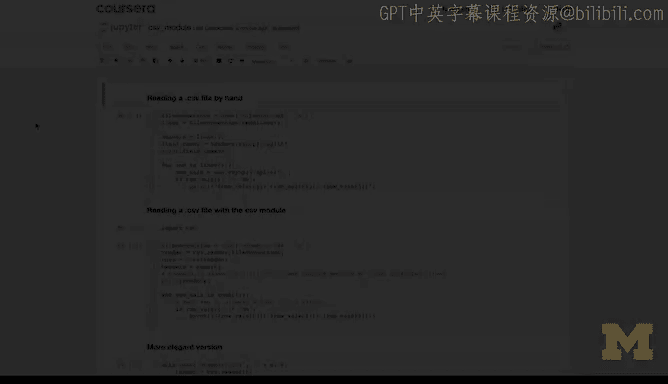
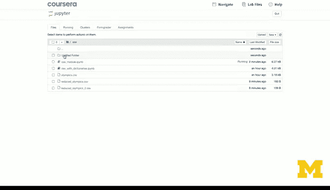
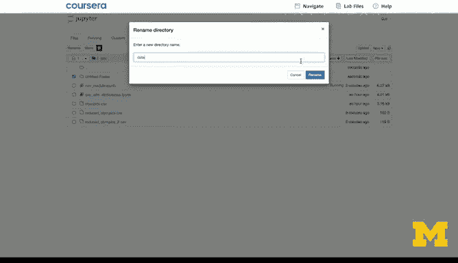
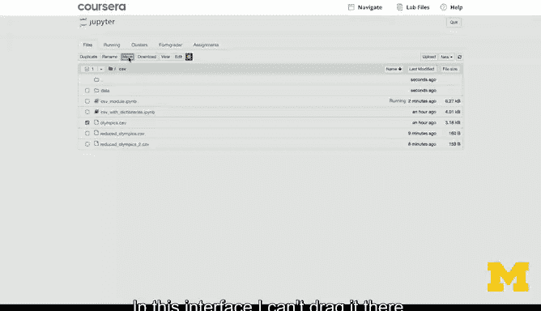
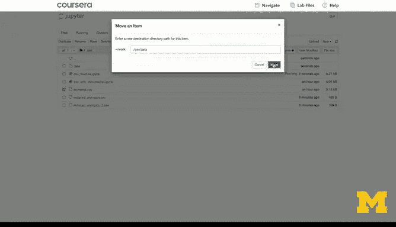
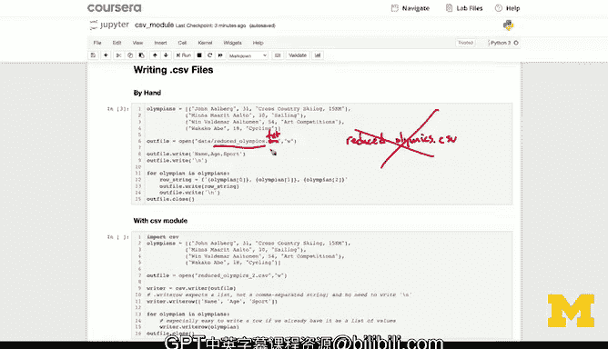

# 105：文件命名规范建议 📚




## 概述
在本节课中，我们将学习关于文件命名的最佳实践与规范建议。良好的命名习惯能确保你的文件在不同计算机和操作系统之间具有更好的可移植性，并避免潜在的混淆和错误。

---

## 历史与现代操作系统的限制
上一节我们介绍了文件操作的基础，本节中我们来看看如何为文件起一个好名字。一些较旧的操作系统对文件名有严格的限制。

例如，MS-DOS（Windows的前身）只允许在点号前使用八个字符，点号后使用三个字符。

现代计算机操作系统对文件名的限制较少。然而，为了确保文件在不同计算机间具有最大的可移植性，为自己设定一些命名限制仍然是一个好主意。

## 文件命名核心建议
以下是关于文件命名的具体建议列表，请务必遵守：

1.  **不要使用逗号**。例如，避免使用 `Olympics, winter` 这样的文件名，即使你的操作系统允许。
2.  **不要使用多个点号**。例如，避免使用 `text.3.csv` 这样的格式。
3.  **不要在文件名中使用正斜杠（/）或反斜杠（\）**。例如，避免使用 `Olympic/winter`。原因是斜杠通常用于表示子目录路径。

让我解释一下什么是子目录。在Jupyter中点击“文件”->“打开”，会列出当前笔记本所在目录的所有文件。我可以在这里创建一个子目录。




我将它命名为 `data`。






然后，我把 `olympics.csv` 文件放入那个目录。在这个界面中，我无法拖拽，必须显式地移动它。




现在，在 `data` 目录（文件夹）中，就有了 `olympics.csv` 文件。如果我回到Python代码，尝试打开 `olympics.csv`，现在会失败，因为该文件不在顶级目录中。

```python
# 错误示例：文件不在当前目录
open(‘olympics.csv‘)  # 会报错：No such file or directory
```

但是，如果我指定路径 `data/olympics.csv`，就能找到它。

```python
# 正确示例：指定子目录路径
open(‘data/olympics.csv‘)  # 成功打开
```

字符串中的斜杠被解释为指向子目录，因此它能在子目录中找到 `olympics.csv` 文件。同样，写入文件时也可以这样做。

```python
# 写入文件到子目录
output_file = open(‘data/reduced_olympics.csv‘, ‘w‘)
```

运行后，`reduced_olympics.csv` 文件就会被写入 `data` 文件夹。这就是为什么你不应该在文件名中使用斜杠，在Windows上也不要用反斜杠，因为这会造成混淆：系统无法区分这是子目录路径还是文件名的一部分。

4.  **建议不要在文件名中使用空格**，尽管大多数现代操作系统允许。`reduced olympics.csv` 不是一个好主意。取而代之，可以使用下划线：`reduced_olympics.csv`。

## 文件扩展名规范
我建议你遵循点号后文件扩展名的一些约定。扩展名帮助操作系统识别文件类型。

以下是常见的扩展名约定：

*   **.txt**：用于纯文本文件。
*   **.py**：用于Python代码文件。
*   **.ipynb**：用于Jupyter笔记本文件。
*   **.csv**：用于逗号分隔值格式的文本文件。

在教材中，我们的代码有时使用 `.txt` 作为CSV文件的扩展名，这并不好。在本笔记本中，我遵循了更好的约定，将其命名为 `olympics.csv`。

遵循这些扩展名约定的原因是，计算机操作系统通常会查看这个扩展名（如 `.txt`、`.csv`、`.py`）。当你双击一个文件时，系统会根据扩展名决定使用哪个程序来打开它。

*   如果是 `.py` 文件，系统会尝试用文本编辑器打开，或将其作为Python程序执行。
*   如果是 `.xls` 文件，系统会尝试用Microsoft Excel打开，以此类推。

## 总结
本节课中，我们一起学习了文件命名的核心规范。我们了解了历史限制，掌握了避免使用特殊字符（如逗号、多个点号、斜杠和空格）的原则，并学习了使用下划线连接单词。同时，我们强调了遵循标准文件扩展名（如 `.py`、`.csv`）的重要性，这有助于操作系统正确识别和处理文件。遵循这些简单的规则，将使你的编程工作更加顺畅，文件管理更加高效。

---



