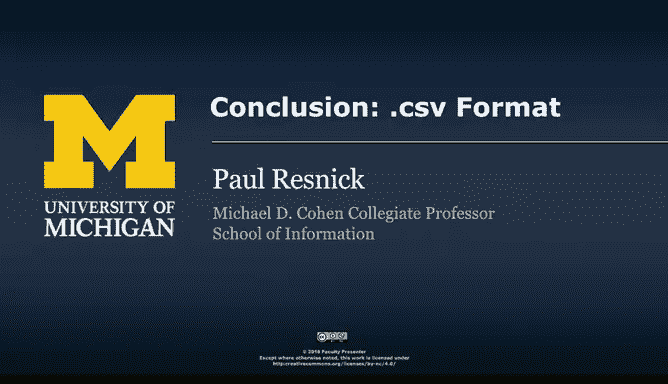

# 课程1：Python 3编程｜P106：CSV格式总结 📊

在本节课中，我们将总结CSV（逗号分隔值）格式的核心概念。你将学习如何读取和写入CSV文件，并理解其在实际应用中的重要性。

---


## 概述

CSV格式是一种常用的数据交换格式，广泛用于电子表格和统计程序之间的数据传输。掌握CSV文件的处理是数据分析和程序开发中的基础技能。



---

## CSV格式简介

CSV代表“逗号分隔值”。它是一种简单的文本格式，用于存储表格数据，如电子表格或数据库中的数据。每行代表一条记录，每个字段由逗号分隔。

**核心概念**：`CSV = Comma-Separated Values`

---

## 读取CSV文件

上一节我们介绍了CSV格式的基本概念，本节中我们来看看如何读取CSV文件。你可以编写程序来读取CSV格式的文本文件，这些文件可能来自电子表格或统计程序的导出。

以下是读取CSV文件的基本步骤：

1.  打开文件：使用Python的`open()`函数打开CSV文件。
2.  读取内容：使用`read()`或`readlines()`方法读取文件内容。
3.  解析数据：将每行内容按逗号分割，转换为列表或字典。

**代码示例**：
```python
with open('data.csv', 'r') as file:
    content = file.read()
    lines = content.split('\n')
    for line in lines:
        fields = line.split(',')
        print(fields)
```

---

## 写入CSV文件

除了读取CSV文件，你还需要能够将数据写入CSV格式的文本文件。这样，你可以将数据导入电子表格或统计程序进行处理。

以下是写入CSV文件的基本步骤：

1.  准备数据：将数据组织为列表或字典格式。
2.  格式化内容：将每个字段用逗号连接，每行用换行符分隔。
3.  写入文件：使用Python的`open()`函数和`write()`方法将内容写入文件。

**代码示例**：
```python
data = [['Name', 'Age'], ['Alice', 30], ['Bob', 25]]
with open('output.csv', 'w') as file:
    for row in data:
        line = ','.join(map(str, row))
        file.write(line + '\n')
```

---

## CSV格式的应用

CSV格式因其简单性和通用性，在数据交换中扮演着重要角色。无论是从电子表格导出数据，还是将数据导入统计程序，CSV都是首选格式之一。

**核心概念**：`数据交换 -> CSV格式 -> 电子表格/统计程序`

---

## 总结

本节课中我们一起学习了CSV格式的核心概念、读取和写入CSV文件的方法，以及其在实际应用中的重要性。掌握这些技能将为你在数据分析和程序开发中打下坚实基础。

---

**附：关于逗号的小幽默**

*   问：猫和逗号有什么区别？
*   答：猫的爪子末端有爪子，而逗号是子句末尾的停顿。

*   问：王子、秃头男人、猴子和孤儿有什么区别？
*   答：第一个是显而易见的继承人，第二个没有明显的头发，第三个有毛茸茸的父母，最后一个几乎没有父母。