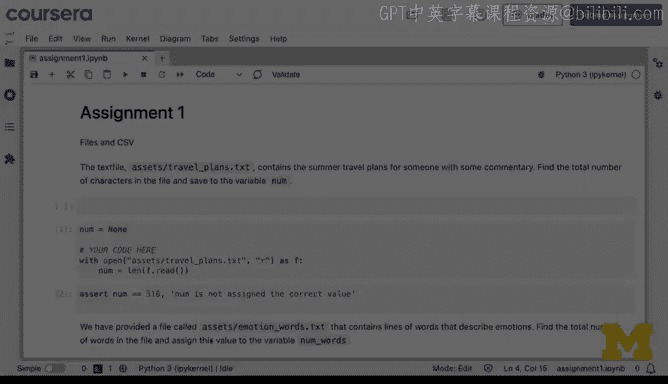
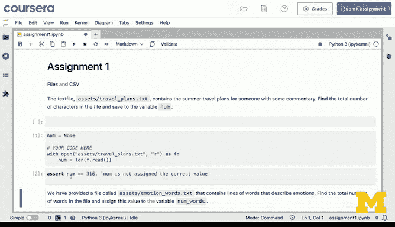
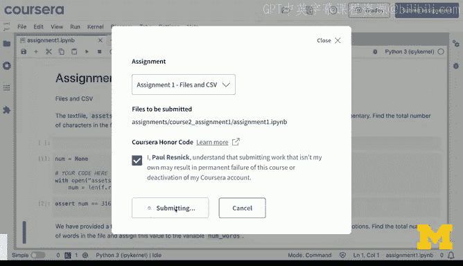
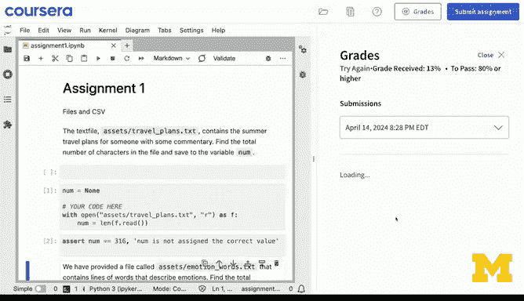

# 课程1：Python 3编程 - P107：作业提交指南 📝

在本节课中，我们将学习如何提交课程作业。你将了解到作业的格式、如何完成作业中的问题、如何利用断言进行自我测试，以及提交和查看成绩的完整流程。

---

## 作业格式与结构

上一节我们介绍了课程背景，本节中我们来看看作业的具体形式。

你的作业将以Jupyter Notebook文件的形式提交。这是第一份作业，你现在已经可以开始完成它。该文件中包含多个代码单元格。

以下是作业中常见的元素：

*   文件中存在一些带有“**your code here**”标记的单元格，这些是要求你编写代码的地方。
*   我已经完成了第一个问题的解答，相关说明位于其上方。
*   我们的任务是计算一个文件中的总字符数，并将结果保存到变量`num_chars`中。
*   我在此展示了第一个问题的答案，但即使不展示，你也能自行解答，因此无需担心。

## 完成与测试代码

上一节我们了解了作业结构，本节中我们来看看如何完成并测试你的代码。

我已经将代码写入单元格。如果我运行这个单元格，它会执行计算。

接着，下方有另一个包含`assert`语句的单元格。如果我运行它，可以看到测试通过了。

以下是关于测试的重要说明：

*   这些单元格中可能还隐藏了一些断言语句。
*   这些隐藏的测试只会在你提交作业进行评分时运行。
*   提交作业可能需要一些时间，因此我强烈建议你在提交前，尽最大努力确保答案正确。

## 提交作业流程

了解了如何测试代码后，现在我们来看看如何提交作业。

如果我提交这份作业，需要先勾选诚信守则，然后点击提交。

提交后，我需要等待。此时我可以尝试查看成绩，但系统会显示“评分正在进行中”，我必须继续等待一段时间。

因此，这不是获取反馈的高效方式。更好的做法是自己完成工作，只有在认为正确无误时才提交。

## 查看成绩与反馈

提交作业后，我们来看看如何解读成绩和反馈。

这是我第一次提交的结果：我只答对了第一题，其他题目都错了。系统显示我得了13分。

在本课程中，我们需要达到100%的正确率才能通过。

我可以查看具体反馈。对于答对的题目，通常没有额外反馈。

对于出错的题目，反馈形式多样。例如，一条评论指出“没有响应”。另一处则显示“断言错误”，你会收到各种类型的反馈。

我们通常不会显示完整的错误跟踪信息，但会告诉你问题所在，例如“变量`num_words`未被赋予正确的值”。

你可以随意多次提交。但正如之前建议的，更好的方法是自己创建测试，弄清楚问题所在，在相当确定答案正确后再提交。

---

在本节课中，我们一起学习了作业的Jupyter Notebook格式、如何填写代码并利用断言进行测试、提交作业的具体步骤，以及如何查看成绩和解读反馈信息。祝你好运，学习愉快！