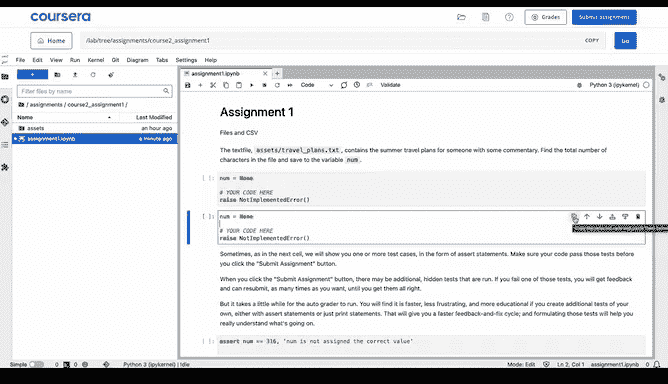
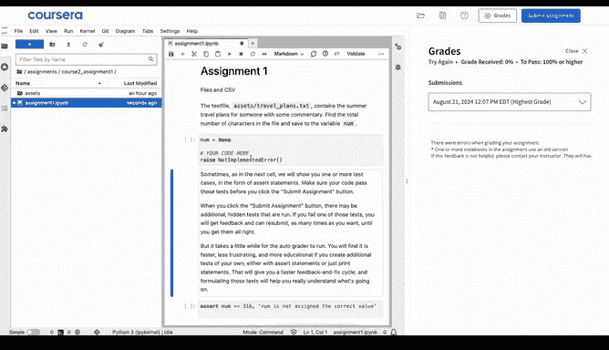
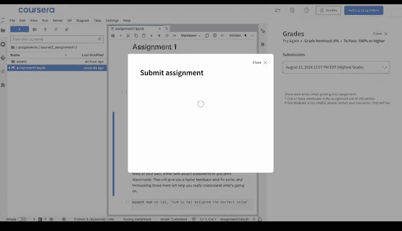
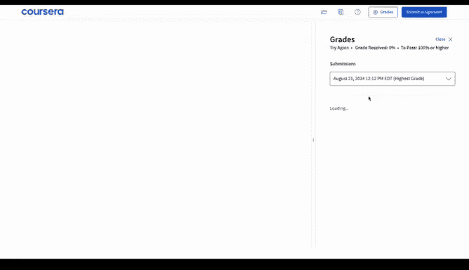

# 密歇根大学《Python3编程》课程1、2｜P108：损坏作业笔记本恢复方法 📝🛠️

## 概述
在本节课中，我们将学习如何修复或重新生成Jupyter工作空间中损坏的作业文件或数据文件。这种情况通常发生在你提交作业后，收到类似“JSON模式错误”或“旧版作业笔记本错误”的反馈，表明问题出在笔记本文件本身，而非你的答案。

## 问题诊断与简单修复

上一节我们介绍了问题的背景，本节中我们来看看如何诊断并执行简单的修复。

当你在编程作业或实验项目中收到此类错误时，通常意味着笔记本附带的元数据出现了问题。这常常是由于复制了包含自动评分器特定元数据的现有单元格，并在修改后提交，导致自动评分器因在多个单元格中发现预期之外的元数据而感到困惑。

以下是识别和修复重复单元格的步骤：



1.  在Jupyter工作空间中，找到可能被重复的单元格。
2.  选中重复的单元格。
3.  点击删除按钮，或右键点击该单元格并选择“删除单元格”。

完成此操作后重新提交文件，自动评分器通常就能正确识别并处理作业。





## 重新生成全新作业文件

如果问题更复杂，无法轻易识别哪些单元格被重复，或者数据文件本身已损坏，我们可以采用另一种方法：重新生成一个全新的作业文件副本。

首先，你需要重命名当前有问题的文件，确保工作空间中不存在与你想要生成的新文件同名的文件。

以下是重命名文件的具体步骤：

1.  在Jupyter左侧的文件导航栏中，右键点击目标文件（例如 `assignment1.ipynb`）。
2.  在弹出的菜单中选择“重命名”。
3.  将文件重命名为其他任何名称，例如 `assignment1_old.ipynb`，然后点击确认。

**重要提示**：请勿使用“文件”菜单中的“另存为”功能来创建副本，因为这不会移除原始文件，可能导致后续步骤失败。

## 获取文件最新版本

上一节我们完成了文件重命名，本节中我们来看看如何获取全新的原始文件。

重命名旧文件后，你可以通过帮助菜单请求系统重新生成一份全新的原始文件副本。

以下是获取最新版本文件的步骤：

1.  点击Jupyter界面右上角的帮助按钮（一个带问号的圆圈图标）。
2.  在弹出的“实验室帮助”部分，点击“获取最新版本”按钮。
3.  系统会提示“是否确定？任何未保存的进度将会丢失”，如果已保存必要文件，请点击“更新实验室”。



后台处理流程如下：
```python
# 系统检查逻辑（概念性描述）
if 预期文件路径中不存在目标文件:
    重新生成一份全新的目标文件副本
```
系统会扫描你的工作空间，核对文件名称和位置。如果发现预期存在的文件（如 `assignment1.ipynb`）缺失，它将自动生成一份全新的副本。

## 迁移工作与安全操作建议

现在你拥有了一份全新的作业文件。如果你在旧文件中已完成部分工作，需要手动将代码和答案复制到新文件中。

为了避免未来再次出现元数据问题，在需要添加新单元格时，建议使用“插入单元格”功能，而非“复制单元格”。

以下是添加新单元格的方法：

*   将鼠标悬停在某个单元格上方或下方，点击出现的“+”图标。
*   使用顶部工具栏的“插入”菜单，选择“在上方插入单元格”或“在下方插入单元格”。

**核心建议**：与复制现有单元格相比，插入全新单元格是更安全的操作。

如果需要一次性重新生成多个文件，你可以先批量重命名或删除所有需要替换的文件（**注意：删除操作不可逆**），然后再次点击“获取最新版本”按钮。系统会一次性检查并重新生成所有缺失的文件。

## 总结
本节课中我们一起学习了修复Jupyter作业笔记本的两种主要方法：一是直接删除导致问题的重复单元格；二是通过重命名旧文件并利用“获取最新版本”功能来重新生成一个全新的、未损坏的作业文件副本。记住，在编辑作业时，优先使用“插入单元格”而非“复制单元格”，可以最大程度地避免元数据错误。