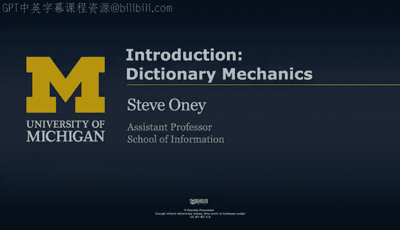

# Python 3 编程（课程 1、2）｜P109：字典机制导论 📚

在本节课中，我们将学习 Python 中的字典。字典是一种非常强大的数据结构，它允许我们通过“键”来存储和查找对应的“值”。通过学习字典，你将能够更高效地组织和处理程序中的数据。




---

## 什么是字典？ 🔍

上一节我们介绍了课程目标，本节中我们来看看字典的基本概念。

想象一个词典网站，你可以输入一个单词，然后它给出该单词的定义。在 Python 中，我们可以用术语 **键** 来指代我们要查找的单词，用 **值** 来指代它的定义。

因此，一个键值对就是一个单词及其定义。但在 Python 中，我们可以使用键和值来表示和存储几乎任何东西。

Python 字典就是这些键值对的集合。与列表和元组类似，Python 中的字典也存储多个项目。但与序列不同，字典是无序的。这意味着，不像列表那样我们可以查找第一个或最后一个项目，字典中没有“第一个项目”的概念。相反，我们只能根据特定的键来查找其对应的值。

字典是 Python 程序中管理和组织数据最通用、最强大的方法之一。在本节课结束时，你将能够使用字典更好地表示和操作多种类型的数据。

---

## 字典的核心机制 ⚙️

理解了字典的基本概念后，本节我们来深入探讨其核心机制。

以下是字典的几个关键特性：

*   **键值对结构**：每个条目都由一个唯一的键和其关联的值组成。
*   **无序性**：字典中的条目没有固定的顺序。
*   **可变性**：创建后，可以添加、修改或删除键值对。
*   **键的唯一性**：字典中的键必须是不可变的类型（如字符串、数字、元组），并且在一个字典内是唯一的。

字典在代码中通常用花括号 `{}` 定义，键和值之间用冒号 `:` 分隔，不同的键值对用逗号 `,` 分隔。

其基本语法结构可以用以下代码描述：

```python
# 创建一个字典
my_dict = {
    "key1": "value1",
    "key2": "value2",
    "key3": "value3"
}
```

要访问字典中的值，我们使用方括号 `[]` 并提供对应的键，其访问公式可以表示为：

**`value = dictionary_name[key]`**

---

## 总结 📝

本节课中，我们一起学习了 Python 字典的基础知识。我们了解了字典是一种通过键来存储和访问值的无序集合，它比列表等序列结构在某些场景下更为灵活和高效。记住字典的 **键值对** 结构和用 **`{key: value}`** 定义的语法，是掌握它的第一步。在接下来的课程中，我们将学习如何对字典进行实际操作。