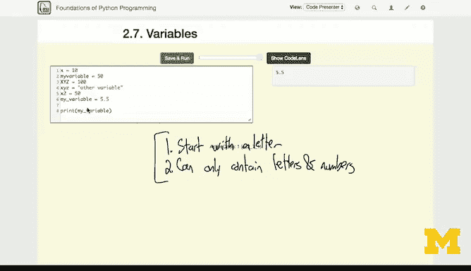

# 密歇根大学《Python3编程》课程1：第7讲 - 变量 🧮


在本节课中，我们将要学习Python编程中的一个核心概念：**变量**。变量是存储数据值的容器，它让我们的程序能够记住信息、重复使用计算结果，并使代码更易于人类阅读和理解。

---

## 什么是变量？

上一节我们介绍了表达式，本节中我们来看看如何存储表达式的计算结果。变量之所以有用，主要有两个原因：
1.  它们允许我们存储表达式的值，以便在程序后续部分使用。
2.  它们允许我们为值赋予人类可读的名称，以便后续重复使用。

例如，在数学中，我们使用符号 **π** 来代表圆周率，而不是每次都写出 3.14159。在Python中，变量扮演着类似的角色。

每个变量都包含一个**名称**和一个**值**。请看以下程序：

```python
message = "What's up doc"
n = 17
pi = 3.14159

print(message)
print(n)
print(pi)
```

在这个程序中，我们创建了三个变量：
*   `message` 的值是字符串 `"What's up doc"`。
*   `n` 的值是整数 `17`。
*   `pi` 的值是浮点数 `3.14159`。

前三条语句是**设置变量**，后三条语句是**引用或使用**这些变量。运行代码后，`print` 语句会分别输出这三个变量的值。

---

## 变量引用图

为了更好地在脑海中模拟程序的执行过程，我们可以使用一种叫做**变量-值图**或**引用图**的工具。

绘制引用图的方法是：**从上到下逐行分析程序**，记录每个变量被设置为何值。引用图包含两列：**变量**和**值**。

对于上面的程序，其引用图如下：

| 变量 | 值 |
| :--- | :--- |
| `message` | `"What's up doc"` |
| `n` | `17` |
| `pi` | `3.14159` |

当Python执行到 `print(message)` 时，它会查找引用图，找到 `message` 对应的值 `"What's up doc"`，然后将其打印出来。对于 `n` 和 `pi` 也是同样的过程。

---

## 变量的重新赋值

变量的值是可以改变的。我们来看一个例子：

```python
x = 5
print(x)  # 输出 5
x = 10
print(x)  # 输出 10
```

以下是这个程序的执行过程，我们用引用图来跟踪：

1.  第一行：变量 `x` 被设置为值 `5`。
2.  第二行：打印 `x` 时，输出 `5`。
3.  第四行：变量 `x` 被**重新赋值**为 `10`。此时，`x` 不再指向 `5`，而是指向 `10`。
4.  第五行：再次打印 `x` 时，输出 `10`。

这说明，**变量在程序运行过程中可以指向不同的值**。

---

## 变量命名规则

虽然变量的值可以是任何类型，但变量的名称必须遵循特定的规则。

以下是关于变量命名的核心规则：

1.  **必须以字母开头**。
2.  **只能包含字母、数字和下划线（_）**。

让我们看一些例子：

```python
x = 1           # 有效：以字母开头，只含字母
my_variable = 5.5 # 有效：以字母开头，包含字母和下划线
x2 = 100        # 有效：以字母开头，包含字母和数字
_private = 0    # 有效：下划线被视为字母
```

以下是一些**无效**的变量名示例：

```python
2x = 50         # 无效：以数字开头
my-variable = 1 # 无效：包含连字符“-”
my variable = 1 # 无效：包含空格
```

**一个重要提示**：Python是**区分大小写**的。这意味着 `XYZ`、`Xyz`、`xyz` 是三个完全不同的变量名。

```python
XYZ = 100
xyz = 200
print(XYZ)  # 输出 100
print(xyz)  # 输出 200
print(Xyz)  # 报错：NameError，变量 `Xyz` 未定义
```

---

## 总结

本节课中我们一起学习了Python中**变量**的核心概念。我们了解到：
*   变量是存储数据的容器，由**名称**和**值**组成。
*   使用变量可以保存计算结果以供后续使用，并为数据赋予有意义的名称，提高代码可读性。
*   我们可以通过**变量引用图**来跟踪程序执行过程中变量的状态。
*   变量的值可以被重新赋值。
*   变量命名必须遵循规则：以字母或下划线开头，且只能包含字母、数字和下划线。
*   Python变量名是**区分大小写**的。



变量是编程的基础工具，掌握它将为后续学习更复杂的概念打下坚实的基础。