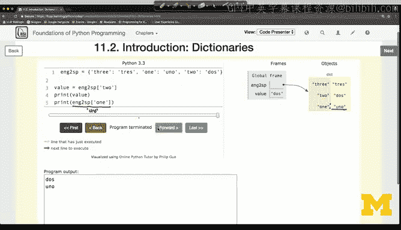

# 110：字典数据结构 📚


在本节课中，我们将要学习Python中一种新的数据类型——字典。字典与字符串、列表和元组一样，是项目的集合，但它是**无序**的键值对集合。

## 概述

上一节我们介绍了有序的序列类型。本节中我们来看看Python中一种强大的无序数据结构——字典。字典允许我们通过唯一的“键”来存储和访问对应的“值”。

## 创建字典

要创建一个字典，我们使用花括号 `{}`。

以下代码创建了一个空字典，并将其赋值给变量 `english_to_spanish`：
```python
english_to_spanish = {}
```

为了向字典中添加一个键值对，我们使用以下语法：
```python
english_to_spanish[‘one’] = ‘uno’
```
在这行代码中，键是字符串 `‘one’`，对应的值是字符串 `‘uno’`。

与列表、字符串或元组不同，字典存储的是**键值对**，而不仅仅是项目。每个字典项都包含一个键和一个值。你可以将键视为访问值的“钥匙”。

## 字典的特性

一个重要特性是字典是**无序**的。这意味着字典中的项目没有“第一个”、“第二个”这样的顺序概念。你可以把它想象成一个装着键值对的袋子，你不知道它们会以什么顺序出现，但你知道每个键都关联着其对应的值。

以下是向字典添加更多键值对的示例：
```python
english_to_spanish[‘two’] = ‘dos’
english_to_spanish[‘three’] = ‘tres’
```
当我们打印字典时，输出会显示所有键值对，用花括号包裹，键和值之间用冒号分隔，各项之间用逗号分隔，例如：`{‘three’: ‘tres’， ‘two’: ‘dos’， ‘one’: ‘uno’}`。

## 初始化字典

你也可以在创建字典时直接初始化所有键值对，而无需逐行添加。以下是等效的创建方式：
```python
english_to_spanish = {‘one’: ‘uno’， ‘two’: ‘dos’， ‘three’: ‘tres’}
```
这行代码直接创建了一个包含三个键值对的字典。

## 访问字典中的值

要查找与特定键关联的值，我们使用方括号 `[]` 并指定键名。

以下是如何访问值的示例：
```python
value = english_to_spanish[‘two’]
print(value)  # 输出：dos
```
在这段代码中，表达式 `english_to_spanish[‘two’]` 的值是字符串 `‘dos’`，因此变量 `value` 被赋值为 `‘dos’`，打印后即得到该输出。

同样，我们可以直接打印某个键对应的值：
```python
print(english_to_spanish[‘one’])  # 输出：uno
```
表达式 `english_to_spanish[‘one’]` 的值是字符串 `‘uno’`，因此会打印出 `uno`。

## 关键概念总结

以下是本节课的核心要点：
*   **创建空字典**：使用 `{}`。
*   **添加键值对**：使用 `dict_name[key] = value` 语法。
*   **字典字面量**：使用 `{key1: value1， key2: value2}` 格式直接创建。
*   **访问值**：使用 `dict_name[key]` 语法通过键来获取对应的值。
*   **无序性**：字典中的项目没有固定顺序。

## 总结




本节课中我们一起学习了Python字典的基础知识。我们了解了字典是一种存储**键值对**的无序集合，掌握了如何使用花括号创建字典、如何添加和访问键值对。记住，键就像查找值的“标签”，而字典本身不关心项目的排列顺序。这是构建更复杂程序的重要工具。