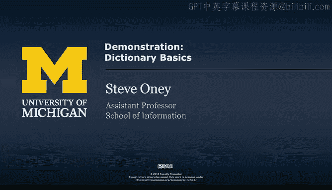
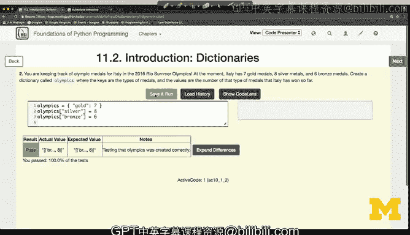

# 111：字典基础演示 📚




在本节课中，我们将学习Python字典的基础知识，包括其定义、如何访问值以及如何创建和修改字典。我们将通过几个具体的编程问题来巩固这些概念。

---

## 什么是字典？ 🔑

上一节我们介绍了字典的基本概念，本节中我们来看看具体的定义和特性。

字典是一个**无序**的键值对集合。这意味着字典中的元素没有固定的顺序，我们通过唯一的键来访问对应的值。

**核心概念公式**：
`字典 = {键1: 值1, 键2: 值2, ...}`

---

## 访问字典中的值 🔍

理解了字典的定义后，我们来看看如何从字典中获取信息。

以下是如何通过键来访问字典中对应值的示例。

**代码示例**：
```python
my_dict = {'cat': 5, 'dog': 6, 'elephant': 7}
print(my_dict['dog'])  # 输出：6
```
在这段代码中，字典 `my_dict` 包含三个键值对。表达式 `my_dict['dog']` 会查找键 `'dog'` 并返回其关联的值 `6`。

---

## 创建字典：跟踪奖牌数 🥇

现在，让我们应用所学知识来创建一个实际的字典。

以下是创建一个字典来跟踪美国奥运会奖牌数量的步骤。

1.  确定字典的键：奖牌类型（金、银、铜）。
2.  确定每个键对应的值：该类型奖牌的数量。
3.  使用花括号 `{}` 和冒号 `:` 来创建键值对。

根据题目，美国队有33金、17银、12铜。因此，字典如下：

**代码示例**：
```python
medals = {'gold': 33, 'silver': 17, 'bronze': 12}
```

---

## 另一种创建和修改字典的方法 ✏️

除了在创建时一次性定义所有键值对，我们也可以在创建后动态地添加或修改。

以下是创建字典后，再为其添加键值对的另一种方法。

我们可以先创建一个空字典或部分字典，然后使用赋值语句来添加新的键值对。

**代码示例**：
```python
# 创建一个空字典
olympics = {}

# 使用赋值语句添加键值对
olympics['gold'] = 7
olympics['silver'] = 8
olympics['bronze'] = 6

# 此时 olympics 的值为 {'gold': 7, 'silver': 8, 'bronze': 6}
```
这种方法非常灵活，允许我们在程序运行过程中根据需要更新字典的内容。

---

## 总结 📝



本节课中我们一起学习了Python字典的基础操作。我们了解到字典是一种通过键来存储和访问值的无序集合。我们练习了如何通过键访问值、如何使用花括号语法创建字典，以及如何使用赋值语句来动态添加键值对。掌握这些基础是使用字典进行更复杂数据管理的关键。